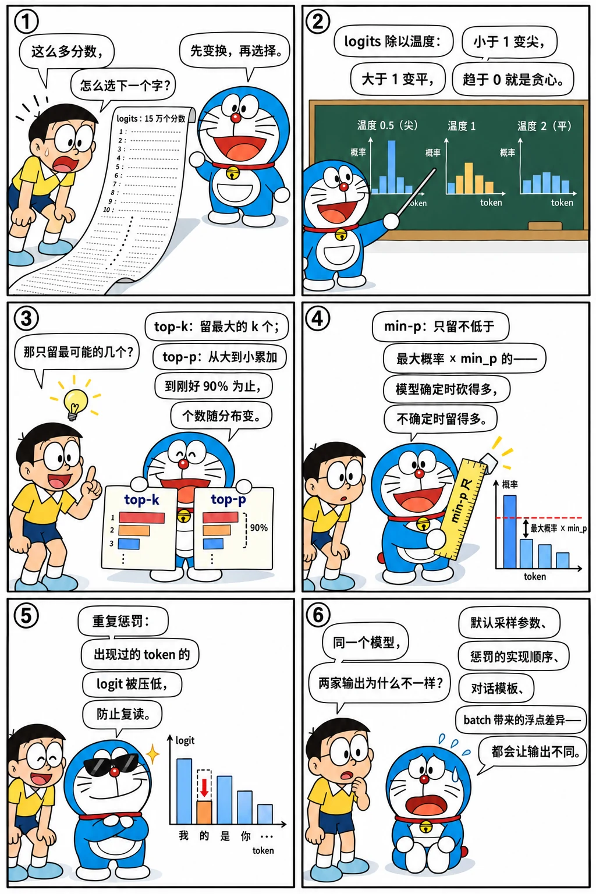

# 解码与采样

<p class="lead">模型每一步输出的是一个概率分布，怎么从中选出下一个 token，就是解码策略。贪心、温度、top-k、top-p、min-p、重复惩罚……这些参数直接决定了输出的质量和多样性，也是推理服务 API 里用户最常调的参数。这一章从零实现它们，并与 transformers 的实现逐一核对。</p>

!!! question "自测：能答上来就可以跳过本章"
    1. 温度（temperature）对分布有什么影响？温度趋于 0 时等价于什么？
    2. top-k 和 top-p 的区别是什么？top-p = 0.9 具体保留哪些 token？
    3. min-p 是怎么工作的？它比 top-p 好在哪里？
    4. 重复惩罚（repetition penalty）和出现惩罚（presence penalty）有什么区别？
    5. 为什么同一个模型、同样的参数，在不同框架里的输出可能不一样？

??? success "自测参考答案（先自己答，再展开对照）"
    1. logits 除以温度：温度小于 1 分布变尖，大于 1 变平；温度趋于 0 时概率集中到最大的那个 token，等价于贪心（argmax）。
    2. top-k 只保留概率最大的 k 个；top-p 按概率从大到小累加，保留累积概率刚达到 p 的最小集合——top-p = 0.9 就是"加起来刚好不少于 90% 的那几个"，个数随分布变化。
    3. 只保留概率不低于 $\text{min\_p} \times p_{max}$ 的 token：阈值随最大概率自适应，模型很确定时砍得多、不确定时留得多，高温采样时比 top-p 更稳。
    4. 重复惩罚按 token 是否出现过，对它的 logit 做乘性缩放（正数除以惩罚系数、负数乘以它）；出现惩罚对出现过的 token 减去一个固定值，与出现次数无关（频率惩罚才和次数成正比）。
    5. 默认采样参数（`generation_config.json`）不同、惩罚和截断的实现与顺序不同、分词或对话模板不同，以及批处理和 kernel 带来的浮点差异，都会让输出不一样。

先看一个六格小剧场，再读正文：

{.aig-comic}

## 从 logits 到下一个 token

每一步，模型对最后一个位置输出 logits（长度为词表大小）。解码策略做两件事：

1. **变换 logits**：缩放（温度）、截断（top-k、top-p、min-p，把不要的 token 设为 −∞）、惩罚（重复惩罚）；
2. **选择**：取最大值（贪心），或者按 softmax 后的概率随机采样。

| 策略 | 做法 | 效果 |
| --- | --- | --- |
| 贪心 | 取概率最大的 token | 确定、稳定，但容易重复、缺乏多样性 |
| 温度 T | logits 除以 T | T < 1 分布更尖锐（更保守），T > 1 更平坦（更多样）；T → 0 等价于贪心 |
| top-k | 只保留概率最高的 k 个 | 截掉长尾的低概率 token |
| top-p（核采样） | 按概率从高到低累加，保留累积概率刚好达到 p 的最小集合 | 候选数量随分布自适应：模型确定时候选少，不确定时候选多 |
| min-p | 只保留概率不低于"最大概率 × min_p"的 token | 相对阈值，在高温下比 top-p 更稳健 |
| 重复惩罚 | 已出现过的 token 的 logit：正数除以 penalty，负数乘以 penalty | 抑制复读（transformers 的定义） |
| 出现/频率惩罚 | 已出现过的 token 的 logit 减去一个固定值 / 减去"出现次数 × 系数" | OpenAI API 的定义，vLLM 等引擎也支持 |

温度、top-k、top-p 对同一个分布各做了什么，直接拨一拨（和[概率与采样](math://probability/)一章是同一个工具）：

<div class="aig-widget" data-widget="softmax"></div>

## 实现

```python title="sampling.py"
"""sampling.py —— 常用采样策略的实现。logits: [B, V]。"""

import torch


def apply_repetition_penalty(logits, prev_ids, penalty):
    """transformers 的定义：出现过的 token，正 logit 除以 penalty，负 logit 乘以 penalty。"""
    if penalty == 1.0:
        return logits
    score = logits.gather(1, prev_ids)
    score = torch.where(score > 0, score / penalty, score * penalty)
    return logits.scatter(1, prev_ids, score)


def top_k_filter(logits, k):
    if k <= 0 or k >= logits.shape[-1]:
        return logits
    kth = logits.topk(k, dim=-1).values[..., -1:]            # 第 k 大的值
    return logits.masked_fill(logits < kth, float("-inf"))


def top_p_filter(logits, p):
    if p >= 1.0:
        return logits
    sorted_logits, sorted_idx = logits.sort(dim=-1, descending=True)
    probs = sorted_logits.softmax(dim=-1)
    cum_before = probs.cumsum(dim=-1) - probs                 # 排在它前面的 token 的累积概率
    remove_sorted = cum_before >= p                           # 前面已经够 p 了，它就不需要了
    remove = remove_sorted.scatter(1, sorted_idx, remove_sorted)
    return logits.masked_fill(remove, float("-inf"))


def min_p_filter(logits, min_p):
    if min_p <= 0.0:
        return logits
    probs = logits.softmax(dim=-1)
    threshold = min_p * probs.max(dim=-1, keepdim=True).values
    return logits.masked_fill(probs < threshold, float("-inf"))


def sample_next(logits, prev_ids=None, temperature=1.0, top_k=0, top_p=1.0, min_p=0.0,
                repetition_penalty=1.0, generator=None):
    """按 transformers 的顺序：重复惩罚 -> 温度 -> top-k -> top-p -> min-p -> 采样。"""
    if prev_ids is not None:
        logits = apply_repetition_penalty(logits, prev_ids, repetition_penalty)
    if temperature == 0.0:
        return logits.argmax(dim=-1)                          # 温度为 0 视为贪心
    logits = logits / temperature
    logits = min_p_filter(top_p_filter(top_k_filter(logits, top_k), top_p), min_p)
    return torch.multinomial(logits.softmax(dim=-1), 1, generator=generator).squeeze(-1)
```

和 transformers 的 logits 处理器逐一核对：

```python
import torch
from transformers.generation.logits_process import (MinPLogitsWarper, RepetitionPenaltyLogitsProcessor,
                                                    TopKLogitsWarper, TopPLogitsWarper)
from sampling import apply_repetition_penalty, min_p_filter, top_k_filter, top_p_filter

torch.manual_seed(0)
logits = torch.randn(4, 1000) * 3
prev = torch.randint(0, 1000, (4, 30))

def same(a, b):
    return torch.equal(a.isinf(), b.isinf()) and torch.allclose(a[~a.isinf()], b[~b.isinf()])

for k in (1, 10, 50):
    assert same(top_k_filter(logits, k), TopKLogitsWarper(k)(prev, logits))
for p in (0.1, 0.5, 0.9, 0.99):
    assert same(top_p_filter(logits, p), TopPLogitsWarper(p)(prev, logits))
for m in (0.05, 0.1, 0.5):
    assert same(min_p_filter(logits, m), MinPLogitsWarper(m)(prev, logits))
for r in (1.1, 1.5):
    assert same(apply_repetition_penalty(logits, prev, r), RepetitionPenaltyLogitsProcessor(r)(prev, logits))
print("top-k / top-p / min-p / 重复惩罚 与 transformers 一致")
```

```text title="输出"
top-k / top-p / min-p / 重复惩罚 与 transformers 一致
```

## 看看它们的效果

一个具体的分布，看各种截断保留了多少个候选：

```pycon
>>> import torch
>>> from sampling import min_p_filter, top_k_filter, top_p_filter
>>> logits = torch.tensor([[3.0, 2.5, 2.0, 1.0, 0.5, 0.0, -1.0, -2.0]])
>>> [round(p, 3) for p in logits.softmax(-1)[0].tolist()]
[0.441, 0.268, 0.162, 0.06, 0.036, 0.022, 0.008, 0.003]
>>> for name, out in [("top_k=3", top_k_filter(logits, 3)), ("top_p=0.8", top_p_filter(logits, 0.8)),
...                   ("min_p=0.1", min_p_filter(logits, 0.1)), ("temp=0.5 后 top_p=0.8", top_p_filter(logits / 0.5, 0.8))]:
...     print(name, int((~out.isinf()).sum()))
...
top_k=3 3
top_p=0.8 3
min_p=0.1 4
temp=0.5 后 top_p=0.8 2
```

- top-p = 0.8：0.441 + 0.268 = 0.709 还不够，加上第三个 0.162 达到 0.871，保留 3 个；
- min-p = 0.1：阈值是 0.441 × 0.1 ≈ 0.044，保留概率不低于它的 4 个；
- 先降温到 0.5 再做 top-p：分布变尖锐，前两个就超过了 0.8，只保留 2 个。**温度和截断的顺序会影响结果**，transformers 和 vLLM 都是先应用温度再截断。

在真实模型上用不同的参数生成（固定随机种子，结果可复现）：

```python ci="loose"
from transformers import AutoTokenizer
from mini_llm import KVCache, Transformer
from sampling import sample_next

path = "models/Qwen3-0.6B"
tok = AutoTokenizer.from_pretrained(path)
model = Transformer.from_pretrained(path)
msgs = [{"role": "user", "content": "写一句关于秋天的诗。"}]
prompt_ids = tok(tok.apply_chat_template(msgs, tokenize=False, add_generation_prompt=True, enable_thinking=False), return_tensors="pt").input_ids

@torch.no_grad()
def run(max_new_tokens=40, seed=0, **params):
    g = torch.Generator().manual_seed(seed)
    cache = KVCache(model.cfg.num_hidden_layers)
    logits = model(prompt_ids, cache)
    ids = prompt_ids
    for _ in range(max_new_tokens):
        nxt = sample_next(logits[:, -1], prev_ids=ids, generator=g, **params)
        if nxt.item() == tok.eos_token_id:
            break
        ids = torch.cat([ids, nxt[:, None]], dim=1)
        logits = model(nxt[:, None], cache)
    return tok.decode(ids[0, prompt_ids.shape[1]:])

settings = {
    "贪心": dict(temperature=0.0),
    "T=0.7, top_p=0.8": dict(temperature=0.7, top_p=0.8),
    "T=1.5, 不截断": dict(temperature=1.5),
    "T=1.5, min_p=0.1": dict(temperature=1.5, min_p=0.1),
}
for name, params in settings.items():
    print(f"[{name}] {run(**params)}")
```

```text title="输出"
[贪心] 秋风起，枫叶红，山色染金黄，岁月静好。
[T=0.7, top_p=0.8] 秋风送爽，枫叶染红了大地。
[T=1.5, 不截断] 枫叶染晚秋愈旺品尝；啦啦黑夜นิยม
[T=1.5, min_p=0.1] 枫叶染金秋，寒蝉鸣不息。
```

高温且不截断时，长尾里大量无关的 token 都有机会被选中，一旦选错一个，后续就越来越偏（这里第一句就出现了不通的词和泰文字符）；同样的高温加上 min-p 截断，输出依然通顺，而且比低温时更有变化。这就是截断策略存在的意义。

### 实验：温度把候选拉得多宽

还是写秋天的诗，只看第一个 token 的分布，换几个温度：

```python
with torch.no_grad():
    first = model(prompt_ids)[0, -1]                              # 写诗的第一个 token 的 logits
for T in (0.3, 0.7, 1.0, 1.5):
    p = (first / T).softmax(-1)
    top = p.sort(descending=True).values
    n90 = int((top.cumsum(0) < 0.9).sum()) + 1                    # 从高到低凑够 90% 的概率要几个候选
    entropy = -(p * p.clamp_min(1e-12).log()).sum()
    print(f"T={T}：最可能的「{tok.decode([int(p.argmax())])}」占 {top[0]:.0%}，凑够 90% 要 {n90} 个候选，熵 {entropy:.2f}")
```

```text title="输出"
T=0.3：最可能的「秋」占 96%，凑够 90% 要 1 个候选，熵 0.18
T=0.7：最可能的「秋」占 71%，凑够 90% 要 3 个候选，熵 0.96
T=1.0：最可能的「秋」占 53%，凑够 90% 要 6 个候选，熵 1.73
T=1.5：最可能的「秋」占 26%，凑够 90% 要 285 个候选，熵 4.07
```

温度从 1.0 升到 1.5，凑够 90% 概率的候选从 6 个暴涨到 285 个：长尾里成百上千个"每个都不太可能、加起来却不小"的 token 被放了进来，上面高温不截断时冒出泰文字符就是这么来的。min-p、top-p 截断砍掉的正是这条长尾。

### 实验：top-p 的候选数随位置变化

贪心写完这句诗，看每一步如果用 top_p = 0.9，会保留几个候选：

```python
from mini_llm import generate

out = generate(model, prompt_ids, 30, eos_token_id=tok.eos_token_id)          # 贪心写完这句诗
with torch.no_grad():
    logits = model(torch.cat([prompt_ids, out], dim=1))[0, prompt_ids.shape[1] - 1:-1]   # 每一步的 logits
probs = logits.softmax(-1).sort(-1, descending=True).values
keep = ((probs.cumsum(-1) < 0.9).sum(-1) + 1).tolist()          # top_p = 0.9 时每一步保留几个候选
print("  ".join(f"{tok.decode([t])}:{k}" for t, k in zip(out[0].tolist(), keep)))
```

```text title="输出"
秋:6  风:1  起:4  ，:2  枫:4  叶:2  红:4  ，:1  山:38  色:7  染:8  金:37  黄:6  ，:2  岁月:54  静:17  好:1  。:2  <|im_end|>:1
```

每个字后面的数字是这一步保留的候选数。"秋风"的"风"、"岁月静好"的"好"几乎是确定的，只剩 1 个；开新句子的"山""金""岁月"有 37～54 个。top-k 不管这些，一律保留 k 个：k 小了会卡死需要发挥的地方，k 大了又会在确定的地方放进不该有的候选。top-p 按每一步的分布自适应，这是它比 top-k 好用的地方。

### 实验：贪心为什么容易复读

不套对话模板，让模型直接续写一句话，比较三种设置：

```python
@torch.no_grad()
def continue_text(prompt, n=40, **params):
    """不套对话模板，直接续写"""
    ids = tok(prompt, return_tensors="pt").input_ids
    g, cache, start = torch.Generator().manual_seed(0), KVCache(model.cfg.num_hidden_layers), ids.shape[1]
    logits = model(ids, cache)
    for _ in range(n):
        nxt = sample_next(logits[:, -1], prev_ids=ids, generator=g, **params)
        ids = torch.cat([ids, nxt[:, None]], dim=1)
        logits = model(nxt[:, None], cache)
    return tok.decode(ids[0, start:]).replace("\n", "⏎")


for name, params in [("贪心", dict(temperature=0.0)), ("T=0.7, top_p=0.8", dict(temperature=0.7, top_p=0.8)),
                     ("贪心 + 重复惩罚 1.2", dict(temperature=0.0, repetition_penalty=1.2))]:
    print(f"[{name}] 我爱北京天安门，{continue_text('我爱北京天安门，', **params)}")
```

```text title="输出"
[贪心] 我爱北京天安门，我爱北京的胡同，我爱北京的胡同，我爱北京的胡同，我爱北京的胡同，我爱北京的胡同，我爱北京的胡同，我爱北京的
[T=0.7, top_p=0.8] 我爱北京天安门，我爱北京天安门，我爱北京天安门，我爱北京天安门，我爱北京天安门，我爱北京天安门，我爱北京天安
[贪心 + 重复惩罚 1.2] 我爱北京天安门，因为那里有我的家。这句话的结构是怎样的？  这句话中的“我家”和“天安门广场”的关系是什么？⏎⏎这句诗中，“我家”与“
```

- 贪心：一旦"我爱北京的胡同，"在下一轮又是概率最高的，模型就进了一个循环，复读是贪心解码的典型毛病；
- 低温采样也逃不出来：循环里每个 token 的概率都很高，截断之后几乎只剩它；
- 重复惩罚把出现过的 token 的 logit 压低，循环立刻就断了，但模型转去写了别的内容（开始像在做题）。惩罚改变的是"写什么"，副作用不小，所以默认值都很温和（Qwen2.5 是 1.1）。

## 模型自带的默认参数

很多模型在 `generation_config.json` 里给出了推荐的采样参数：

```pycon
>>> import json
>>> json.load(open("models/Qwen3-0.6B/generation_config.json"))  # doctest: +NORMALIZE_WHITESPACE
{'bos_token_id': 151643, 'do_sample': True, 'eos_token_id': [151645, 151643], 'pad_token_id': 151643, 'temperature': 0.6, 'top_k': 20, 'top_p': 0.95, 'transformers_version': '4.51.0'}
```

transformers 的 `generate` 会默认使用这些值；vLLM、SGLang 等引擎是否读取它们，取决于版本和启动参数。**对比两个框架的输出、做效果评测时，要先确认采样参数真的一致**（[上一章](../transformer/build-llm.md#验证二加载真实的-qwen3-06b)里，不显式关掉采样，默认参数就会让"贪心"生成的结果变样；Qwen2.5 的配置里还有默认的重复惩罚 1.1，即使贪心也会生效）。另外注意 `eos_token_id` 有两个：遇到任何一个都应停止生成。

## 其他常见的解码控制

- **停止条件**：遇到结束 token、生成了指定的停止字符串、达到最大长度。停止字符串需要在反分词之后的文本上匹配，并处理它跨越多个 token 的情况；
- **beam search**：同时保留若干条得分最高的候选序列。机器翻译里常用，对话场景下很少用（容易生成平淡、重复的文本，而且开销是 beam 数倍）；
- **logit bias**：直接给某些 token 的 logit 加减一个值，比如禁止生成某个词；
- **结构化输出（约束解码）**：要求输出符合 JSON Schema 或某个语法。实现方法是在每一步根据当前状态算出"哪些 token 合法"，把不合法的 logits 设为 −∞。xgrammar、Outlines、llguidance 等库负责高效地计算这个掩码，vLLM、SGLang 已经集成。

!!! inference "推理视角"
    - **采样也要在 GPU 上高效执行**：词表有十几万，top-p 需要排序，一个 batch 里每个请求的参数还可能都不一样。FlashInfer 等库用基于拒绝采样的方法实现 top-k/top-p，避免完整排序；
    - **惩罚需要状态**：重复/频率惩罚需要知道每个请求已经生成了哪些 token、各出现了几次，推理引擎要为每个请求维护这些计数；
    - **可复现性**：固定种子只能保证同样的"随机数"，但 GPU 上的计算结果可能因为 batch 的组成不同而略有差异（不同的 batch 大小会让 kernel 选择不同的归约顺序），导致采样结果分叉。需要严格可复现时，要使用与 batch 无关（batch-invariant）的 kernel，代价是一些性能；
    - **约束解码的开销**：计算合法 token 掩码是在 CPU 上进行的，需要与 GPU 的前向计算重叠，否则会拖慢 decode。

!!! interview "怎么讲清楚"
    讲采样参数的标准顺序：解码 = 变换 logits（温度、重复惩罚、top-k / top-p / min-p 截断）+ 选择（贪心或采样），顺序会影响结果；温度趋于 0 等价于贪心；top-k 固定个数，top-p 按累积概率自适应，min-p 用相对于最大概率的阈值，高温时更稳。再补工程：同一个模型在不同框架里输出不同，常见原因是 `generation_config.json` 的默认参数没对齐、惩罚的实现不同，以及批处理带来的浮点差异；推理引擎要在 GPU 上按请求各自的参数批量采样。

!!! note "延伸阅读"
    - [How to generate text](https://huggingface.co/blog/how-to-generate)（Hugging Face）：用同一个模型、同一句开头，把贪心、beam search、top-k、top-p 逐个跑一遍对比，本章实验的思路和它一样；
    - [The Curious Case of Neural Text Degeneration](https://arxiv.org/abs/1904.09751)（Holtzman 等）：top-p（核采样）的原始论文，分析了贪心为什么会复读、高温为什么会胡言乱语；
    - [Turning Up the Heat: Min-p Sampling](https://arxiv.org/abs/2407.01082)：min-p 的论文，解释了高温下它为什么比 top-p 稳；
    - [Generation configurations](https://huyenchip.com/2024/01/16/sampling.html)（Chip Huyen）：温度、top-k、top-p 的直观讲解，以及结构化输出和测试时计算；
    - [Sorting-Free GPU Kernels for LLM Sampling](https://flashinfer.ai/2025/03/10/sampling.html)（FlashInfer）：推理引擎里不排序的 top-k / top-p 采样是怎么做的；
    - [Defeating Nondeterminism in LLM Inference](https://thinkingmachines.ai/blog/defeating-nondeterminism-in-llm-inference/)（Thinking Machines）：同样的输入为什么在推理服务里会得到不同的输出，以及 batch-invariant kernel 怎么解决。

## 练习

**1. 手算 top-p。** 概率为 [0.5, 0.2, 0.15, 0.1, 0.05]，top-p = 0.75 保留哪些 token？如果 top-p = 0.5 呢？

??? success "参考答案"
    top-p = 0.75：0.5 不够，加上 0.2 为 0.7 仍不够，加上 0.15 为 0.85 达到，保留前 3 个。top-p = 0.5：第一个就正好达到 0.5，只保留 1 个（第二个 token 之前的累积概率已经是 0.5，不再需要）。

    ```python
    probs = torch.tensor([[0.5, 0.2, 0.15, 0.1, 0.05]])
    assert int((~top_p_filter(probs.log(), 0.75).isinf()).sum()) == 3
    assert int((~top_p_filter(probs.log(), 0.5).isinf()).sum()) == 1
    ```

**2. 实现出现惩罚与频率惩罚。** 按 OpenAI 的定义实现：`logits[t] -= presence_penalty * (count[t] > 0) + frequency_penalty * count[t]`，其中 count 是 token t 在已生成部分中出现的次数。

??? success "参考答案"
    ```python
    def apply_presence_frequency(logits, generated_ids, presence=0.0, frequency=0.0):
        counts = torch.zeros_like(logits)
        counts.scatter_add_(1, generated_ids, torch.ones_like(generated_ids, dtype=logits.dtype))
        return logits - presence * (counts > 0).to(logits.dtype) - frequency * counts

    lg = torch.zeros(1, 5)
    out = apply_presence_frequency(lg, torch.tensor([[1, 1, 3]]), presence=0.5, frequency=0.2)
    assert torch.allclose(out, torch.tensor([[0.0, -0.9, 0.0, -0.7, 0.0]]))
    ```

    注意和 transformers 的重复惩罚不同：这里是减法，而且通常只统计**生成部分**，不包括提示词。不同框架对这些参数的定义不完全相同，迁移时要仔细核对。

## 小结

- [x] 解码 = 变换 logits（温度、截断、惩罚）+ 选择（贪心或采样）。
- [x] top-k 固定个数，top-p 按累积概率自适应，min-p 用相对阈值；顺序是先温度后截断。
- [x] 模型的 `generation_config.json` 带有默认采样参数，比较不同框架时必须对齐。
- [x] 停止条件、结构化输出、logit bias 也属于解码控制。
- [x] 推理引擎要在 GPU 上高效地为每个请求执行各自的采样参数，并维护惩罚所需的状态。

相关的数学：温度如何改变熵、采样算法为什么正确、蒙特卡洛误差，见[概率与采样](math://probability/)和[信息论](math://information-theory/)。
