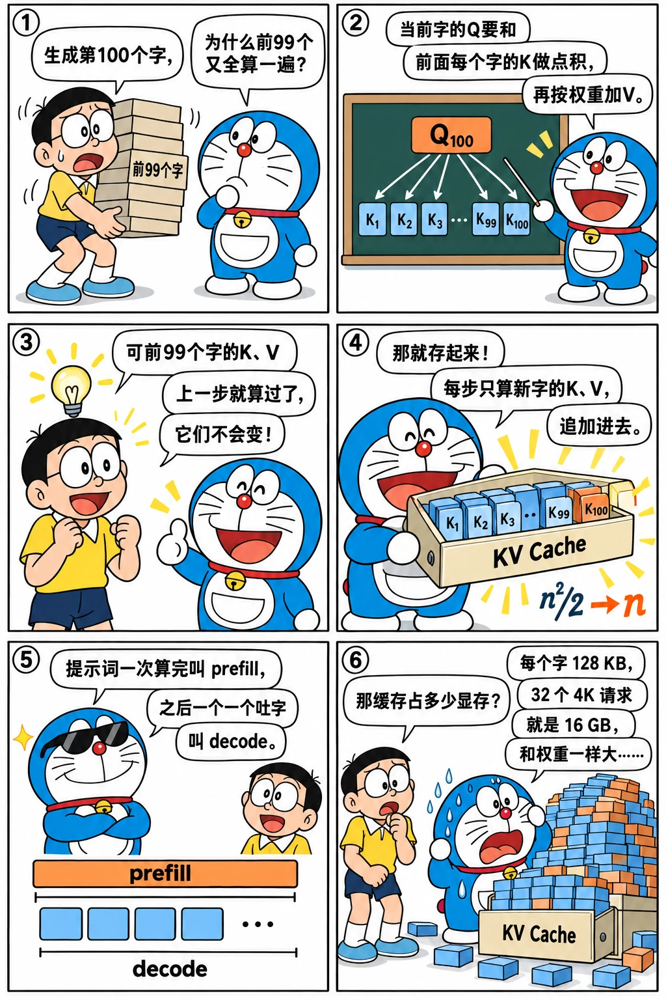

# KV Cache 与两阶段推理

<p class="lead">KV Cache 是大模型推理中最重要的一个概念：它把生成的计算量从平方级降到线性级，同时带来了推理系统里几乎所有的显存管理问题。理解了它，也就理解了推理为什么分成 prefill 和 decode 两个性质完全不同的阶段，以及批处理为什么能大幅提升吞吐。</p>

!!! question "自测：能答上来就可以跳过本章"
    1. 为什么历史 token 的 K、V 可以缓存复用？Q 为什么不需要缓存？
    2. 不用 KV Cache 生成 n 个 token，总共要处理多少个 token？用了之后呢？
    3. prefill 和 decode 的算术强度分别是多少？各自是什么瓶颈？
    4. 为什么把 8 个请求放在一起 decode，耗时远小于单独 decode 8 次？
    5. PagedAttention 解决的是 KV Cache 的什么问题？
    6. 提示词中间改了一个 token，KV Cache 里哪些部分还能用？换成双向注意力（BERT）呢？

??? success "自测参考答案（先自己答，再展开对照）"
    1. 因果注意力里，历史 token 的 K、V 只依赖它自己和更早的 token，后面加入新 token 不会改变它们；Q 只在计算当前 token 的输出时用一次，之后不再需要。
    2. 不用缓存时，生成第 t 个 token 要重新处理 t 个 token，n 个 token 共约 $n^2/2$ 个；用了缓存每步只处理 1 个新 token，共约 n 个（加上一次提示词的 prefill）。
    3. prefill 一次处理成百上千个 token，算术强度约等于 token 数，是计算瓶颈；decode 每个请求每步 1 个 token，强度约等于 batch 大小，远低于屋脊点，是访存瓶颈。
    4. decode 的时间主要花在读权重上，8 个请求一起 decode 时权重只读一遍、同时算 8 个 token，耗时增加很少（本章实测只多 60%），吞吐约为原来的 5 倍。
    5. KV Cache 的显存碎片和浪费：按最大长度连续预留会有大量内部和外部碎片；分页后按块按需分配，还能在请求之间按块共享前缀。
    6. 只有它前面的部分还能用：位置 i 的 K、V 只依赖位置 ≤ i 的 token，改动的位置之后，从第 1 层起全变了（第 0 层只看自己，不变）。双向注意力下每个位置都看得到所有位置，追加一个 token 都会让历史位置的 K、V 从第 1 层起全变，缓存根本用不上。

先看一个六格小剧场，再读正文：

{.aig-comic}

## 为什么 K、V 可以缓存

生成第 t+1 个 token 时，模型要对前 t 个 token 做完整的前向计算吗？看因果注意力的结构：**位置 i 的输出只依赖位置 ≤ i 的输入**。所以追加一个新 token 时，所有历史位置在每一层的隐藏状态都不会改变，它们的 K、V 自然也不变。新 token 只需要：

1. 计算自己的 Q、K、V；
2. 把自己的 K、V 追加到缓存里；
3. 用自己的 Q 和缓存中**全部**的 K、V 做注意力。

历史 token 的 Q 以后再也用不到（只有最新 token 的 query 参与计算），所以只缓存 K 和 V。这就是 **KV Cache**。

不用缓存时，生成第 t 个 token 要重新处理 t 个 token，生成 n 个 token 共处理约 $n^2/2$ 个；用了缓存，每步只处理 1 个新 token。

## 验证：带缓存的逐步计算等于完整重算

这是检验推理实现正确性最常用的方法：

```python ci="loose"
import time
import torch
from transformers import AutoTokenizer
from mini_llm import KVCache, Transformer

path = "models/Qwen3-0.6B"
tok = AutoTokenizer.from_pretrained(path)
model = Transformer.from_pretrained(path)
ids = tok("KV Cache 是大模型推理中最重要的概念之一，因为", return_tensors="pt").input_ids

with torch.no_grad():
    full = model(ids)                                   # 一次性处理整个序列
    cache = KVCache(model.cfg.num_hidden_layers)
    step_logits = [model(ids[:, :5], cache)]            # 先 prefill 前 5 个 token
    for t in range(5, ids.shape[1]):                    # 再逐个 decode 剩下的 token
        step_logits.append(model(ids[:, t:t + 1], cache))
    incremental = torch.cat(step_logits, dim=1)

diff = (full - incremental).abs().max().item()
print(f"逐步计算 vs 完整重算，logits 最大差异 {diff:.1e}；缓存长度 {cache.length}，K 的形状 {tuple(cache.k[0].shape)}")
assert diff < 1e-3 and cache.length == ids.shape[1]
```

```text title="输出"
逐步计算 vs 完整重算，logits 最大差异 1.9e-05；缓存长度 12，K 的形状 (1, 8, 12, 128)
```

- 两种算法算出的 logits 只差浮点误差的量级：逐步计算时矩阵乘法的形状不同，累加顺序跟着变，结果在最后几位上略有出入；
- 缓存里存了全部 12 个 token。每一层的 K 形状为 `[B, n_kv, S, d_h]` = `[1, 8, 12, 128]`，V 也一样。

### 实验：历史 token 的 K、V 会不会变

上面说"追加新 token 时，历史位置的 K、V 不变"，这是缓存成立的前提。直接比一比：同一句话少最后一个 token 和完整的一句，各算一遍，看前面那些位置的 K 在每一层变了多少；再把因果掩码换成全 1（双向注意力，BERT 就是这样），看同样的操作会怎样：

```python ci="loose"
from contextlib import contextmanager, nullcontext

@contextmanager
def bidirectional():
    """mini_llm 用 tril 把全 1 矩阵截成下三角当因果掩码；临时让 tril 原样返回，掩码全是 1，每个位置都能看到所有位置"""
    tril = torch.Tensor.tril
    torch.Tensor.tril = lambda self, diagonal=0: self
    try:
        yield
    finally:
        torch.Tensor.tril = tril

@torch.no_grad()
def keys(x):
    cache = KVCache(model.cfg.num_hidden_layers)
    model(x, cache)
    return cache.k                                       # 每层一个 [1, 8, T, 128]

def change(a, b, pos):
    """指定位置的 K 在每一层的相对变化"""
    return [((x[:, :, pos] - y[:, :, pos]).norm() / x[:, :, pos].norm()).item() for x, y in zip(a, b)]

T, layers = ids.shape[1], [0, 1, 2, 7, 14, 27]
history = list(range(T - 1))                             # 追加之前就有的位置
for name, mode in [("因果注意力", nullcontext), ("双向注意力", bidirectional)]:
    with mode():
        ch = change(keys(ids[:, :-1]), keys(ids), history)
    print(f"{name}，末尾追加一个 token，历史位置的 K：" + "  ".join(f"第 {l} 层 {ch[l]:.1%}" for l in layers))

edited = ids.clone()
edited[0, 5] = tok("训练").input_ids[0]                  # 下标 5 的 token「推理」改成「训练」
ch_before, ch_after = change(keys(ids), keys(edited), range(5)), change(keys(ids), keys(edited), range(6, T))
print(f"因果注意力，把「推理」改成「训练」：它前面 5 个位置的 K 在各层最多变了 {max(ch_before):.1%}；"
      f"它后面 {T - 6} 个位置的 K，第 0 层变了 {ch_after[0]:.1%}，第 1～27 层最多变了 {max(ch_after[1:]):.1%}")
```

```text title="输出"
因果注意力，末尾追加一个 token，历史位置的 K：第 0 层 0.0%  第 1 层 0.0%  第 2 层 0.0%  第 7 层 0.0%  第 14 层 0.0%  第 27 层 0.0%
双向注意力，末尾追加一个 token，历史位置的 K：第 0 层 0.0%  第 1 层 1.1%  第 2 层 3.3%  第 7 层 14.5%  第 14 层 63.4%  第 27 层 43.1%
因果注意力，把「推理」改成「训练」：它前面 5 个位置的 K 在各层最多变了 0.0%；它后面 6 个位置的 K，第 0 层变了 0.0%，第 1～27 层最多变了 15.9%
```

- **因果注意力，追加一个 token**：历史位置在每一层的 K 一点都没变（V 也一样）。所以算过一次就可以存起来，以后直接用；
- **双向注意力，追加一个 token**：第 0 层没变，因为第 0 层的 K 只由这个 token 自己的词向量和位置算出来，还没和别的 token 交换过信息；从第 1 层起，每个历史位置都"看到"了新 token，K 跟着变，越往后变得越多。缓存就失效了：每生成一个 token，整个序列都得重算。这是 BERT 这类双向模型不拿来逐个生成 token 的原因之一；
- **改动中间一个 token**：它前面的位置不受影响，后面所有位置从第 1 层起都变了。所以缓存只能复用"从开头起完全相同"的那一段，中间改一个字，后面的缓存全部作废。写提示词时，把固定的内容（系统提示、工具说明）放在前面，会变的内容（日期、用户信息）放在后面，[前缀缓存](serving.md#kv-cache-管理与前缀缓存)才命中得了。

### 实验：不用缓存，每一步越来越慢

已经有 T − 1 个 token，生成第 T 个要多久？不用缓存就把 T 个 token 整个算一遍，用缓存只算最后 1 个：

```python
torch.set_num_threads(16)
passage = tok(open("docs/assets/sample-passage.txt", encoding="utf-8").read(), return_tensors="pt").input_ids

@torch.no_grad()
def next_token_ms(T, use_cache, reps=3):
    x = passage[:, :T]
    if use_cache:
        cache = KVCache(model.cfg.num_hidden_layers)
        model(x[:, :-1], cache)                          # 前 T - 1 个 token 的 K、V 已经在缓存里（不计时）
    best = float("inf")
    for _ in range(reps):
        t0 = time.perf_counter()
        if use_cache:
            c = KVCache(model.cfg.num_hidden_layers)
            c.k, c.v = list(cache.k), list(cache.v)      # update 不会原地改张量，浅拷贝一份就能反复测
            model(x[:, -1:], c)
        else:
            model(x)
        best = min(best, time.perf_counter() - t0)
    return best * 1000

next_token_ms(16, False), next_token_ms(16, True)        # 预热
for T in (64, 256, 1024):
    a, b = next_token_ms(T, False), next_token_ms(T, True)
    print(f"上下文 {T:4d}：不用缓存 {a:5.0f} ms，用缓存 {b:4.1f} ms（快 {a / b:.0f} 倍）")
```

在本手册的环境里运行得到（数值因机器而异）：

```text
上下文   64：不用缓存   130 ms，用缓存 42.5 ms（快 3 倍）
上下文  256：不用缓存   312 ms，用缓存 47.1 ms（快 7 倍）
上下文 1024：不用缓存  1928 ms，用缓存 70.2 ms（快 27 倍）
```

- 不用缓存，每一步都要把前面所有 token 重新算一遍，上下文越长越慢：从 256 到 1024，耗时涨了 6 倍多（计算量随 token 数线性增长，注意力还多一个平方项）。把每一步加起来，生成 n 个 token 的总计算量是平方级；
- 用了缓存，每一步只算 1 个新 token，上下文从 64 涨到 1024，耗时只多了二三十毫秒。多出来的时间花在更长的 KV Cache 上，其中大部分是 mini_llm 每步要把缓存复制两遍，后面的[「读 KV Cache 要多久」](#实验读-kv-cache-要多久)会单独测；
- 上下文越长，差距越大：1024 时已经差了二十多倍。

## prefill 与 decode

有了 KV Cache，一次生成请求分成两个阶段：

{.aig-svg}

| | prefill | decode |
| --- | --- | --- |
| 输入 | 整个提示词（T 个 token） | 每步 1 个新 token |
| 做什么 | 计算所有提示词 token 的 K、V 写入缓存，输出第一个新 token | 读取缓存，生成下一个 token，追加它的 K、V |
| 每读一次权重参与计算的 token 数 | T | batch 中的请求数 |
| 瓶颈 | 计算（T 较大时） | 显存带宽（读权重、读 KV Cache） |
| 对应的延迟指标 | TTFT（首 token 延迟） | TPOT / ITL（每个输出 token 的延迟） |

**算术强度**的差异是理解一切的关键。一个 BF16 线性层，每个参数 2 字节，每个 token 用它做 2 次运算：

- decode（batch = 1）：每读 2 字节做 2 次运算，算术强度约 1 FLOP/Byte；
- prefill（T 个 token）：每读 2 字节做 2T 次运算，算术强度约 T FLOP/Byte。

H100 的脊点约为 989 TFLOPS / 3.35 TB/s ≈ 295 FLOP/Byte。所以 prefill 几百个 token 就能把 GPU 算满，而 decode 离算满差了两个数量级：**GPU 的大部分算力在 decode 时是闲置的**，时间都花在从显存读权重和 KV Cache 上。

在 CPU 上也能观察到同样的规律（CPU 同样有"内存带宽 vs 算力"的平衡问题）：

```python
torch.set_num_threads(16)
prompt = tok("介绍一下大模型推理中的 prefill 和 decode 两个阶段。" * 8, return_tensors="pt").input_ids

@torch.no_grad()
def timed_generate(input_ids, n_new=20):
    cache = KVCache(model.cfg.num_hidden_layers)
    t0 = time.perf_counter()
    logits = model(input_ids, cache)
    t_prefill = time.perf_counter() - t0
    nxt = logits[:, -1].argmax(-1)
    t0 = time.perf_counter()
    for _ in range(n_new):
        nxt = model(nxt[:, None], cache)[:, -1].argmax(-1)
    return t_prefill, (time.perf_counter() - t0) / n_new

timed_generate(prompt[:, :8], n_new=2)                   # 预热
t_pre, t_dec = timed_generate(prompt)
T = prompt.shape[1]
print(f"prefill {T} 个 token: {t_pre * 1000:.0f} ms（每个 token {t_pre / T * 1000:.1f} ms）")
print(f"decode: 每个 token {t_dec * 1000:.1f} ms")
```

在本手册的环境里运行得到（数值因机器而异，重要的是比例）：

```text
prefill 104 个 token: 179 ms（每个 token 1.7 ms）
decode: 每个 token 45.5 ms
```

prefill 平均到每个 token 只要 1.7 ms，decode 生成一个 token 却要 45.5 ms，相差约 26 倍：同样读一遍权重，prefill 让一百多个 token 分摊了这次读取，decode 只有一个。

## 批处理：让多个请求分摊权重读取

既然 decode 的瓶颈在于"读一次权重只算一个 token"，那就让多个请求**一起** decode：权重读一次，同时为 B 个请求各算一个 token。只要还没到计算瓶颈，耗时几乎不随 B 增长，吞吐量却提高了 B 倍：

```python
@torch.no_grad()
def decode_step_time(batch, ctx_len=64, steps=10):
    ids = torch.randint(0, 150000, (batch, ctx_len))
    cache = KVCache(model.cfg.num_hidden_layers)
    model(ids, cache)
    nxt = torch.randint(0, 150000, (batch,))
    t0 = time.perf_counter()
    for _ in range(steps):
        nxt = model(nxt[:, None], cache)[:, -1].argmax(-1)
    return (time.perf_counter() - t0) / steps

decode_step_time(2, steps=2)                              # 预热
t1, t8 = decode_step_time(1), decode_step_time(8)
print(f"batch=1: 每步 {t1 * 1000:.1f} ms；batch=8: 每步 {t8 * 1000:.1f} ms（{t8 / t1:.1f} 倍的时间，8 倍的 token）")
```

在本手册的环境里：

```text
batch=1: 每步 45.4 ms；batch=8: 每步 74.8 ms（1.6 倍的时间，8 倍的 token）
```

8 个请求一起 decode，每一步只多花了 60% 的时间，吞吐却提高到约 5 倍。**这就是推理服务追求大 batch 的根本原因**。但 batch 不能无限增大：每个请求都有自己的 KV Cache，显存会先耗尽；batch 越大，每个请求的 decode 延迟也会上升。推理服务的调度，本质上是在吞吐和延迟之间找平衡，见[推理服务](serving.md)。

### batch 加到多大就不再免费

把 batch 从 1 一路加到 256，看每步的时间和吞吐。这里故意把上下文设得很短，让 KV Cache 小到可以忽略，只看权重：

```python
times = {b: decode_step_time(b, ctx_len=8) for b in (1, 4, 16, 64, 256)}
for b, t in times.items():
    print(f"batch={b:3d}：每步 {t * 1000:5.1f} ms（batch=1 的 {t / times[1]:.1f} 倍），吞吐 {b / t:3.0f} token/s")
```

在本手册的环境里：

```text
batch=  1：每步  45.6 ms（batch=1 的 1.0 倍），吞吐  22 token/s
batch=  4：每步  61.1 ms（batch=1 的 1.3 倍），吞吐  66 token/s
batch= 16：每步  96.7 ms（batch=1 的 2.1 倍），吞吐 165 token/s
batch= 64：每步 151.0 ms（batch=1 的 3.3 倍），吞吐 424 token/s
batch=256：每步 450.9 ms（batch=1 的 9.9 倍），吞吐 568 token/s
```

- batch 从 1 到 64，每步的时间只涨到 3 倍多，吞吐涨了将近 20 倍：多算几个 token 不怎么花时间，时间主要花在读权重上；
- batch 从 64 到 256，翻了两番，每步的时间也涨到 3 倍，吞吐只多了三成多：计算量追上了读权重的时间，CPU 开始进入计算瓶颈。再往上加，每个请求都更慢，吞吐也涨不了多少；
- 拐点在哪里，由硬件的算力和带宽之比决定，也就是上面说的脊点。这台 CPU 算力弱，batch 一两百就差不多到头了；H100 上 BF16 权重要 batch 两三百才能把算力用满。具体怎么算，见[估算](estimation.md#延迟的下限)。

!!! inference "推理视角"
    decode 时，除了权重，**KV Cache 也要每步完整地读一遍**。权重是所有请求共享的，批处理可以分摊；KV Cache 却是每个请求私有的，无法分摊。上下文越长、batch 越大，读 KV Cache 的时间占比越高，最终可能超过读权重的时间。这就是长上下文推理慢的原因，也是 GQA、MLA、KV Cache 量化如此重要的原因（见[注意力变体](../transformer/attention-variants.md)）。

### 实验：读 KV Cache 要多久

单独测 decode 一步里注意力那部分：每层用新 token 的 q 读一遍各个请求自己的 K、V。K、V 里放随机数就行，耗时只和大小有关：

```python
import torch.nn.functional as F

def attention_ms(batch, ctx_len, copy_heads=False, reps=3):
    """decode 一步里 28 层注意力的耗时"""
    cfg = model.cfg
    q = torch.randn(batch, cfg.num_attention_heads, 1, cfg.hd)
    kv = [(torch.randn(batch, cfg.num_key_value_heads, ctx_len, cfg.hd),
           torch.randn(batch, cfg.num_key_value_heads, ctx_len, cfg.hd)) for _ in range(cfg.num_hidden_layers)]
    rep = cfg.num_attention_heads // cfg.num_key_value_heads
    best = float("inf")
    for _ in range(reps):
        t0 = time.perf_counter()
        for k, v in kv:
            if copy_heads:                               # mini_llm 的写法：先把 8 个 KV 头复制成 16 个再算
                F.scaled_dot_product_attention(q, k.repeat_interleave(rep, 1), v.repeat_interleave(rep, 1))
            else:                                        # kernel 直接让每个 KV 头服务一组 query 头，不复制
                F.scaled_dot_product_attention(q, k, v, enable_gqa=True)
        best = min(best, time.perf_counter() - t0)
    return best * 1000

cfg = model.cfg
weight_gb = sum(p.numel() for p in model.parameters()) * 4 / 1e9
print(f"权重 {weight_gb:.1f} GB，所有请求共用，decode 一步约 {times[1] * 1000:.0f} ms（上面 batch=1 的实测）")
for b, ctx in [(1, 1024), (4, 1024), (16, 1024), (4, 4096)]:
    kv_gb = b * ctx * 2 * cfg.num_hidden_layers * cfg.num_key_value_heads * cfg.hd * 4 / 1e9
    print(f"batch={b:2d}，上下文 {ctx}：KV Cache {kv_gb:.2f} GB，读一遍 {attention_ms(b, ctx):3.0f} ms")
print(f"batch=16，上下文 1024，先复制 KV 头再算：{attention_ms(16, 1024, copy_heads=True):.0f} ms")
```

在本手册的环境里：

```text
权重 2.4 GB，所有请求共用，decode 一步约 46 ms（上面 batch=1 的实测）
batch= 1，上下文 1024：KV Cache 0.23 GB，读一遍   4 ms
batch= 4，上下文 1024：KV Cache 0.94 GB，读一遍  17 ms
batch=16，上下文 1024：KV Cache 3.76 GB，读一遍  73 ms
batch= 4，上下文 4096：KV Cache 3.76 GB，读一遍 105 ms
batch=16，上下文 1024，先复制 KV 头再算：933 ms
```

- 读 KV 的时间跟着 KV 的大小走：batch 每大 4 倍，KV 大 4 倍（0.23 → 0.94 → 3.76 GB），耗时也大约 4 倍（4 → 17 → 73 ms）。上下文 4096 那一行的 KV 和 batch=16 的一样大，耗时也在同一个量级：batch 大也好，上下文长也好，对 KV 来说是一回事；
- 平摊到每 GB，读 KV 和读权重的速度差不多，两者都卡在内存带宽上；
- batch=16、上下文 1024 时，KV（3.76 GB）已经比权重（2.4 GB）还大，读它的时间（73 ms）也超过了读权重（46 ms）。权重读一次能分给所有请求，KV 是每个请求自己的，分摊不了：batch 和上下文再往上加，decode 的时间就主要花在 KV 上了；
- 最后一行是 mini_llm 的写法：先用 `repeat_interleave` 把 8 个 KV 头复制成 16 个再算，慢了十几倍。GQA 省下的 KV，要 kernel 直接按组读才能兑现。mini_llm 每步还要用 `torch.cat` 把整个缓存复制一遍，这两次复制就是前面"不用缓存"的实验里，用缓存的那一步随上下文变慢的主要原因。推理引擎启动时就预先分配好整块 KV 显存，新 token 的 K、V 原地写入，kernel 原地读，没有这些复制。

同样的账放到具体的模型和 GPU 上算一算：选一个模型、一张卡和平均上下文长度，看 KV 能放下多少个请求，满载时 decode 一步至少要多久。

<div class="aig-widget" data-widget="kv-calc"></div>

几个值得试的组合：LLaMA-3-8B 和 Qwen2.5-7B 参数量差不多，但 KV 头数差一倍、层数也多 4 层，每个 token 的 KV 差了一倍多，能服务的请求数也差这么多；把 KV 换成 FP8，请求数翻倍；DeepSeek-V3 的 FP8 权重在 8 张 H100 上放不下、8 张 H200 可以，而且 MLA 的缓存每张卡都要存一份。

## KV Cache 的显存管理

每个 token 的 KV Cache 大小是固定的（Qwen3-0.6B 为 2 × 28 × 8 × 128 × 2 字节 = 112 KB，BF16），但一个请求最终会生成多少 token 是事先不知道的。朴素的做法是按最大长度为每个请求预留一块连续的显存，问题很大：

- **内部碎片**：预留了 32K，实际只用了 500，其余全浪费；
- **外部碎片**：请求来来去去，显存被切成大小不一的空洞；
- **无法共享**：多个请求有相同的前缀（系统提示），却要各存一份。

vLLM 提出的 **PagedAttention** 借鉴了操作系统的虚拟内存：把 KV Cache 切成固定大小的**块**（比如每块 16 个 token），每个请求用一张**块表**记录它的逻辑块存放在哪些物理块中，按需分配、用完回收；相同的前缀可以映射到相同的物理块（写时复制）。显存浪费从 60%-80% 降到不足 4%（数据来自 vLLM 论文），同样的显存能容纳多得多的并发请求。代价是注意力 kernel 需要通过块表间接寻址，参见 CUDA 手册中的[分页 decode attention](cuda://advanced/attention/#一个分页-decode-attention-kernel支持-gqa)。

拖一拖块大小和请求数，看按最大长度预留和分页各浪费多少；切到"共享同一段长前缀"，看分页之后前缀怎么只存一份：

<div class="aig-widget" data-widget="pagedkv"></div>

块表怎么实现、注意力怎么按块表读 K、V、块大小怎么选，推理系统手册的[分页 KV Cache](serving://engine/paged-kv/) 一章有完整的参考实现，并验证了分页存放和连续存放算出的注意力完全一样。

在此基础上，还有这些常见的 KV Cache 管理手段：

| 手段 | 做什么 |
| --- | --- |
| 前缀缓存（prefix caching） | 请求结束后不立即释放 KV，按内容哈希（vLLM）或基数树（SGLang 的 RadixAttention）索引，新请求命中相同前缀就直接复用，实验见[推理服务](serving.md#kv-cache-管理与前缀缓存) |
| 抢占（preemption） | 显存不够时暂停一些请求，丢弃它们的 KV（之后重新计算）或换出到 CPU 内存 |
| KV 卸载 | 把不常用的 KV 放到 CPU 内存或 SSD（LMCache、Mooncake 等），需要时再拉回来 |
| KV 量化 | FP8 或更低精度存储 KV，容量翻倍、读取量减半 |

!!! interview "怎么讲清楚"
    按"为什么能缓存 → 省了什么 → 带来什么问题"讲：因果注意力下历史 token 的 K、V 不会变，Q 只用当前的；缓存把生成 n 个 token 的计算从平方级降到线性级。代价是显存：每 token 的 KV = 2 × 层数 × KV 头数 × 头维 × 字节数（Qwen3-0.6B 为 112 KB），它决定并发和上下文上限。prefill 计算密集（决定 TTFT），decode 访存密集（决定 TPOT）；批处理能分摊权重的读取（本章 8 个请求一起 decode 只多花 60% 的时间），却分摊不了各自的 KV。最后提 PagedAttention、前缀缓存、KV 量化。

!!! note "延伸阅读"
    - [Understanding and Coding the KV Cache in LLMs from Scratch](https://magazine.sebastianraschka.com/p/coding-the-kv-cache-in-llms)（Sebastian Raschka）：从一个不带缓存的 GPT 出发，一步步加上 KV Cache，并测了加速比；
    - [KV Cache from scratch in nanoVLM](https://huggingface.co/blog/kv-cache)（Hugging Face）：在一个小的多模态模型里实现 KV Cache，讲清楚了 prefill 和 decode 两个阶段怎么分；
    - [Cache strategies](https://huggingface.co/docs/transformers/kv_cache)（transformers 文档）：动态缓存、静态缓存、量化缓存、卸载到 CPU 各是什么，什么时候用。本章 `KVCache` 每步用 `torch.cat` 拼接，对应其中的动态缓存；
    - [Dissecting Batching Effects in GPT Inference](https://le.qun.ch/en/blog/2023/05/13/transformer-batching/)（Lequn Chen，有[中文版](https://abcdabcd987.com/2023/05/13/transformer-batching/)）：在 A100 上分别测 batch 对 prefill、decode 中线性层和注意力的影响，和本章 batch 实验的思路一样；
    - [vLLM: Easy, Fast, and Cheap LLM Serving with PagedAttention](https://blog.vllm.ai/2023/06/20/vllm.html)（vLLM 博客）和[论文](https://arxiv.org/abs/2309.06180)：PagedAttention 的来历，显存浪费 60%～80% 的数字出自这里；
    - [All About Transformer Inference](https://jax-ml.github.io/scaling-book/inference/)（How To Scale Your Model）：用屋顶线模型系统地分析 prefill、decode、KV Cache 和 batch 的取舍。

## 练习

**1. 计算题。** 生成 1000 个 token（提示词 100 个 token），不用 KV Cache 和使用 KV Cache，分别需要处理多少个 token 的前向计算？

??? success "参考答案"
    不用缓存：第 i 步处理 100 + i − 1 个 token，总共 $\sum_{i=1}^{1000}(99 + i) = 99 \times 1000 + 500500 = 599500$ 个。使用缓存：prefill 100 个，之后 999 步各 1 个（最后一个 token 生成后不需要再计算），共 1099 个，约为前者的 1/545。

    ```python
    assert sum(99 + i for i in range(1, 1001)) == 599_500
    ```

**2. 估算题。** 在 H100（3.35 TB/s）上用 BF16 部署 LLaMA-3-8B（权重约 16 GB，KV Cache 128 KB/token）。batch = 32、每个请求的上下文长度都是 4096 时，decode 每一步至少要读多少数据？延迟下限是多少？此时读 KV 占多大比例？

??? success "参考答案"
    KV Cache：32 × 4096 × 128 KB = 16 GB，和权重一样大。每步至少读 32 GB，延迟下限约 32 GB / 3.35 TB/s ≈ 10 ms，读 KV 占一半。如果上下文增加到 16K，KV 就是权重的 4 倍。这说明长上下文、大 batch 的场景下，KV Cache 的读取才是 decode 的主要开销。

    ```python
    kv = 32 * 4096 * 128 * 1024
    weights = 16 * 2**30
    print(f"{(kv + weights) / 3.35e12 * 1000:.1f} ms, KV 占比 {kv / (kv + weights):.0%}")
    ```

## 小结

- [x] 因果注意力保证历史 token 的 K、V 不变，所以可以缓存；Q 不需要缓存。
- [x] KV Cache 把生成的计算量从平方级降到线性级；用"逐步计算 = 完整重算"验证实现。
- [x] 实测：因果注意力下追加 token，历史 K、V 一点不变；换成双向注意力，从第 1 层起全变；改动中间一个 token，它后面的缓存全部作废。
- [x] prefill 计算密集（TTFT），decode 访存密集（TPOT）；decode 时 GPU 算力大量闲置。
- [x] 批处理让多个请求分摊权重读取，是提高吞吐的根本手段；batch 大到算力用满（脊点）之后，吞吐就涨不动了。
- [x] KV Cache 每个请求一份，分摊不了：读它的时间和它的大小成正比，batch 和上下文一大就超过读权重。缓存要预先分配、原地读写，GQA 要 kernel 直接按组读，否则复制的开销比读还大。
- [x] PagedAttention 用块表管理 KV Cache，消除碎片并支持前缀共享；另有前缀缓存、抢占、卸载、量化等手段。
