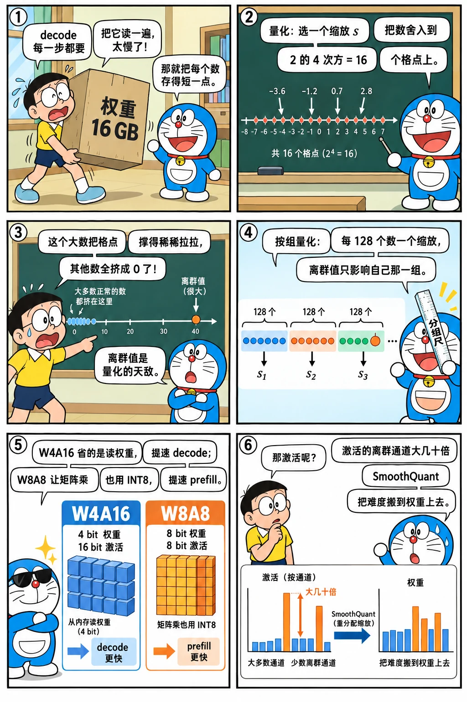

# 量化原理

<p class="lead">量化用更少的比特表示权重和激活：权重从 16 位变成 8 位、4 位，decode 时要读取的字节数就成比例减少；激活也量化后，还能用 INT8/FP8 的 Tensor Core 加速计算。这一章讲清楚量化的数学、粒度和主流方法，并在真实模型上做实验：不同粒度的误差差多少，激活离群值为什么让量化变难，SmoothQuant 怎么解决。</p>

!!! question "自测：能答上来就可以跳过本章"
    1. 对称量化和非对称量化分别怎么计算缩放因子和零点？
    2. 按张量、按通道、按组量化的区别是什么？为什么 INT4 几乎都按组量化？
    3. weight-only 量化和 W8A8 量化分别加速了什么？
    4. 激活离群值为什么让量化变难？SmoothQuant 怎么解决？
    5. GPTQ 和 AWQ 的核心思想分别是什么？
    6. GPTQ 量化后的权重离原值更远，效果却比四舍五入好，为什么？
    7. 给 KV Cache 做 INT4 量化，K 和 V 为什么要用不同的分组方式？

??? success "自测参考答案（先自己答，再展开对照）"
    1. 对称：缩放 $s = \max|x| / (2^{b-1} - 1)$，零点为 0；非对称：$s = (\max - \min) / (2^b - 1)$，零点 $z = \mathrm{round}(-\min / s)$，能用满范围但多存一个零点。
    2. 按张量一组一个缩放、按通道每个输出通道一个、按组每连续若干个（如 128）一个；粒度越细，一个离群值影响的数越少。INT4 只有 16 个量化级别，整行一个缩放误差太大，所以几乎都按组量化。
    3. weight-only（如 W4A16）减少的是读权重的字节，加速访存受限的 decode，计算仍用 16 位；W8A8 让矩阵乘也用 INT8 Tensor Core，同时加速计算，对 prefill 和大 batch 有效。
    4. 少数通道的激活比其他大几十上百倍，按张量或按 token 量化时它们决定了缩放，其余数值被压到很少的几个级别。SmoothQuant 把激活按通道除以 $s$、权重乘以 $s$（数学上等价），把量化难度从激活挪到更好量化的权重上。
    5. GPTQ：逐层量化，用激活的二阶信息 $H = X^\top X$ 把每个权重的量化误差补偿到还没量化的权重上；AWQ：按激活的幅度找出重要的通道，量化前先放大它们（等价缩放），减少这些通道的相对误差。
    6. GPTQ 要最小化的是这一层的输出误差，不是权重误差：量化一列产生的误差，按 $H^{-1}$ 补偿到后面还没量化的列上，这些列被有意地推离原值，去抵消前面的误差。本章第 10 层 q_proj 的实验：GPTQ 的权重误差 17.9%（RTN 12.1%），输出误差却只有 7.0%（RTN 10.4%）。
    7. K 有几个固定的离群维度（本章第 2 层最大的一维到 210，中位数只有 6.5），按 token 分组时这几维撑大了每个 token 的缩放，误差 20% 左右；按通道分组，每一维有自己的缩放，误差降到几个百分点。V 没有这种结构，按 token 分组就好。这是 KIVI 的做法。

先看一个六格小剧场，再读正文：

{.aig-comic}

## 量化的数学

把浮点数 $x$ 映射到 b 位整数。**对称量化**：

$$
s = \frac{\max|x|}{2^{b-1} - 1},\qquad q = \text{clamp}\left(\text{round}\left(\frac{x}{s}\right), -2^{b-1}, 2^{b-1}-1\right),\qquad \hat{x} = q \cdot s
$$

**非对称量化**多一个零点 $z$，把 $[\min, \max]$ 映射到 $[0, 2^b - 1]$，适合分布不以 0 为中心的数据（CUDA 手册的 [INT4 GEMV](cuda://advanced/quantization/) 用的就是非对称按组量化）。

误差来自两处：**舍入误差**（每个数最多偏离半个量化步长 $s/2$）和**截断误差**（超出范围的数被截断，通常通过选择合适的 $s$ 避免）。量化步长 $s$ 由这组数中的**最大绝对值**决定，所以一个离群的大数会让所有普通的数都变得不精确，这是理解量化的关键。

把一行 1024 个权重里塞进一个离群值，看它怎么把量化格点撑开、把其余的数压成 0，再换成按组量化看它被隔离的效果：

<div class="aig-widget" data-widget="quant"></div>

## 粒度：多少个数共用一个缩放因子

| 粒度 | 共用缩放因子的范围 | 额外开销 | 精度 |
| --- | --- | --- | --- |
| 按张量（per-tensor） | 整个矩阵 | 可忽略 | 最差：一个离群值影响全部 |
| 按通道（per-channel） | 权重矩阵的每一行（每个输出通道） | 很小 | 好 |
| 按组（per-group） | 每行内每 G 个连续元素（G 常为 128） | 每 G 个数一个缩放因子 | 更好，INT4 的标准做法 |
| 按块（block-wise） | 例如 128×128 的块 | 小 | DeepSeek-V3 的 FP8 权重使用 |

在 Qwen3-0.6B 的一个真实权重矩阵上比较：

```python title="quant.py"
"""quant.py —— 对称的伪量化（量化后立刻反量化），用于评估误差。"""

import torch


def fake_quant_int(w: torch.Tensor, bits: int, granularity: str = "channel", group: int = 128) -> torch.Tensor:
    out_f, in_f = w.shape
    if granularity == "tensor":
        g = w.reshape(1, 1, -1)
    elif granularity == "channel":
        g = w.reshape(out_f, 1, in_f)
    else:                                                     # "group"
        g = w.reshape(out_f, in_f // group, group)
    qmax = 2 ** (bits - 1) - 1
    scale = g.abs().amax(dim=-1, keepdim=True).clamp(min=1e-8) / qmax
    q = (g / scale).round().clamp(-qmax - 1, qmax)
    return (q * scale).reshape(w.shape)


def fake_quant_fp8(w: torch.Tensor) -> torch.Tensor:
    scale = w.abs().max() / 448.0                             # E4M3 的最大值是 448
    return (w / scale).to(torch.float8_e4m3fn).float() * scale


def rel_error(approx: torch.Tensor, exact: torch.Tensor) -> float:
    return ((approx - exact).norm() / exact.norm()).item()
```

```python
import torch
from mini_llm import Transformer
from quant import fake_quant_fp8, fake_quant_int, rel_error

model = Transformer.from_pretrained("models/Qwen3-0.6B")
W = model.layers[0].mlp.down_proj.weight.data                  # [1024, 3072]
results = {
    "INT8 按张量": rel_error(fake_quant_int(W, 8, "tensor"), W),
    "INT8 按通道": rel_error(fake_quant_int(W, 8, "channel"), W),
    "FP8 E4M3 按张量": rel_error(fake_quant_fp8(W), W),
    "INT4 按通道": rel_error(fake_quant_int(W, 4, "channel"), W),
    "INT4 按组（G=128）": rel_error(fake_quant_int(W, 4, "group"), W),
}
for name, e in results.items():
    print(f"{name:18s} 相对误差 {e:.4f}")
assert results["INT8 按通道"] < results["INT8 按张量"] and results["INT4 按组（G=128）"] < results["INT4 按通道"]
```

```text title="输出"
INT8 按张量           相对误差 0.0362
INT8 按通道           相对误差 0.0097
FP8 E4M3 按张量       相对误差 0.0265
INT4 按通道           相对误差 0.1762
INT4 按组（G=128）     相对误差 0.1240
```

几个观察：INT8 按通道的误差只有按张量的 1/4 左右；FP8 即使按张量量化，误差也比 INT8 按张量小，因为浮点格式对大小不同的数有自适应的精度；INT4 只有 16 个量化级别，误差大了一个数量级，按组量化明显好于按通道。

### FP8 的格点长什么样

把 FP8 E4M3 的 256 种编码全部列出来，看它能表示哪些数：

```python
codes = torch.arange(256, dtype=torch.uint8).view(torch.float8_e4m3fn).float()   # 8 位一共 256 种编码
grid = codes[codes.isfinite() & (codes > 0)].unique()                           # 其中的正数，负数和它对称
print(f"FP8 E4M3 能表示 {len(grid)} 个正数，从 {grid.min().item():g} 到 {grid.max().item():g}，其中 {int((grid <= 1).sum())} 个不超过 1")
for x in (0.1, 1, 10, 100, 400):
    i = int(torch.searchsorted(grid, torch.tensor(float(x))))
    gap = (grid[i] - grid[i - 1]).item()
    print(f"{x:>4g} 附近：相邻的两个值相差 {gap:g}，是它的 {gap / x:.1%}")
step = 448 / 127
print(f"INT8 要覆盖同样的范围，步长处处都是 {step:.2f}，绝对值小于 {step / 2:.2f} 的数全部舍成 0")
```

```text title="输出"
FP8 E4M3 能表示 126 个正数，从 0.00195312 到 448，其中 56 个不超过 1
 0.1 附近：相邻的两个值相差 0.0078125，是它的 7.8%
   1 附近：相邻的两个值相差 0.0625，是它的 6.2%
  10 附近：相邻的两个值相差 1，是它的 10.0%
 100 附近：相邻的两个值相差 8，是它的 8.0%
 400 附近：相邻的两个值相差 32，是它的 8.0%
INT8 要覆盖同样的范围，步长处处都是 3.53，绝对值小于 1.76 的数全部舍成 0
```

- FP8 就是 8 位的科学计数法：4 位指数决定数量级，3 位尾数把每个数量级再分成 8 格。所以相邻两个值的间距总是数值本身的 6%～13%：靠近 0 的地方格点密，远离 0 的地方格点疏，一半的格点都在 1 以下；
- INT8 的格点均匀铺开，最大值一大，小数就全都挤在 0 附近的几格里；
- 所以上面按张量量化时 FP8 比 INT8 准：权重的绝对值大多很小，FP8 给它们留了足够多的格点。离群值多的数据（激活、KV Cache）也一样，FP8 即使整个张量共用一个缩放因子也能扛住，这是 FP8 推理从 Hopper 开始普及的原因之一。

## 对整个模型做 weight-only 量化

把所有线性层（注意力的 4 个投影和 FFN 的 3 个投影）都做伪量化，在一段文本上比较困惑度：

```python
import copy
import math
from transformers import AutoTokenizer

tok = AutoTokenizer.from_pretrained("models/Qwen3-0.6B")
text = ("大语言模型的推理过程分为两个阶段。在预填充阶段，模型一次性处理用户输入的全部提示词，计算每个位置的键和值并写入缓存。"
        "在解码阶段，模型每次只生成一个新的词元，需要读取全部的模型权重和已经缓存的键值。由于每一步的计算量很小而读取的数据量很大，"
        "解码阶段通常受限于显存带宽。为了提高吞吐量，推理系统会把多个请求合并成一个批次，让它们共享同一次权重读取。"
        "量化通过降低权重和激活的数值精度来减少需要读取的字节数，是加速解码的常用方法。")
ids = tok(text, return_tensors="pt").input_ids

@torch.no_grad()
def perplexity(m):
    logits = m(ids)
    return math.exp(torch.nn.functional.cross_entropy(logits[0, :-1], ids[0, 1:]).item())

def quantize_model(m, fn):
    m = copy.deepcopy(m)
    for layer in m.layers:
        a, f = layer.self_attn, layer.mlp
        for lin in (a.q_proj, a.k_proj, a.v_proj, a.o_proj, f.gate_proj, f.up_proj, f.down_proj):
            lin.weight.data = fn(lin.weight.data)
    return m

ppl = {"FP32": perplexity(model)}
for name, fn in [("W8 按通道", lambda w: fake_quant_int(w, 8, "channel")),
                 ("W4 按组 G=128", lambda w: fake_quant_int(w, 4, "group")),
                 ("W4 按通道", lambda w: fake_quant_int(w, 4, "channel")),
                 ("W3 按组 G=128", lambda w: fake_quant_int(w, 3, "group"))]:
    ppl[name] = perplexity(quantize_model(model, fn))
for name, v in ppl.items():
    print(f"{name:14s} 困惑度 {v:8.2f}")
assert abs(ppl["W8 按通道"] - ppl["FP32"]) / ppl["FP32"] < 0.02
assert ppl["W4 按组 G=128"] < ppl["W4 按通道"] < ppl["W3 按组 G=128"]
```

```text title="输出"
FP32           困惑度    25.94
W8 按通道         困惑度    25.98
W4 按组 G=128    困惑度    41.49
W4 按通道         困惑度    55.02
W3 按组 G=128    困惑度   442.45
```

- **INT8 按通道几乎无损**，这就是 W8 量化如此普及的原因；
- **INT4 用最朴素的"四舍五入"（RTN）量化，困惑度上升了约 60%**，而且 0.6B 这样的小模型对量化格外敏感（大模型的冗余更多，通常更耐量化）；按组量化（41.49）比按通道（55.02）好；
- 3 位的朴素量化则基本不可用。

这就是为什么 INT4 需要比 RTN 更聪明的方法。

## GPTQ 与 AWQ

**GPTQ**（Frantar 等，2022）：逐列量化权重，每量化一列，就利用校准数据的二阶信息（输入的协方差），调整**尚未量化的列**来补偿这一列引入的误差。目标是让量化后这一层的**输出**（而不是权重本身）尽量接近原来的输出。

**AWQ**（Lin 等，2023）：观察到只有约 1% 的权重通道特别重要，它们对应的**输入激活**通常很大。与其保护这些权重不被量化，不如在量化前把这些通道乘以一个大于 1 的系数（等价地把对应的激活除以这个系数），让它们在量化时获得更高的相对精度。系数用少量校准数据搜索得到。

下面把两种方法各用二十来行实现出来，和 RTN 比一比。存储格式完全相同：INT4、每 128 个数一组、对称量化；区别只在于每个权重舍入到哪里（GPTQ），以及量化前先给每个输入通道乘多大的系数（AWQ）。两者都要一段校准文本，这里用和评测文本不同的一段（本书「分词」一章正文的快照），取 512 个 token：

```python
import re

raw = open("docs/assets/calib-passage.txt", encoding="utf-8").read()
calib = torch.tensor([tok(re.sub(r"[#*`>|\-\[\]()!]", "", raw)).input_ids[:512]])     # 去掉 Markdown 符号
long_ids = tok(open("docs/assets/sample-passage.txt", encoding="utf-8").read(), return_tensors="pt").input_ids[:, :1024]

def linears(m):
    for layer in m.layers:
        a, f = layer.self_attn, layer.mlp
        yield from (a.q_proj, a.k_proj, a.v_proj, a.o_proj, f.gate_proj, f.up_proj, f.down_proj)

def layer_inputs(m, x):
    """跑一遍模型，记下每个线性层的输入 [T, 输入维度]"""
    xs, hooks = {}, []
    for lin in linears(m):
        hooks.append(lin.register_forward_hook(lambda mod, inp, out: xs.__setitem__(mod, inp[0][0])))
    with torch.no_grad():
        m(x)
    for h in hooks:
        h.remove()
    return xs

def gptq(W, X, bits=4, group=128, damp=0.01):
    """逐列量化；每量化一列，就用 H = XᵀX 的逆把这一列的误差补偿到后面还没量化的列上"""
    W, n = W.clone(), W.shape[1]
    H = X.T @ X
    H += damp * H.diag().mean() * torch.eye(n)                               # 阻尼，保证可逆
    U = torch.linalg.cholesky(torch.cholesky_inverse(torch.linalg.cholesky(H)), upper=True)   # H⁻¹ 的 Cholesky 分解
    qmax = 2 ** (bits - 1) - 1
    Q = torch.zeros_like(W)
    for a in range(0, n, group):
        W1, errs = W[:, a:a + group].clone(), torch.zeros(W.shape[0], group)
        scale = W1.abs().amax(dim=1).clamp(min=1e-8) / qmax                  # 这一组的缩放因子，用补偿过的权重算
        for i in range(group):
            Q[:, a + i] = (W1[:, i] / scale).round().clamp(-qmax - 1, qmax) * scale
            err = (W1[:, i] - Q[:, a + i]) / U[a + i, a + i]
            W1[:, i:] -= err[:, None] * U[a + i, a + i:a + group][None, :]   # 补偿到本组剩下的列
            errs[:, i] = err
        W[:, a + group:] -= errs @ U[a:a + group, a + group:]                # 再补偿到后面所有的列
    return Q

def awq(W, X, bits=4, group=128):
    """量化前把每个输入通道乘上 s = (这个通道激活的平均幅度)^α，量化后再除回去；α 在校准数据上搜"""
    mag, Y = X.abs().mean(dim=0).clamp(min=1e-5), X @ W.T
    best_err, best_q = float("inf"), None
    for alpha in [i / 10 for i in range(11)]:                                # α = 0 就是 RTN
        s = mag ** alpha
        s = s / (s.max() * s.min()).sqrt()
        Wq = fake_quant_int(W * s, bits, "group", group) / s                 # 推理时 1/s 合并进前一层，没有额外开销
        err = rel_error(X @ Wq.T, Y)
        if err < best_err:
            best_err, best_q = err, Wq
    return best_q
```

给模型的全部线性层分别用三种方法量化。先单看第 10 层的 q_proj，比较权重本身的误差和这一层输出的误差（输出用另一段文本的激活来算），再看整个模型在两段评测文本上的困惑度：

```python
@torch.no_grad()
def perplexity_on(m, x):
    logits = m(x)
    return math.exp(torch.nn.functional.cross_entropy(logits[0, :-1], x[0, 1:]).item())

calib_x, eval_x = layer_inputs(model, calib), layer_inputs(model, long_ids)
W, X = model.layers[10].self_attn.q_proj.weight.data, eval_x[model.layers[10].self_attn.q_proj]
rows = [f"FP32：短文本困惑度 {perplexity(model):.2f}，长文本 {perplexity_on(model, long_ids):.2f}"]
for name, fn in [("RTN", lambda W, X: fake_quant_int(W, 4, "group")), ("AWQ", awq), ("GPTQ", gptq)]:
    q = copy.deepcopy(model)
    for lin_q, lin in zip(linears(q), linears(model)):
        lin_q.weight.data = fn(lin.weight.data, calib_x[lin])
    Wq = q.layers[10].self_attn.q_proj.weight.data
    print(f"第 10 层 q_proj，{name}：权重误差 {rel_error(Wq, W):.1%}，输出误差 {rel_error(X @ Wq.T, X @ W.T):.1%}")
    rows.append(f"{name}：短文本困惑度 {perplexity(q):.2f}，长文本 {perplexity_on(q, long_ids):.2f}")
    del q
print("\n".join(rows))
```

```text title="输出"
第 10 层 q_proj，RTN：权重误差 12.1%，输出误差 10.4%
第 10 层 q_proj，AWQ：权重误差 12.7%，输出误差 7.4%
第 10 层 q_proj，GPTQ：权重误差 17.9%，输出误差 7.0%
FP32：短文本困惑度 25.94，长文本 22.03
RTN：短文本困惑度 41.49，长文本 29.36
AWQ：短文本困惑度 31.85，长文本 26.71
GPTQ：短文本困惑度 27.61，长文本 25.59
```

- 单看一层：GPTQ 的权重误差反而最大（17.9%），输出误差却最小（7.0%）。它不追求每个权重都离原值最近，而是让这一层的输出最接近原来的输出：一个权重舍入产生的误差，由后面还没量化的权重来抵消。AWQ 的权重误差也比 RTN 稍大，输出误差却小了近三成：激活大的通道对输出的影响最大，先放大再量化，它们的相对误差就小了；
- 整个模型：同样的存储格式，RTN 的困惑度涨了六成，AWQ 涨了两成多，GPTQ 只涨了 6%。短文本只有一百多个 token，困惑度的波动大；换成 1024 个 token 的长文本，排序一样，GPTQ 比原模型只高 16%；
- 两种方法都只用了 512 个 token 的校准文本，几十秒就算完，不需要训练。这里做了两处简化：所有层的校准输入都取自原模型（原论文按层依次量化，后面的层用前面已经量化过的输出来校准）；AWQ 只搜了一个 α，没有搜裁剪范围。GPTQ 的推导和按通道量化的整模型实验，见数学手册的[二阶信息：GPTQ](math://calculus/#二阶信息gptq)。

两者都是**离线**完成的：量化后的模型格式和 RTN 一样（整数权重 + 缩放因子 + 可能的零点），推理 kernel 不需要知道用的是哪种方法。

## 激活量化与离群值

weight-only 量化加速的是**读权重**，计算仍然在 FP16/BF16 下进行。要用 INT8/FP8 的 Tensor Core 加速计算，**激活也必须量化**（W8A8）。这里的难点在于激活的离群值：[归一化与残差流](../transformer/norm-residual.md#看看真实的残差流)一章看到，残差流里少数固定的维度数值特别大。

抓取第 12 层 FFN 的输入激活（已经过 RMSNorm），看看它的分布，以及 W8A8 的误差：

```python
from quant import rel_error

captured = {}
hook = model.layers[12].mlp.gate_proj.register_forward_hook(
    lambda mod, inp, out: captured.__setitem__("x", inp[0][0].detach()))
with torch.no_grad():
    model(ids)
hook.remove()
X = captured["x"]                                         # [T, 1024]
W = model.layers[12].mlp.gate_proj.weight.data            # [3072, 1024]
top = X.abs().amax(dim=0).topk(4)
print("最大的几个通道:", [(i, round(v, 1)) for v, i in zip(top.values.tolist(), top.indices.tolist())],
      " 中位数:", round(X.abs().median().item(), 3))

def q8_per_tensor(x):
    s = x.abs().max() / 127
    return (x / s).round().clamp(-128, 127) * s

def q8_per_row(w):
    s = w.abs().amax(dim=1, keepdim=True) / 127
    return (w / s).round().clamp(-128, 127) * s

Y = X @ W.T
err_w8 = rel_error(X @ q8_per_row(W).T, Y)
err_w8a8 = rel_error(q8_per_tensor(X) @ q8_per_row(W).T, Y)

# SmoothQuant：把激活每个通道除以 s_j，权重对应的列乘以 s_j，乘积不变
alpha = 0.5
s = X.abs().amax(dim=0).clamp(min=1e-5) ** alpha / W.abs().amax(dim=0).clamp(min=1e-5) ** (1 - alpha)
Xs, Ws = X / s, W * s
assert torch.allclose(Xs @ Ws.T, Y, atol=1e-3)              # 数学上完全等价
err_smooth = rel_error(q8_per_tensor(Xs) @ q8_per_row(Ws).T, Y)
print(f"只量化权重 {err_w8:.4f}；W8A8 {err_w8a8:.4f}；SmoothQuant 后 W8A8 {err_smooth:.4f}")
assert err_w8 < err_smooth < err_w8a8
```

```text title="输出"
最大的几个通道: [(277, 21.3), (16, 12.0), (23, 11.6), (3, 11.6)]  中位数: 0.411
只量化权重 0.0065；W8A8 0.0400；SmoothQuant 后 W8A8 0.0130
```

最大的第 277 维也是前面在残差流里看到的离群维度之一（经过 RMSNorm 之后，各维度又乘上了不同的缩放，排序会变）。激活按张量量化时，量化步长被第 277 维的 21.3 决定，中位数只有 0.4 的普通数值只能用很少的几个量化级别表示，误差是只量化权重时的 6 倍。

**SmoothQuant**（Xiao 等，2022）利用了一个简单的等价变换：$XW^\top = (X \operatorname{diag}(s)^{-1})(W\operatorname{diag}(s))^\top$。把激活的离群通道"除小"，权重对应的列"乘大"，难度从激活转移了一部分到权重（权重按通道量化，容易承受）。$\alpha$ 控制转移的程度。这个缩放可以离线合并进前一层 RMSNorm 的权重里，推理时没有额外开销。误差下降到原来的约 1/3。

### 实验：KV Cache 该怎么分组

KV Cache 也有离群值，而且 K 和 V 的样子不一样。用长文本的前 512 个 token 填一份 KV Cache，比较两种分组：每个 token 的 128 维共用一个缩放（按 token），或者每一维在所有 token 上共用一个缩放（按通道）：

```python
from mini_llm import KVCache

cache = KVCache(model.cfg.num_hidden_layers)
with torch.no_grad():
    model(long_ids[:, :512], cache)

def quant_asym(x, bits, dim):
    """非对称量化：沿 dim 方向的一组数共用一个缩放和零点"""
    lo, hi = x.amin(dim, keepdim=True), x.amax(dim, keepdim=True)
    s = (hi - lo).clamp(min=1e-8) / (2 ** bits - 1)
    return ((x - lo) / s).round().clamp(0, 2 ** bits - 1) * s + lo

for layer in (2, 14, 27):
    K, V = cache.k[layer][0], cache.v[layer][0]                   # [8 个头, 512 个 token, 128 维]
    peak = K.abs().amax(dim=(0, 1))                                # K 每一维的最大幅度
    print(f"第 {layer:2d} 层：K 最大的一维 {peak.max():.0f}，各维中位数 {peak.median():.1f}；INT4 误差 "
          f"K 按 token {rel_error(quant_asym(K, 4, -1), K):.1%}、按通道 {rel_error(quant_asym(K, 4, -2), K):.1%}，"
          f"V 按 token {rel_error(quant_asym(V, 4, -1), V):.1%}、按通道 {rel_error(quant_asym(V, 4, -2), V):.1%}")
```

```text title="输出"
第  2 层：K 最大的一维 210，各维中位数 6.5；INT4 误差 K 按 token 23.1%、按通道 3.0%，V 按 token 11.1%、按通道 12.1%
第 14 层：K 最大的一维 41，各维中位数 5.6；INT4 误差 K 按 token 18.1%、按通道 7.7%，V 按 token 11.8%、按通道 14.8%
第 27 层：K 最大的一维 44，各维中位数 4.6；INT4 误差 K 按 token 21.6%、按通道 5.9%，V 按 token 10.7%、按通道 13.1%
```

- K 有几个固定的离群维度：第 2 层最大的一维到了 210，各维的中位数只有 6.5。按 token 分组时，每个 token 的缩放都被这几维撑大，其余的维度被压扁，误差 20% 左右；按通道分组，每一维有自己的缩放，误差降到 3%～8%；
- V 没有这种按维度的结构，按 token 分组反而略好；
- 这就是 KIVI 的做法：K 按通道、V 按 token。按通道分组要先攒够一批 token 才能算缩放，所以最近的一小段 token 先用全精度存着。推理引擎里更常见的是 FP8 KV Cache，整个张量共用一个缩放，靠 FP8 的相对精度扛住离群值（见上面 [FP8 的格点](#fp8-的格点长什么样)）。

## 能快多少：看瓶颈在哪

量化省下的是字节，能不能变快，要看瓶颈在不在读字节上。这台 CPU 上没有现成的高效 INT4 / INT8 kernel，就用 FP32 → BF16 来做同样的实验：每个权重的字节数减半，把模型的 196 个线性层按不同的 batch 各跑一遍：

```python
import time
import torch.nn.functional as F

torch.set_num_threads(16)

def best_ms(f, reps=10):
    f()                                                           # 预热
    best = float("inf")
    for _ in range(reps):
        t0 = time.perf_counter()
        f()
        best = min(best, time.perf_counter() - t0)
    return best * 1000

w32 = [lin.weight.data for lin in linears(model)]                 # 196 个线性层，FP32 每个数 4 字节
w16 = [w.to(torch.bfloat16) for w in w32]                         # BF16 每个数 2 字节
for batch in (1, 8, 64):
    x32 = [torch.randn(batch, w.shape[1]) for w in w32]
    x16 = [x.to(torch.bfloat16) for x in x32]
    t32 = best_ms(lambda: [F.linear(x, w) for x, w in zip(x32, w32)])
    t16 = best_ms(lambda: [F.linear(x, w) for x, w in zip(x16, w16)])
    print(f"batch={batch:2d}：FP32 {t32:5.1f} ms，BF16 {t16:5.1f} ms（BF16 的速度是 FP32 的 {t32 / t16:.1f} 倍）")
```

在本手册的环境里（数值因机器而异）：

```text
batch= 1：FP32  20.5 ms，BF16  12.6 ms（BF16 的速度是 FP32 的 1.6 倍）
batch= 8：FP32  25.6 ms，BF16  65.4 ms（BF16 的速度是 FP32 的 0.4 倍）
batch=64：FP32  63.5 ms，BF16 221.0 ms（BF16 的速度是 FP32 的 0.3 倍）
```

- batch=1 时，BF16 的速度是 FP32 的 1.6 倍：decode 的瓶颈在读权重，字节减半，时间就少了将近一半；
- batch 一大，BF16 反而慢了两三倍：本手册用的 CPU 没有 BF16 的计算指令，BF16 的矩阵乘要先转换成 FP32 再算。batch 一大，瓶颈从读权重变成了计算，这部分开销就露了出来；
- GPU 上的 weight-only 量化（W4A16）也是这个道理：INT4 权重要先在寄存器里反量化成 BF16，才能送进 Tensor Core。batch 小的时候，省下的读取远多于这点开销；batch 大了就不划算，这时该用 W8A8、FP8 这种计算也用低精度的方案；
- 放到整个模型上，decode 的提速还要再打折扣：线性层之外还有二十来毫秒的小算子开销（见[估算](estimation.md#实验下限和实测差多少)一章的实验），它们不会因为权重变小而变快。

## 主流方案小结

| 方案 | 权重 | 激活 | 加速了什么 | 常见用法 |
| --- | --- | --- | --- | --- |
| W8A16 / W4A16 | INT8 / INT4（GPTQ、AWQ） | BF16 | 读权重（decode） | 小 batch、显存受限的部署 |
| W8A8 INT8 | INT8 | INT8（SmoothQuant 等） | 读权重 + INT8 Tensor Core 计算 | Ampere 等支持 INT8 的 GPU |
| FP8（W8A8） | FP8 | FP8（动态或静态缩放） | 读权重 + FP8 Tensor Core 计算 | Hopper/Ada 上的主流选择，精度损失小 |
| FP4（NVFP4 / MXFP4） | FP4 | FP4 | 同上，更进一步 | Blackwell |
| KV Cache 量化 | — | K、V 用 FP8/INT8 | 读 KV、KV 容量 | 长上下文、高并发 |

!!! inference "推理视角"
    - **decode 看字节，prefill 看算力**：weight-only 量化在小 batch 的 decode 中几乎带来与压缩比相当的加速，但大 batch、prefill 时收益递减甚至变慢（反量化有开销，计算仍是 BF16）；W8A8/FP8 在两种场景下都有收益；
    - **反量化在 kernel 里完成**：量化权重在寄存器中被解包、乘以缩放因子，再送进 Tensor Core。Marlin 等 kernel 为此精心设计了权重的离线重排和位运算技巧，参见 CUDA 手册中的[量化与 GEMV](cuda://advanced/quantization/)；
    - **一定要评测精度**：困惑度只是粗略的信号，实际部署前应在目标任务的评测集上比较，小模型、长上下文、推理（数学）任务往往对量化更敏感。

!!! interview "怎么讲清楚"
    讲量化先分清"加速了什么"：weight-only（W4A16、W8A16）减少读权重的字节，加速访存受限的 decode；W8A8 / FP8 让矩阵乘也用低精度 Tensor Core，加速 prefill 和大 batch。再讲精度：步长由一组数的最大绝对值决定，粒度越细越准，INT4 要按组（通常 128）量化；激活的离群值是难点，SmoothQuant 用等价缩放把难度挪到权重上；GPTQ 用二阶信息补偿误差，AWQ 按激活幅度保护重要的通道。最后强调上线前要在目标任务上评测。

!!! note "延伸阅读"
    - [A Visual Guide to Quantization](https://newsletter.maartengrootendorst.com/p/a-visual-guide-to-quantization)（Maarten Grootendorst）：用几十张图把数据类型、对称与非对称、校准、GPTQ、GGUF、量化感知训练讲了一遍，适合先通读；
    - [LLM.int8() and Emergent Features](https://timdettmers.com/2022/08/17/llm-int8-and-emergent-features/)（Tim Dettmers）：激活离群值是怎么被发现的、为什么模型越大越明显，以及把离群维度单独用 16 位计算的思路；配套的 [Hugging Face 博客](https://huggingface.co/blog/hf-bitsandbytes-integration)讲了 8 位矩阵乘法的实现；
    - [4-bit LLM Quantization with GPTQ](https://mlabonne.github.io/blog/posts/4_bit_Quantization_with_GPTQ.html)（Maxime Labonne）：从 OBQ 讲到 GPTQ 的三个改进，再用 AutoGPTQ 量化一个真实模型；
    - 论文：[GPTQ](https://arxiv.org/abs/2210.17323)、[AWQ](https://arxiv.org/abs/2306.00978)、[SmoothQuant](https://arxiv.org/abs/2211.10438)、[KIVI](https://arxiv.org/abs/2402.02750)（KV Cache 的 K 按通道、V 按 token 量化）；
    - [Introducing NVFP4 for Efficient and Accurate Low-Precision Inference](https://developer.nvidia.com/blog/introducing-nvfp4-for-efficient-and-accurate-low-precision-inference/)（NVIDIA）：Blackwell 上的 4 位浮点格式，每 16 个数共用一个 FP8 缩放、再加一个张量级的缩放，是"按组量化"在硬件里的样子。

## 练习

**1. 量化步长。** 一组权重的最大绝对值是 0.8，用对称 INT4 量化，量化步长是多少？0.05 会被量化成多少？误差是多少？

??? success "参考答案"
    INT4 对称量化的最大整数是 7，步长 s = 0.8 / 7 ≈ 0.1143。0.05 / 0.1143 ≈ 0.44，四舍五入为 0，反量化结果为 0，误差 0.05（100%）。可见在 INT4 下，比最大值小一个数量级的数几乎全部被量化成 0。这就是为什么 INT4 必须缩小共用缩放因子的范围（按组量化）。

    ```python
    s = 0.8 / 7
    assert round(0.05 / s) == 0
    ```

**2. 估算题。** 一个 70B 模型用 W4A16（G = 128，每组一个 FP16 缩放因子和一个 4 位零点）量化，权重一共多少 GB？比 BF16 小多少？

??? success "参考答案"
    每个权重 0.5 字节；每 128 个权重额外 2 + 0.5 = 2.5 字节，平均每个权重约 0.02 字节。合计约 0.52 字节/参数，70B 约 36.4 GB（嵌入层和输出层通常不量化，实际会略大），BF16 为 140 GB，约为其 26%。

    ```python
    per_param = 0.5 + 2.5 / 128
    print(f"{70e9 * per_param / 1e9:.1f} GB")
    ```

## 小结

- [x] 量化步长由一组数中的最大绝对值决定，离群值会损害所有普通数值的精度。
- [x] 粒度越细误差越小：INT8 按通道几乎无损，INT4 需要按组量化以及 GPTQ/AWQ 等更聪明的方法。
- [x] weight-only 量化加速读权重（decode），W8A8/FP8 同时加速计算。
- [x] 激活离群值是激活量化的主要难点；SmoothQuant 用等价缩放把难度转移到权重上。
- [x] FP8 是 8 位的科学计数法：格点靠近 0 密、远离 0 疏，相对精度大致固定，所以整个张量共用一个缩放也能扛住离群值。
- [x] GPTQ 让一层的输出误差最小（权重误差反而更大），AWQ 先放大激活大的通道再量化；本章 INT4 按组量化的实验里，GPTQ 把困惑度的上涨从六成压到 6%。
- [x] KV Cache 的 K 有固定的离群维度，低比特量化时 K 按通道、V 按 token 分组。
- [x] 量化能不能变快要看瓶颈：字节减半，batch 1 的 decode 明显变快；batch 大了，如果硬件没有对应的低精度计算单元，反而更慢。
- [x] 部署前必须在目标任务上评测量化后的精度。

相关的数学：旋转为什么能消除离群值见[线性代数](math://linear-algebra/)，用 KL 散度衡量量化损失见[信息论](math://information-theory/)，GPTQ 的推导与实现见[微积分与反向传播](math://calculus/)，每比特 6 dB 的量化噪声见[浮点与数值计算](math://floating-point/)。
