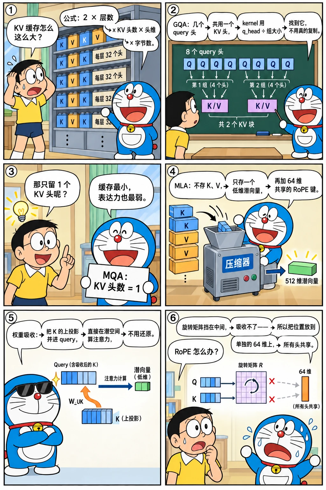
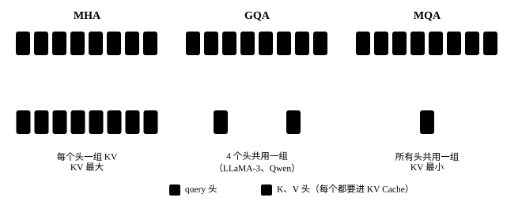
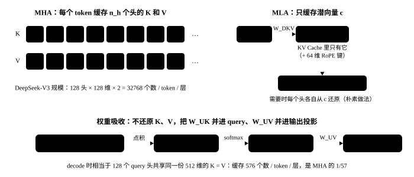

# 注意力变体：MQA、GQA、MLA

<p class="lead">标准多头注意力（MHA）的 KV Cache 太大了：长上下文、高并发下，显存里装不下，decode 时每步读它也太慢。过去几年注意力结构的演进（MQA、GQA、MLA、滑动窗口、稀疏注意力），几乎都是为了缩小 KV Cache。这一章讲清楚它们各自怎么做、省了多少、对推理 kernel 和并行策略有什么影响。</p>

!!! question "自测：能答上来就可以跳过本章"
    1. 每个 token 的 KV Cache 有多大？用 MHA、GQA、MQA 时分别怎么算？
    2. GQA 的推理 kernel 为什么不需要真的复制 KV 头？
    3. MLA 缓存的是什么？"权重吸收"指的是什么？
    4. MLA 为什么要把 RoPE 单独拆出来？
    5. KV 头数少于张量并行的卡数时怎么办？

??? success "自测参考答案（先自己答，再展开对照）"
    1. 2 × 层数 × KV 头数 × 头维 × 字节数。MHA 的 KV 头数等于 query 头数，GQA 是分组数，MQA 是 1。
    2. 同一组的 query 头读同一个 KV 头，kernel 用 `kv_head = q_head // 分组大小` 找到它，一次读取供整组使用，不需要在内存里真的复制。
    3. 缓存每个 token 的低维潜向量（DeepSeek-V3 为 512 维）和 64 维共享的 RoPE 键。权重吸收：把 K 的上投影并进 query、V 的上投影并进输出投影，直接在潜空间里算注意力，不用展开缓存。
    4. RoPE 的旋转矩阵依赖位置，夹在 K 的上投影和潜向量之间，上投影就无法提前并进 query。把位置信息放在单独的少数维度上、所有头共享一份，剩下的部分才能吸收。
    5. KV 头没法再切，只能复制：让每个 KV 头放在若干张卡上，每张卡仍只负责自己的 query 头；代价是 KV 投影和 KV Cache 被复制。MLA 这类 KV 只有一份的模型，干脆用 DP Attention。

先看一个六格小剧场，再读正文：

{.aig-comic}

## KV Cache 有多大

[KV Cache](../inference/kv-cache.md) 为每个历史 token 保存每一层的 K 和 V。每个 token 占用：

$$
\text{KV 字节数} = 2 \times L \times n_{kv} \times d_h \times \text{每元素字节数}
$$

对比几个模型（BF16）：

```python
def kv_bytes_per_token(layers, n_kv, head_dim, bytes_per_elem=2):
    return 2 * layers * n_kv * head_dim * bytes_per_elem

models = {
    "LLaMA-2-7B（MHA，32 个 KV 头）": kv_bytes_per_token(32, 32, 128),
    "LLaMA-3-8B（GQA，8 个 KV 头）": kv_bytes_per_token(32, 8, 128),
    "Qwen2.5-7B（GQA，4 个 KV 头）": kv_bytes_per_token(28, 4, 128),
    "Qwen3-0.6B（GQA，8 个 KV 头）": kv_bytes_per_token(28, 8, 128),
    "DeepSeek-V3（MLA，缓存 512+64 维）": 61 * (512 + 64) * 2,
}
for name, b in models.items():
    print(f"{name:34s} {b / 1024:7.1f} KB/token   32K 上下文: {b * 32768 / 2**30:6.2f} GB")
assert models["LLaMA-2-7B（MHA，32 个 KV 头）"] == 4 * models["LLaMA-3-8B（GQA，8 个 KV 头）"] == 512 * 1024
```

```text title="输出"
LLaMA-2-7B（MHA，32 个 KV 头）            512.0 KB/token   32K 上下文:  16.00 GB
LLaMA-3-8B（GQA，8 个 KV 头）             128.0 KB/token   32K 上下文:   4.00 GB
Qwen2.5-7B（GQA，4 个 KV 头）              56.0 KB/token   32K 上下文:   1.75 GB
Qwen3-0.6B（GQA，8 个 KV 头）             112.0 KB/token   32K 上下文:   3.50 GB
DeepSeek-V3（MLA，缓存 512+64 维）          68.6 KB/token   32K 上下文:   2.14 GB
```

一个 671B 参数的 DeepSeek-V3，每个 token 的 KV Cache 只有约 69 KB，比 7B 的 LLaMA-2 还小得多。这就是结构设计的威力。反过来，只有 0.6B 参数的 Qwen3-0.6B 每个 token 要 112 KB，和 8B 的 LLaMA-3 差不多——KV 的大小由层数、KV 头数和头维决定，和参数量没有直接关系。

### 实验：实测 Qwen3-0.6B 的 KV Cache

公式对不对，拿上一章的 `mini_llm.py` 跑一下：喂 100 个 token，把缓存里所有张量的字节数加起来：

```python
import torch
import torch.nn.functional as F
from transformers import AutoTokenizer

from mini_llm import KVCache, Transformer

tok = AutoTokenizer.from_pretrained("models/Qwen3-0.6B")
ours = Transformer.from_pretrained("models/Qwen3-0.6B")          # 上一章的实现，FP32
ids = tok(open("docs/assets/sample-passage.txt", encoding="utf-8").read(), return_tensors="pt").input_ids[:, :512]

cache = KVCache(ours.cfg.num_hidden_layers)
with torch.no_grad():
    ours(ids[:, :100], cache)                                   # 喂 100 个 token，看缓存里实际存了多少字节
used = sum(t.numel() * t.element_size() for t in cache.k + cache.v)
print(f"实测：{used / 100:,.0f} 字节/token（FP32）；公式：2 × 28 层 × 8 个 KV 头 × 128 维 × 4 字节 = {2 * 28 * 8 * 128 * 4:,}")
print(f"K 的形状 {tuple(cache.k[0].shape)}：[批大小, KV 头数, 已缓存的 token 数, 头维]")
```

```text title="输出"
实测：229,376 字节/token（FP32）；公式：2 × 28 层 × 8 个 KV 头 × 128 维 × 4 字节 = 229,376
K 的形状 (1, 8, 100, 128)：[批大小, KV 头数, 已缓存的 token 数, 头维]
```

实测和公式一字不差：FP32 下每个 token 224 KB，换成 BF16 就是表里的 112 KB。缓存里 K 的第二维是 8 个 KV 头，而不是 16 个 query 头，GQA 省下的一半就在这里。

## MQA 与 GQA

- **MHA**：每个 query 头有自己的 K、V 头，$n_{kv} = n_h$；
- **MQA**（Multi-Query Attention，Shazeer 2019）：所有 query 头共享**一组** K、V，$n_{kv} = 1$，KV Cache 缩小 $n_h$ 倍，但模型质量有一定损失；
- **GQA**（Grouped-Query Attention，Ainslie 等 2023）：折中方案，query 头分成 $n_{kv}$ 组，每组共享一组 K、V。LLaMA-2-70B 开始使用，现在几乎是标配（LLaMA-3 用 8 组，Qwen2.5-7B 用 4 组）。

{.aig-svg}

GQA 论文还提出了一种把已有 MHA 模型转换成 GQA 的方法：对同一组内各头的 K、V 投影权重取平均，再用少量数据继续训练（uptraining）。

### 实验：直接合并 KV 头会怎样

"取平均"这一步单独做会怎样？把 Qwen3-0.6B 的 8 个 KV 头两两、四四、全部合并（组内的投影权重取平均），不再训练，看困惑度：

```python
def ppl():
    with torch.no_grad():
        logits = ours(ids)[0, :-1]
    return F.cross_entropy(logits, ids[0, 1:]).exp().item()


saved = {n: p.detach().clone() for n, p in ours.named_parameters() if "k_proj" in n or "v_proj" in n}
print(f"原样，8 个 KV 头：困惑度 {ppl():.1f}")
for groups in (4, 2, 1):
    for layer in ours.layers:                                     # 把每组的 KV 投影取平均：组内的头从此完全一样，等于只剩 groups 个 KV 头
        for proj in (layer.self_attn.k_proj, layer.self_attn.v_proj):
            w = proj.weight.data.view(groups, 8 // groups, 128, -1)
            proj.weight.data.copy_(w.mean(1, keepdim=True).expand_as(w).reshape_as(proj.weight))
    print(f"合并成 {groups} 个 KV 头（组内取平均，不再训练）：困惑度 {ppl():,.0f}")
    for n, p in ours.named_parameters():                          # 还原
        if n in saved:
            p.data.copy_(saved[n])
```

```text title="输出"
原样，8 个 KV 头：困惑度 28.1
合并成 4 个 KV 头（组内取平均，不再训练）：困惑度 22,330
合并成 2 个 KV 头（组内取平均，不再训练）：困惑度 3,508,027
合并成 1 个 KV 头（组内取平均，不再训练）：困惑度 7,702,031
```

只是把两两一组的 KV 投影取了平均，困惑度就从 28 变成两万多，合并成 1 个更是完全不能用：训练好的各个 KV 头学到的东西差别很大，不能简单合并。所以 GQA 论文合并之后还要用约 5% 的预训练算力继续训练；现在的模型基本都是从一开始就按 GQA 训练的。

### kernel 不需要复制 KV 头

[mini_llm.py](build-llm.md) 用 `repeat_interleave` 把每个 KV 头复制给对应的 query 头，这很直观但浪费。更好的做法是把 query 头按组排列，让一组 query 头一起和同一个 KV 头计算：

```python
import math
import torch

torch.manual_seed(0)
B, T, n_h, n_kv, d = 2, 9, 12, 3, 16
rep = n_h // n_kv
q = torch.randn(B, n_h, T, d)
k = torch.randn(B, n_kv, T, d)
v = torch.randn(B, n_kv, T, d)
mask = torch.ones(T, T, dtype=torch.bool).tril()

def attend(q, k, v):
    s = (q @ k.transpose(-2, -1) / math.sqrt(d)).masked_fill(~mask, float("-inf"))
    return s.softmax(-1) @ v

# 写法一：把 KV 头复制成 n_h 份
out1 = attend(q, k.repeat_interleave(rep, 1), v.repeat_interleave(rep, 1))

# 写法二：不复制。把同一组的 rep 个 query 头看成"更多的 query 行"，和同一个 KV 头做一次矩阵乘
qg = q.view(B, n_kv, rep, T, d).reshape(B, n_kv, rep * T, d)      # [B, n_kv, rep*T, d]
s = qg @ k.transpose(-2, -1) / math.sqrt(d)                        # [B, n_kv, rep*T, T]
s = s.view(B, n_kv, rep, T, T).masked_fill(~mask, float("-inf"))
out2 = (s.softmax(-1).view(B, n_kv, rep * T, T) @ v).view(B, n_h, T, d)

print("两种写法一致：", torch.allclose(out1, out2, atol=1e-5))
assert torch.allclose(out1, out2, atol=1e-5)
```

```text title="输出"
两种写法一致： True
```

写法二中，K、V 各只读一次，就服务了一组里的所有 query 头。decode 时这一点尤其重要：每个 KV 头的数据从显存读出来之后，被 `rep` 个 query 复用，算术强度提高了 `rep` 倍，而 decode 注意力正是访存瓶颈。FlashInfer、FlashAttention 的 decode kernel 都是这样组织计算的。

### 实验：decode 时每读 1 字节做多少运算

把"复用"量化一下：decode 一步、一层、一条序列，每读 1 字节 KV Cache 要做多少次运算（算术强度，见 CUDA 手册的 [Roofline 模型](cuda://basics/execution/#roofline-模型)）：

```python
def decode_intensity(n_h, kv_dims, qk_dims, pv_dims):
    """decode 一步、一层、一条序列：每读 1 字节 KV Cache 要做多少次运算（S 个历史 token 约掉了）"""
    flops = 2 * n_h * (qk_dims + pv_dims)                         # 每个历史 token：每个 query 头算一次 q·k、一次 p·v
    return flops / (kv_dims * 2)                                  # 每个历史 token 读 kv_dims 个 BF16


for name, args in [("MHA（16 个 query 头，16 个 KV 头）", (16, 2 * 16 * 128, 128, 128)),
                   ("GQA（16 个 query 头，8 个 KV 头）", (16, 2 * 8 * 128, 128, 128)),
                   ("MQA（16 个 query 头，1 个 KV 头）", (16, 2 * 1 * 128, 128, 128)),
                   ("MLA（DeepSeek-V3：128 个头共享 512 + 64 维）", (128, 512 + 64, 512 + 64, 512))]:
    print(f"{name}：每读 1 字节做 {decode_intensity(*args):.0f} 次运算")
print(f"H100 的平衡点：989 TFLOPS ÷ 3.35 TB/s ≈ {989 / 3.35:.0f} 次运算/字节，低于它就是访存瓶颈")
```

```text title="输出"
MHA（16 个 query 头，16 个 KV 头）：每读 1 字节做 1 次运算
GQA（16 个 query 头，8 个 KV 头）：每读 1 字节做 2 次运算
MQA（16 个 query 头，1 个 KV 头）：每读 1 字节做 16 次运算
MLA（DeepSeek-V3：128 个头共享 512 + 64 维）：每读 1 字节做 242 次运算
H100 的平衡点：989 TFLOPS ÷ 3.35 TB/s ≈ 295 次运算/字节，低于它就是访存瓶颈
```

MHA 的 decode 注意力每读 1 字节只做 1 次运算，离 H100 的平衡点（约 295）差得很远，算力几乎全闲着，速度完全由读 KV 的快慢决定；GQA 把它提到 2，MQA 提到 16。MLA 让 128 个头共享同一份潜向量，提到约 242，已经接近平衡点。这就是下面"推理视角"里说的 decode 更偏向计算，也是 DeepSeek 要专门写 FlashMLA 的原因。

## MLA：多头潜在注意力

DeepSeek-V2/V3 使用的 **MLA（Multi-head Latent Attention）** 走得更远：不缓存 K、V 本身，而是缓存一个**低维的潜向量**。

**压缩与还原**：每个 token 的隐藏状态 $h$ 先被压缩成 $d_c$ 维的潜向量（DeepSeek-V3 中 $d_c = 512$）：

$$
c = h W_{DKV} \in \mathbb{R}^{d_c}
$$

需要时，每个头的 K、V 再从 $c$ 还原：$k^{(i)} = c\, W_{UK}^{(i)}$，$v^{(i)} = c\, W_{UV}^{(i)}$。KV Cache 只需要保存 $c$，而不是 $n_h$ 个头的 K、V（DeepSeek-V3 有 128 个头，每头 128 维）。

### 实验：K、V 本来就挤在低维子空间里

压缩成 512 维会不会丢掉太多信息？看看一个没有按 MLA 训练的普通模型里，K、V 实际用了多少个方向。取 Qwen3-0.6B 三层的 K、V（各 1024 维），对 512 个 token 做 SVD，看前多少个方向能占到 90%、99% 的能量：

```python
inputs, kv, handles = {}, {}, []
for i in (2, 13, 26):                                             # 记下第 2、13、26 层注意力的输入 x 和 K、V
    attn = ours.layers[i].self_attn
    handles.append(attn.q_proj.register_forward_hook(lambda m, inp, out, i=i: inputs.__setitem__(i, inp[0][0])))
    handles.append(attn.k_proj.register_forward_hook(lambda m, inp, out, i=i: kv.__setitem__(("K", i), out[0])))
    handles.append(attn.v_proj.register_forward_hook(lambda m, inp, out, i=i: kv.__setitem__(("V", i), out[0])))
with torch.no_grad():
    ours(ids)
for h in handles:
    h.remove()


def dims_for(m, frac):
    """把 512 个 token 的向量减去均值后做 SVD，前多少个方向能占到 frac 的能量"""
    s = torch.linalg.svdvals(m[1:] - m[1:].mean(0))               # 去掉有巨大激活的第 0 个 token
    return int(((s ** 2).cumsum(0) / (s ** 2).sum() < frac).sum()) + 1


for i in (2, 13, 26):
    print(f"第 {i:2d} 层（各 1024 维）：90% 的能量，输入 x 要 {dims_for(inputs[i], 0.9):3d} 维，K 要 {dims_for(kv['K', i], 0.9):3d} 维，V 要 {dims_for(kv['V', i], 0.9):3d} 维；"
          f"99%：x {dims_for(inputs[i], 0.99)}、K {dims_for(kv['K', i], 0.99)}、V {dims_for(kv['V', i], 0.99)}")
```

```text title="输出"
第  2 层（各 1024 维）：90% 的能量，输入 x 要 165 维，K 要  93 维，V 要 136 维；99%：x 315、K 248、V 284
第 13 层（各 1024 维）：90% 的能量，输入 x 要 149 维，K 要  28 维，V 要  62 维；99%：x 365、K 177、V 246
第 26 层（各 1024 维）：90% 的能量，输入 x 要 112 维，K 要  77 维，V 要 101 维；99%：x 295、K 224、V 257
```

1024 维的 K，在第 13 层只要 28 个方向就占了 90% 的能量，99% 也只要 177 个；V 和注意力的输入也类似。真实的 K、V 本来就挤在一个低维子空间里。MLA 让模型从训练开始就只保留一个 512 维的潜向量（DeepSeek-V3 的 K 展开是 128 个头 × 128 维 = 16384 维），把这种低秩结构变成了显式的压缩。注意 Qwen3 并没有按 MLA 训练，这个实验只说明压缩的余地是存在的。

**权重吸收**：推理时甚至不需要还原出 K、V。注意力分数

$$
q^{(i)\top} k^{(i)}_j = q^{(i)\top} W_{UK}^{(i)\top} c_j = \big(W_{UK}^{(i)} q^{(i)}\big)^\top c_j
$$

可以先把 query 投影到潜空间（$\tilde q^{(i)} = W_{UK}^{(i)} q^{(i)}$，这个矩阵乘可以和 $W_Q$ 合并），然后**直接和缓存的潜向量做点积**。输出一侧也一样：$\sum_j p_j v_j^{(i)} = \big(\sum_j p_j c_j\big) W_{UV}^{(i)}$，先在潜空间里加权求和，$W_{UV}$ 可以合并进输出投影。于是 decode 时的注意力变成了："128 个 query 头，共享同一份 512 维的 K（也就是 V）"，相当于一个维度很大的 MQA。

{.aig-svg}

**解耦的 RoPE**：RoPE 在 q 和 k 之间插入了一个依赖位置的旋转矩阵，$q^\top R_m^\top R_n W_{UK} c$ 中的旋转挡在中间，$W_{UK}$ 就没法再吸收进 query 了。MLA 的解决办法是把位置信息拆到单独的一小部分维度上：每个头的 query 和 key 额外拼上 $d_R = 64$ 维只用于 RoPE 的部分，其中 key 的 RoPE 部分所有头共享、单独缓存。所以 DeepSeek-V3 每层每个 token 缓存 512 + 64 = 576 个数。

下面用一个小例子验证"吸收"的等价性（先不考虑 RoPE 部分）：

```python
torch.manual_seed(0)
T, d_model, d_c, n_h, d_h = 7, 64, 16, 4, 8
h = torch.randn(T, d_model)
W_q = torch.randn(d_model, n_h * d_h) / 8
W_dkv = torch.randn(d_model, d_c) / 8                   # 压缩：hidden -> 潜向量
W_uk = torch.randn(n_h, d_c, d_h) / 4                   # 每个头：潜向量 -> k
W_uv = torch.randn(n_h, d_c, d_h) / 4                   # 每个头：潜向量 -> v
causal = torch.ones(T, T, dtype=torch.bool).tril()

c = h @ W_dkv                                           # [T, d_c]：KV Cache 里只存这个
q = (h @ W_q).view(T, n_h, d_h).transpose(0, 1)         # [n_h, T, d_h]

# 朴素做法：从潜向量还原出每个头的 K、V
k = torch.einsum("tc,hcd->htd", c, W_uk)                # [n_h, T, d_h]
v = torch.einsum("tc,hcd->htd", c, W_uv)
p = (q @ k.transpose(-2, -1) / math.sqrt(d_h)).masked_fill(~causal, float("-inf")).softmax(-1)
out_naive = p @ v                                       # [n_h, T, d_h]

# 吸收后：query 投影到潜空间，直接和 c 做注意力；输出最后再乘 W_uv
q_lat = torch.einsum("htd,hcd->htc", q, W_uk)           # [n_h, T, d_c]
p2 = (q_lat @ c.T / math.sqrt(d_h)).masked_fill(~causal, float("-inf")).softmax(-1)
out_absorbed = torch.einsum("hts,sc,hcd->htd", p2, c, W_uv)

assert torch.allclose(out_naive, out_absorbed, atol=1e-5)
print("每个 token 缓存:", "MHA", 2 * n_h * d_h, "个数，MLA", d_c, "个数")
```

```text title="输出"
每个 token 缓存: MHA 64 个数，MLA 16 个数
```

!!! inference "推理视角"
    MLA 让推理系统的设计发生了不少变化：

    - **decode 更偏向计算**：128 个 query 头共享同一份潜向量，每读 1 字节 KV 做的运算多得多，decode 注意力不再是纯粹的访存瓶颈。DeepSeek 开源的 **FlashMLA** 就是针对这种形状的 decode kernel；
    - **prefill 和 decode 用不同的计算方式**：prefill 时 token 多，还原出 K、V 再做普通注意力更划算；decode 时用吸收后的潜空间计算。推理引擎要实现两套路径；
    - **张量并行的难题**：GQA 的 KV 头可以按卡切分，但 MLA 的潜向量是所有头共享的一份，TP 切分注意力头时，每张卡都要保存完整的潜向量 KV Cache，等于 KV Cache 被复制了 TP 份。SGLang 为 DeepSeek 引入了 **DP Attention**：注意力部分改用数据并行（每张卡处理不同的请求、保存各自的 KV），MoE 部分再用专家并行，从而避免了复制。

## 其他缩小 KV Cache 的思路

| 方法 | 思路 | 例子 |
| --- | --- | --- |
| 滑动窗口注意力 | 部分层（或全部层）只看最近 W 个 token，这些层的 KV Cache 大小固定 | Mistral；Gemma 2/3、gpt-oss 让局部层与全局层交替 |
| 跨层共享 KV | 相邻几层共用同一份 KV | 部分研究模型 |
| 稀疏注意力 | 每个 query 只看被选出的少数 token（选择本身要足够便宜） | DeepSeek-V3.2 的 DeepSeek Sparse Attention |
| 线性注意力 / 状态空间模型混合 | 大部分层用状态大小固定的线性注意力或 SSM，少数层保留完整注意力 | Jamba、MiniMax-01、Qwen3-Next 等混合架构 |
| KV Cache 量化 | K、V 用 FP8 或 INT8/INT4 存储 | vLLM、SGLang 都支持 FP8 KV Cache |

!!! inference "推理视角"
    **KV Cache 大小几乎决定了一个推理服务能同时处理多少请求**：显存减去权重，剩下的空间除以"每个请求的平均 KV 大小"就是并发上限；decode 时每步要把所有请求的 KV 读一遍，它也决定了 decode 的速度。所以看到一个新模型，第一件事就是算出它每个 token 的 KV Cache 大小。另外，当模型的 KV 头数少于张量并行的卡数时（比如 8 张卡跑一个只有 4 个 KV 头的模型），KV 头无法均分，推理引擎会在多张卡上复制 KV 头，KV Cache 的总占用随之增加。

!!! interview "怎么讲清楚"
    按"KV 多大 → 怎么缩小 → 对引擎的影响"讲：每 token 的 KV = 2 × 层数 × KV 头数 × 头维 × 字节数；MQA 所有头共享一组 KV，GQA 分组共享，kernel 按组计算、不复制 KV；MLA 缓存 512 维潜向量加 64 维 RoPE 键，靠权重吸收在潜空间里算，RoPE 必须解耦出来才能吸收；此外还有滑窗、稀疏注意力、线性注意力混合和 KV 量化。部署上：KV 头数少于张量并行的卡数时要复制 KV；MLA 模型常用 DP Attention。

!!! note "延伸阅读"
    - [Fast Transformer Decoding: One Write-Head is All You Need](https://arxiv.org/abs/1911.02150)（Shazeer，2019）：MQA 的原始论文，从 decode 时的访存出发，推导为什么要让所有头共享 K、V；
    - [GQA: Training Generalized Multi-Query Transformer Models from Multi-Head Checkpoints](https://arxiv.org/abs/2305.13245)：GQA 的论文，包括"组内取平均再继续训练"的转换方法；
    - [缓存与效果的极限拉扯：从 MHA、MQA、GQA 到 MLA](https://kexue.fm/archives/10091)（苏剑林）：中文里把 MLA 讲得最透的一篇，一步步推出权重吸收和解耦 RoPE；
    - [DeepSeek-V2](https://arxiv.org/abs/2405.04434)：MLA 的原始论文；
    - [TransMLA](https://arxiv.org/abs/2502.07864)：把已有的 GQA 模型转换成 MLA，可以和上面"合并 KV 头"的实验对照着看；
    - [FlashMLA](https://github.com/deepseek-ai/FlashMLA)：DeepSeek 开源的 MLA decode kernel。

## 练习

**1. 并发估算。** 一张 80 GB 的 GPU 部署 LLaMA-3-8B（BF16 权重约 16 GB），预留 4 GB 给激活和其他开销。如果每个请求平均上下文长度为 4096，最多能同时服务多少个请求？换成 LLaMA-2-7B（MHA，权重约 13.5 GB）呢？

??? success "参考答案"
    ```python
    gb = 2**30
    kv_llama3 = 2 * 32 * 8 * 128 * 2            # 128 KB/token
    kv_llama2 = 2 * 32 * 32 * 128 * 2           # 512 KB/token
    free3 = (80 - 16 - 4) * gb
    free2 = (80 - 13.5 - 4) * gb
    print(int(free3 // (kv_llama3 * 4096)), int(free2 // (kv_llama2 * 4096)))   # 120 和 31
    ```

    LLaMA-3-8B 约 120 个，LLaMA-2-7B 只有约 31 个。GQA 让同一张卡的并发能力提高了约 4 倍，decode 时每步读 KV 的量也少了 4 倍。

**2. 思考题。** 为什么 MQA 省的 KV 最多，主流模型却大多选择 GQA？

??? success "参考答案"
    MQA 让所有头共享一组 K、V，表达能力下降明显，模型质量和训练稳定性都受影响；GQA 在 8 组左右时质量接近 MHA，KV Cache 已经缩小了很多倍，性价比最好。另外 MQA 只有一个 KV 头，张量并行时每张卡都要复制它，而 GQA 的 8 个 KV 头正好可以均分到 8 张卡上。MLA 则通过低秩压缩在更小的缓存下保持了接近 MHA 的质量，代价是结构和推理实现都更复杂。

## 小结

- [x] 每个 token 的 KV Cache = 2 × 层数 × KV 头数 × 头维度 × 字节数，它决定了并发上限和 decode 速度。
- [x] MQA 所有头共享一组 KV，GQA 分组共享；kernel 按组组织计算，不复制 KV 头。
- [x] MLA 缓存低维潜向量，通过权重吸收直接在潜空间计算注意力；RoPE 被解耦到单独的少量维度。
- [x] 滑动窗口、稀疏注意力、混合架构、KV 量化是缩小 KV Cache 的其他思路。
- [x] KV 头数少于 TP 卡数时会复制 KV；MLA 模型常用 DP Attention。
