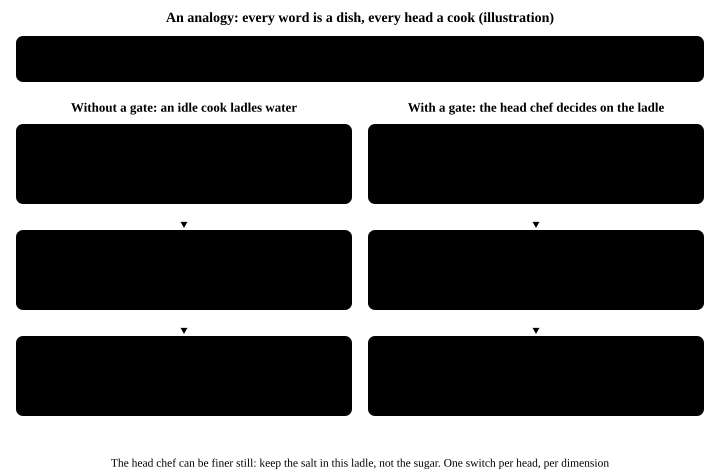
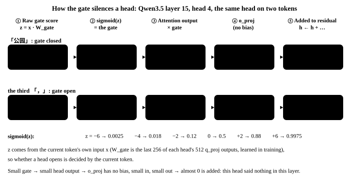
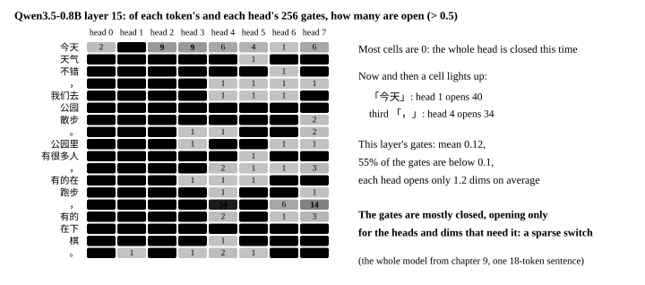
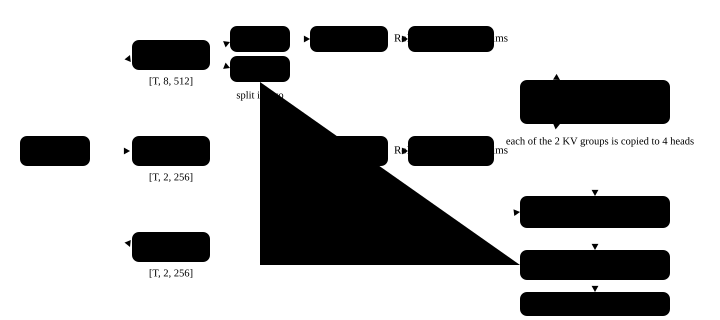

# 6. Gated attention

<p class="lead">Only 6 of the 24 layers are full attention, but they are the model's only means of "looking back precisely": a linear-attention memory table blurs, an attention matrix does not. This chapter first works through attention by hand with three tokens, then covers the four things Qwen3.5 adds to the textbook version. The newest of them is the <strong>output gate</strong>, which lets a head "stay silent this time". Finally we write it and draw the attention matrix with real weights.</p>

!!! abstract "After this chapter you can"
    1. Work a small example by hand and say what scoring, softmax, the weighted sum and the causal mask each do.
    2. Name the four things Qwen3.5's attention adds to the textbook version and what each solves: GQA, QK-Norm, RoPE on 1/4 of the dimensions, the output gate.
    3. Explain the output gate: why a head needs to "stay silent", how a model gets by without a gate, how the gate is computed, how it is learned, and why it lives inside `q_proj`.
    4. Write `qwen/attention.py` and see an attention matrix computed with real weights.

!!! note "What this chapter runs"
    Three small examples that need no model, `ch06_toy.py`, `ch06_gate_toy.py` and `ch06_gate_sgd.py` (1 second each), and `ch06_attention.py` with real weights (about 10 seconds).

@@files@@

## What attention does: three tokens by hand {#注意力在做什么三个-token-手算一遍}

Every token first computes three things: a **query** (what am I looking for), a **key** (the label I carry) and a **value** (the content I can offer). Token i takes the dot product of its query with the key of every token so far, giving a row of scores; softmax turns the row into proportions that add up to exactly 1; mixing the tokens' values in those proportions gives token i's output for this layer.

Do it once by hand with 2-dimensional vectors. The three tokens 「今天」「天气」「不错」 ("today", "weather", "not bad") have keys $(1, 0)$, $(0, 1)$, $(0.5, 0.5)$ and values $(2, 0)$, $(0, 2)$, $(1, 1)$; the query of 「不错」 is $(0, 4)$: it is looking for "what is being judged".

1. **Score**: the dot products with the three keys are $0$, $4$, $2$; divided by $\sqrt{2}$ they become $0$, $2.83$, $1.41$.
2. **Softmax**: $e^{0} : e^{2.83} : e^{1.41} \approx 1 : 16.9 : 4.1$, normalized to $0.045$, $0.768$, $0.187$.
3. **Weighted sum**: $0.045 \times (2, 0) + 0.768 \times (0, 2) + 0.187 \times (1, 1) = (0.277,\ 1.723)$.

「不错」 gives 77% of its attention to 「天气」, so what it brings back is mostly the content of 「天气」. Check it with code:

```python title="ch06_toy.py"
"""第 6 章（一）：三个 token、两维向量，手算一遍注意力；再看 softmax 为什么不让一个头"交白卷" """
import math

import torch

words = ["今天", "天气", "不错"]
k = torch.tensor([[1.0, 0.0], [0.0, 1.0], [0.5, 0.5]])      # each token's key: the "label" others look it up by
v = torch.tensor([[2.0, 0.0], [0.0, 2.0], [1.0, 1.0]])      # each token's value: the "content" that gets taken
q = torch.tensor([0.0, 4.0])                                # the query of 「不错」 ("not bad"): it is looking for "what is being judged"

scores = k @ q / math.sqrt(2)                               # 1. score: dot product with every key, divided by √d (d = 2)
w = torch.softmax(scores, dim=-1)                           # 2. softmax: turn the scores into proportions that add up to exactly 1
out = w @ v                                                 # 3. weighted sum: mix the values by those proportions
r = lambda t, n=3: [round(x, n) for x in t.tolist()]
print(f"「不错」给三个 token 打的分：{r(scores, 2)}")
print(f"softmax 之后的比例：{r(w)}，加起来 {w.sum():.3f}")
print(f"输出 = 比例 × value 再相加：{r(out)}")

Q = torch.tensor([[0.0, 0.0], [3.0, 0.0], [0.0, 4.0]])      # 4. all three tokens at once: one query per row
mask = torch.ones(3, 3, dtype=torch.bool).triu(1)          # causal mask: fill the upper triangle with −inf, so row i only sees the first i tokens
W = torch.softmax((Q @ k.T / math.sqrt(2)).masked_fill(mask, float("-inf")), dim=-1)
print("三行一起算、加上因果掩码（行 = query，列 = key）：")
for word, row in zip(words, W):
    print(f"  {word}  {r(row)}")

q0 = torch.tensor([0.0, 0.0])                               # 5. this head has nothing it wants to look at this time: the query is all zeros
w0 = torch.softmax(k @ q0 / math.sqrt(2), dim=-1)
print(f"什么都不想看时的比例：{r(w0)} → 输出 {r(w0 @ v)}：还是交了一份平均值")
g = torch.sigmoid(torch.tensor(-6.0))                       # 6. with a gate: multiply the output by sigmoid(−6)
print(f"乘上门 sigmoid(−6) = {g:.4f} → 输出 {r(w0 @ v * g, 4)}：这次真的没发言")
```

```text title="output"
「不错」给三个 token 打的分：[0.0, 2.83, 1.41]
softmax 之后的比例：[0.045, 0.768, 0.187]，加起来 1.000
输出 = 比例 × value 再相加：[0.277, 1.723]
三行一起算、加上因果掩码（行 = query，列 = key）：
  今天  [1.0, 0.0, 0.0]
  天气  [0.893, 0.107, 0.0]
  不错  [0.045, 0.768, 0.187]
什么都不想看时的比例：[0.333, 0.333, 0.333] → 输出 [1.0, 1.0]：还是交了一份平均值
乘上门 sigmoid(−6) = 0.0025 → 输出 [0.0025, 0.0025]：这次真的没发言
```

Part 4 computes all three rows at once: each row is one token's query, and the **causal mask** fills the upper triangle with $-\infty$, which softmax turns into 0, so 「今天」 only sees itself and 「天气」 only sees the first two. Parts 5 and 6 come back when we get to the output gate.

## The formula {#公式}

Stack the queries, keys and values of all tokens into matrices $Q$, $K$, $V$ (one token per row). One head's attention is

$$
\mathrm{Attention}(Q, K, V) = \mathrm{softmax}\!\left(\frac{QK^\top}{\sqrt{d}} + M\right) V
$$

- $QK^\top$ computes the score of every (query, key) pair at once; its shape is $T \times T$.
- $M$ is the causal mask: $-\infty$ above the diagonal, 0 elsewhere.
- Dividing by $\sqrt{d}$: the dot product of $d$-dimensional vectors grows with $d$, and when scores get too large softmax nearly becomes a one-hot and the gradients become tiny. Qwen3.5's head dimension is $d = 256$, so dividing by 16 pulls the scores back into a normal range.
- Softmax is taken per row: every row adds up to 1.

Multi-head attention runs this side by side many times: Qwen3.5's full-attention layers have 8 query heads, each with its own 256-dimensional q, k, v; the 8 head outputs are concatenated and `o_proj` maps them back to 1024 dimensions.

## Four things Qwen3.5 adds to the textbook {#qwen35-比教科书多的四样东西}

**GQA saves KV cache.** The 8 query heads have only 2 key/value groups, each shared by 4 query heads. The keys and values stored per token drop from $8 \times 256 \times 2 = 4096$ numbers to $2 \times 256 \times 2 = 1024$, a 4× difference in inference memory and bandwidth (chapter 10 does the arithmetic). The quality loss is small, because several heads looking at the same keys were redundant anyway.

**QK-Norm prevents exploding logits.** During training the scale of $q$ and $k$ drifts; once the dot products get large, softmax degenerates into a one-hot. Passing $q$ and $k$ each through an RMSNorm before RoPE pins the scale of the dot product. Qwen3 introduced it, Qwen3.5 keeps it.

**RoPE rotates only the first 64 dimensions.** As chapter 5 showed, only the first 64 of each head's 256 dimensions rotate with position; the other 192 do not, and are left for position-free matching.

**The output gate is new in this generation.** `q_proj` computes two things at once: one half is the query, the other half goes through a sigmoid and becomes a gate, multiplied into this head's output dimension by dimension. The next section is all about it.

## The output gate: letting a head "stay silent" {#输出门让一个头可以不发言}

### Without a gate: the first token becomes a trash can {#没有门时把第一个-token-养成垃圾桶}

Back to part 5 of `ch06_toy.py`: a head has nothing it wants to look at this time, its query is all zeros, every score is the same, and softmax still hands out $1/3$, $1/3$, $1/3$, so the output is the average of the three values. **The proportions of softmax must add up to 1, so a head cannot hand in a blank sheet.** The average it hands in is added to the residual stream as noise.

Trained models find a workaround: pick a token that every query can see (under the causal mask only the first token qualifies) and learn to make its value almost a zero vector. A head with nothing to do dumps all its attention there, brings back roughly 0, and has effectively said nothing. This is called an **attention sink**. An analogy:

{.aig-svg}

Real models really do this. [The attention chapter of the LLM handbook](llm://transformer/attention/#真实模型里的注意力注意力汇聚) measured it on Qwen3-0.6B, which has no gate: from layer 6 on, the second half of the queries give 40%–77% of their attention to the first token, while an even split would give about 5%. Measuring Qwen3.5-0.8B, which has the gate, with the same sentence and the same method (chapter 9 measures it again once the whole model is assembled):

{.aig-svg}

The two models differ in more than the gate (number of layers, linear attention, training data), but the Qwen team ran a controlled comparison in their paper: same model, same data, and adding the gate cut the attention on the first token from 46.7% to 4.8%.

### How the gate is computed: three steps {#门怎么算三步}

The gate does not look at other tokens, only at **the current token's own** input $x$:

1. **Score**: $z = x\,W_{\text{gate}}$. $W_{\text{gate}}$ is the last 256 of each head's 512 outputs in `q_proj`, so every head and every dimension gets a score.
2. **Squeeze into 0–1**: $g = \mathrm{sigmoid}(z)$. At $z = -6$ the gate is 0.0025, at $z = 0$ it is 0.5, at $z = 6$ it is 0.9975.
3. **Multiply dimension by dimension**: the head's attention output $o$ becomes $o \odot g$ before it enters `o_proj`.

Whether a head opens is decided by the current token. Here are toy numbers: 4 features, 2 heads, 2 dimensions per head, with a hand-written $W_{\text{gate}}$ (in a real model it is learned, and nowhere near this readable).

```python title="ch06_gate_toy.py"
"""第 6 章（二）：门由当前 token 自己算出来——同一个头，碰到「书」关上、碰到「她」打开（玩具数字，示意）"""
import torch

x = {"书": torch.tensor([1.0, 0.0, 0.0, 1.0]),              # the current token's input: the toy has only 4 features
     "她": torch.tensor([0.0, 1.0, 0.0, 1.0])}              # [is a noun, is a pronoun, is a verb, a person was mentioned earlier]
W_gate = torch.tensor([                                    # 4 features → 2 heads × 2 dims per head = 4 gate scores (learned in training in a real model)
    [-5.0, -5.0, 2.0, 1.0],                                 # is a noun     pronoun head: dim 0, dim 1 | grammar head: dim 0, dim 1
    [6.0, 5.0, -1.0, -1.0],                                 # is a pronoun
    [-2.0, -2.0, 2.0, 2.0],                                 # is a verb
    [0.5, 0.5, 0.0, 0.0],                                   # a person was mentioned earlier
])
heads = {"书": torch.tensor([[0.8, -0.3], [0.4, 0.9]]),    # what the two heads' attention returned this time (2 dims per head)
         "她": torch.tensor([[1.2, 0.5], [0.3, -0.2]])}    # for 「她」 ("she"), the pronoun head brought back information about 「小红」 (Xiaohong)
r = lambda t, n=3: [round(v, n) for v in t.tolist()]
for w in ("书", "她"):
    z = x[w] @ W_gate                                      # 1. the raw gate score: z = x · W_gate
    g = torch.sigmoid(z).view(2, 2)                        # 2. sigmoid squeezes it into 0–1: one gate per head per dimension
    out = heads[w] * g                                     # 3. multiply it into this head's output, dimension by dimension
    print(f"「{w}」：z = {r(z, 1)}")
    print(f"   代词头：门 {r(g[0])}，输出 {r(heads[w][0], 2)} → {r(out[0])}")
    print(f"   语法头：门 {r(g[1])}，输出 {r(heads[w][1], 2)} → {r(out[1])}")
```

```text title="output"
「书」：z = [-4.5, -4.5, 2.0, 1.0]
   代词头：门 [0.011, 0.011]，输出 [0.8, -0.3] → [0.009, -0.003]
   语法头：门 [0.881, 0.731]，输出 [0.4, 0.9] → [0.352, 0.658]
「她」：z = [6.5, 5.5, -1.0, -1.0]
   代词头：门 [0.998, 0.996]，输出 [1.2, 0.5] → [1.198, 0.498]
   语法头：门 [0.269, 0.269]，输出 [0.3, -0.2] → [0.081, -0.054]
```

「书」 ("book") is a noun: the "pronoun head" has a gate of 0.011 and what it brought back is almost multiplied away. 「她」 ("she") is a pronoun: the same head has a gate of 0.998 and the information about 「小红」 (Xiaohong) it brought back passes almost unchanged. The "grammar head" is the other way round. Every dimension has its own gate, so a gate can be finer still and let through only part of a head's output. And back to part 6 of `ch06_toy.py`: a head with nothing to look at, multiplied by 0.0025, really does say nothing.

### How the gate silences a head: one head in the real model {#门怎么让一个头闭嘴看真实模型里的一个头}

Run a sentence through the whole model assembled in chapter 9 and follow head 4 of layer 15, from the gate score all the way to the residual stream:

{.aig-svg}

`o_proj` has no bias, so a small input gives a small output; the residual stream is only ever added to, never overwritten, so adding almost 0 means this head said nothing in this layer. Across a whole layer, the gates are closed most of the time:

{.aig-svg}

### How the gate is learned {#门是怎么学出来的}

$W_{\text{gate}}$ starts like every other weight, as tiny random numbers (Qwen3.5's `initializer_range` is 0.02), so right after initialization every gate is around 0.5, half open. During training the gradient pushes down the gates that only add noise when open and pulls up the gates that should speak. The smallest example can be followed by hand:

```python title="ch06_gate_sgd.py"
"""第 6 章（三）：门是怎么学出来的——一个能手算的最小例子，看 W_gate 从初始化一步步变成"该开就开、该关就关"。

两种 token：x(问号) = [1, 0]，x(数字) = [0, 1]；门只有 1 维，W_gate 就是两个数 w = [w_问号, w_数字]。
这一层的输出 y = 残差 r + 门 g × 头的输出 o，目标 t = 1，损失 (y − t)² / 2：
  问号：r = 0（残差流里还没有答案），o = 1.0（头找到了答案）     → 门应该开
  数字：r = 1（残差流里已经对了），  o = 0.8（头在这里只会添乱） → 门应该关
"""
import torch

x = torch.tensor([[1.0, 0.0], [0.0, 1.0]])
r, o, t = torch.tensor([0.0, 1.0]), torch.tensor([1.0, 0.8]), torch.tensor([1.0, 1.0])
w = torch.tensor([0.01, -0.02], requires_grad=True)        # initialization: tiny random numbers, so every gate starts near 0.5
for step in range(201):
    g = torch.sigmoid(x @ w)                               # the gate
    loss = ((r + g * o - t) ** 2 / 2).sum()
    w.grad = None
    loss.backward()                                        # gradient = (y − t) × o × g(1 − g) × x
    if step in (0, 1, 2, 5, 20, 50, 200):
        print(f"第 {step:3d} 步：w = [{w[0].item():+.3f}, {w[1].item():+.3f}]，门(问号) {g[0].item():.3f}，门(数字) {g[1].item():.3f}，"
              f"损失 {loss.item():.4f}，梯度 [{w.grad[0].item():+.4f}, {w.grad[1].item():+.4f}]")
    with torch.no_grad():
        w -= 1.0 * w.grad                                  # learning rate 1
```

```text title="output"
第   0 步：w = [+0.010, -0.020]，门(问号) 0.502，门(数字) 0.495，损失 0.2022，梯度 [-0.1244, +0.0792]
第   1 步：w = [+0.134, -0.099]，门(问号) 0.534，门(数字) 0.475，损失 0.1811，梯度 [-0.1161, +0.0758]
第   2 步：w = [+0.250, -0.175]，门(问号) 0.562，门(数字) 0.456，损失 0.1624，梯度 [-0.1077, +0.0725]
第   5 步：w = [+0.550, -0.382]，门(问号) 0.634，门(数字) 0.406，损失 0.1196，梯度 [-0.0849, +0.0626]
第  20 步：w = [+1.365, -1.065]，门(问号) 0.797，门(数字) 0.256，损失 0.0417，梯度 [-0.0330, +0.0313]
第  50 步：w = [+1.980, -1.678]，门(问号) 0.879，门(数字) 0.157，损失 0.0153，梯度 [-0.0129, +0.0134]
第 200 步：w = [+2.835, -2.568]，门(问号) 0.945，门(数字) 0.071，损失 0.0032，梯度 [-0.0029, +0.0030]
```

The gradient at every step is $(y - t) \times o \times g(1 - g) \times x$, that is, "how far off × the head's output × the slope of the sigmoid × the input". At the question mark $y < t$, the gradient is negative, $w_{\text{?}}$ goes up and the gate opens further; at the digit the head only adds noise, $y > t$, and $w_{\text{digit}}$ goes down. After 200 steps the two gates are 0.945 and 0.071. The closer a gate gets to 0 or 1, the smaller $g(1-g)$ and the slower it moves. Nobody tells a real model that "the question mark should open", but it works the same way: wherever letting a (token, head, dimension) through makes the next word easier to predict, the gradient pushes that gate open.

### Why the gate is packed into q_proj {#为什么把门拼在-q_proj-里}

- **Mathematically it is the same as a separate `gate_proj`**: two matrices placed side by side as one, each multiplying its own part.
- **The gate and the query are both decisions of "the current token"**: both come from the same $x$, and neither enters the KV cache; keys and values are looked up by later tokens and have to be cached.
- **One matrix multiplication fewer**: the same reason as the merged `gate_up_proj` in chapter 4: read the weights once and compute everything at once.
- **Interleaved per head**: each head's 512 outputs are "this head's query + this head's gate", so when tensor parallelism splits `q_proj` by heads, each gate travels with its own head and no extra communication is needed.

The cost is $1024 \times 2048 \approx 2.1$M extra parameters per layer, 12.6M over the 6 layers, about 1.7% of the whole model.

### Where the gate came from {#门是怎么来的}

| When | What |
| --- | --- |
| 1997 | LSTM uses sigmoid gates to control the flow of information |
| 2016 | GLU: one linear path and one through a sigmoid, multiplied together (the ancestor of chapter 4's SwiGLU) |
| 2023-06 | Qualcomm's paper *Quantizable Transformers: Removing Outliers by Helping Attention Heads Do Nothing*: heads that "want to do nothing" create huge outliers; it proposes clipped softmax and gated attention |
| 2023-07 | Evan Miller's blog post *Attention Is Off By One*: add 1 to the softmax denominator so that a row may add up to less than 1 |
| 2023-09 | StreamingLLM names the phenomenon attention sink: drop the earliest KV and the model collapses, so the first few tokens must be kept |
| 2025-05 | The Qwen team's *Gated Attention for Large Language Models*: compares 30 ways of adding a gate; a sigmoid gate on the attention output, per dimension, computed from the current token works best; NeurIPS 2025 best paper |
| 2025-09 on | Qwen3-Next and Qwen3.5 adopt this gate |

The same problem has other solutions: OpenAI's gpt-oss gives every head a learnable sink score, which amounts to a "water tank" that is always there.

## The code: qwen/attention.py {#代码qwenattentionpy}

```python title="qwen/attention.py"
"""门控注意力：Qwen3.5 的全注意力层，24 层里的 6 层。

和教科书的多头注意力比有四处不同：GQA（8 个 query 头共用 2 组 key/value）、QK-Norm（q 和 k 各过一个
RMSNorm 再旋转）、只旋转前 1/4 维的 RoPE、以及输出门——q_proj 一次算出两份，一份当 query，
一份过 sigmoid 当门，逐维乘在注意力的输出上。
"""
import math

import torch
import torch.nn as nn

from qwen.norm import RMSNorm
from qwen.rope import apply_rope


class Attention(nn.Module):
    def __init__(self, cfg):
        super().__init__()
        H, self.n_head, self.n_kv, self.d = cfg.hidden_size, cfg.num_attention_heads, cfg.num_key_value_heads, cfg.head_dim
        self.q_proj = nn.Linear(H, self.n_head * self.d * 2, bias=False)   # twice as wide: half query, half gate
        self.k_proj = nn.Linear(H, self.n_kv * self.d, bias=False)
        self.v_proj = nn.Linear(H, self.n_kv * self.d, bias=False)
        self.o_proj = nn.Linear(self.n_head * self.d, H, bias=False)
        self.q_norm = RMSNorm(self.d, cfg.rms_norm_eps)                     # normalized per head: only head_dim weights
        self.k_norm = RMSNorm(self.d, cfg.rms_norm_eps)

    def forward(self, x, cos, sin):
        B, T, _ = x.shape
        q, gate = self.q_proj(x).view(B, T, self.n_head, 2 * self.d).chunk(2, dim=-1)   # each head's 512 dims: the first 256 are the query, the last 256 the gate
        k = self.k_proj(x).view(B, T, self.n_kv, self.d)
        v = self.v_proj(x).view(B, T, self.n_kv, self.d)
        q, k = apply_rope(self.q_norm(q), cos, sin), apply_rope(self.k_norm(k), cos, sin)
        q, k, v = (t.transpose(1, 2) for t in (q, k, v))                                  # [B, heads, T, d]
        rep = self.n_head // self.n_kv
        k, v = k.repeat_interleave(rep, dim=1), v.repeat_interleave(rep, dim=1)           # GQA: each KV group is copied to 4 query heads
        scores = q @ k.transpose(-1, -2) / math.sqrt(self.d)                               # [B, heads, T, T]
        causal = torch.ones(T, T, dtype=torch.bool, device=x.device).triu(1)               # upper triangle: later tokens are invisible
        scores = scores.masked_fill(causal, float("-inf"))
        out = torch.softmax(scores, dim=-1) @ v                                            # [B, heads, T, d]
        out = out.transpose(1, 2).reshape(B, T, -1) * torch.sigmoid(gate.reshape(B, T, -1))   # output gate
        return self.o_proj(out)
```

Read it line by line against the shapes:

| Step | Shape | Note |
| --- | --- | --- |
| `q_proj(x)` | `[B, T, 4096]` → `[B, T, 8, 512]` | 512 dims per head: the first 256 are the query, the last 256 the gate |
| `k_proj`, `v_proj` | `[B, T, 2, 256]` | only 2 key/value groups (GQA) |
| `q_norm`, `k_norm` | unchanged | RMSNorm per head, with only 256 weights; then RoPE |
| `repeat_interleave` | `[B, 8, T, 256]` | each KV group is copied to 4 query heads |
| `scores` | `[B, 8, T, T]` | $qk^\top/\sqrt{256}$, the upper triangle filled with $-\infty$ |
| `softmax @ v` | `[B, 8, T, 256]` → `[B, T, 2048]` | normalize per row, then a weighted sum |
| `* sigmoid(gate)` | `[B, T, 2048]` | the output gate: per dimension, how much of this head's output gets through |
| `o_proj` | `[B, T, 1024]` | back to the width of the residual stream |

{.aig-svg}

## Run it: an attention matrix with real weights {#跑起来真实权重上的注意力矩阵}

```python title="ch06_attention.py" ci="loose"
"""第 6 章（四）：门控注意力。用真实权重跑一层，把注意力矩阵和输出门拿出来看"""
import math
import os

import torch
from tokenizers import Tokenizer

from qwen.attention import Attention
from qwen.embedding import Embedding
from qwen.norm import RMSNorm
from qwen.rope import apply_rope, rope_tables
from qwen.weights import Config, find_model, load, load_weights

torch.set_num_threads(max(1, os.cpu_count() // 2))
path = find_model()
cfg = Config.load(path)
W = load_weights(path)
attn = load(Attention(cfg), W, "layers.3.self_attn.")                                          # layer 3 is the first full-attention layer
n = sum(p.numel() for p in attn.parameters())
print(f"一层注意力 {n / 1e6:.1f}M 参数，其中 q_proj {attn.q_proj.weight.numel() / 1e6:.1f}M（一半是门）")

tk = Tokenizer.from_file(str(path / "tokenizer.json"))         # build a real input with the parts from chapters 2 and 3
ids = torch.tensor([tk.encode("今天天气不错，我们去公园").ids])
T = ids.shape[1]
h = load(RMSNorm(cfg.hidden_size, cfg.rms_norm_eps), W, "layers.3.input_layernorm.")(load(Embedding(cfg.vocab_size, cfg.hidden_size), W, "embed_tokens.")(ids))
cos, sin = rope_tables(cfg, torch.arange(T))
y = attn(h, cos, sin)
print(f"输入 {tuple(h.shape)} -> 输出 {tuple(y.shape)}")

with torch.no_grad():                                                                          # 1. compute the attention matrix and look at it: every row sums to 1, the upper triangle is 0
    q, gate = attn.q_proj(h).view(1, T, attn.n_head, 2 * attn.d).chunk(2, dim=-1)
    k = attn.k_proj(h).view(1, T, attn.n_kv, attn.d)
    q, k = apply_rope(attn.q_norm(q), cos, sin), apply_rope(attn.k_norm(k), cos, sin)
    scores = q[0, :, 0] @ k[0, :, 0].T / math.sqrt(attn.d)                                     # query head 0 × its KV group
    probs = torch.softmax(scores.masked_fill(torch.ones(T, T, dtype=torch.bool).triu(1), float("-inf")), dim=-1)
    words = [tk.decode([i]) for i in ids[0].tolist()]
    print("第 0 个头的注意力矩阵（行 = query，列 = key）：")
    for w, row in zip(words, probs):
        print(f"  {w:<4}", " ".join(f"{p:.2f}" for p in row.tolist()))
    g = torch.sigmoid(gate)                                                                    # 2. the output gate: one per token, per head, per dimension
    print(f"输出门的形状 {tuple(g.shape)}：{T} 个 token × {attn.n_head} 个头 × {attn.d} 维，每个数都在 0～1 之间")
print(f"GQA：{attn.n_head} 个 query 头共用 {attn.n_kv} 组 KV，每个 token 要存的 KV 是 {2 * attn.n_kv * attn.d} 个数，不用 GQA 要存 {2 * attn.n_head * attn.d} 个")
```

```text title="output"
一层注意力 7.3M 参数，其中 q_proj 4.2M（一半是门）
输入 (1, 6, 1024) -> 输出 (1, 6, 1024)
第 0 个头的注意力矩阵（行 = query，列 = key）：
  今天   1.00 0.00 0.00 0.00 0.00 0.00
  天气   0.07 0.93 0.00 0.00 0.00 0.00
  不错   0.01 0.97 0.02 0.00 0.00 0.00
  ，    0.00 0.23 0.76 0.00 0.00 0.00
  我们去  0.05 0.01 0.00 0.43 0.50 0.00
  公园   0.00 0.00 0.13 0.21 0.06 0.60
输出门的形状 (1, 6, 8, 256)：6 个 token × 8 个头 × 256 维，每个数都在 0～1 之间
GQA：8 个 query 头共用 2 组 KV，每个 token 要存的 KV 是 1024 个数，不用 GQA 要存 4096 个
```

Every row of the attention matrix adds up to 1 and the upper triangle is all 0: the first token can only see itself, hence the 1.00; 「不错」 gives 97% of its attention to the token before it, 「天气」, just like the hand-worked example at the start; 「公园」 spreads its attention over 「不错」, 「，」, 「我们去」 and itself. This is only head 0 of the first full-attention layer, and the input has only been through the embedding and a normalization (the three linear-attention layers in front of it are not written yet), so it looks like it is doing something local such as "look at the previous word". Such an input also cannot show how the gate is really used: that has to wait until chapter 9 assembles the whole model and feeds in real intermediate results, where the 6 full-attention layers turn out to have gates averaging only 0.07–0.19, closed most of the time.

## Common questions {#常见疑问}

**Does the gate mark "whether this word and this head have anything to do with each other"?**

Roughly, but finer. The gate has shape [token, head, 256]: one number between 0 and 1 for each token, each head, each dimension. It answers "how much of what this head brought back this time should go to the residual stream", and it is decided by the current token alone, without looking at the tokens it attends to.

**What is the difference between the gate and the attention weights? Both are numbers between 0 and 1.**

The attention weights are a row of softmax and decide "which tokens to take from and how much from each"; a row must add up to 1. The gate comes after the taking and decides "whether to keep what was taken"; every number is independent and they can all be 0.

**With the gate, is the attention sink gone completely?**

Not completely. In Qwen3.5 the first token still gets about 12% on average, up to 27% in one layer (the figure above). The gate gives a head a more direct way to stay silent, so there is no need to turn the first token into a trash can, and its value is just an ordinary word.

**Why are only 6 of the 24 layers attention?**

Full attention has to store KV for every token, more and more as the context grows; the other 18 layers use a memory table that does not grow with the context. That is the next chapter.

!!! interview "How to explain it"
    To explain an attention implementation, walking through the shapes is clearest: project → split heads → normalize → rotate → score → mask → softmax → weighted sum → merge heads → gate → project. Then name what each of Qwen3.5's four changes solves: GQA saves KV cache, QK-Norm pins the scale of the dot product, partial rotation keeps some position-free dimensions, the output gate lets a head stay silent. For the gate, give the problem before the solution: softmax forces every head to hand in a weighted average, so a model without a gate has to turn the first token into a trash can whose value is close to 0; the gate is computed from the current token and multiplied into the head's output dimension by dimension, and multiplying by 0 means silence. Finish with numbers: Qwen3-0.6B without a gate pours more than half of its attention into the first token, Qwen3.5 only about a tenth.

## Summary {#小结}

- [x] Attention = score ($q \cdot k / \sqrt{d}$) → causal mask → softmax → mix the values in those proportions; a row of softmax must add up to 1.
- [x] Gated attention = GQA + QK-Norm + partial RoPE + an output gate; `q_proj` is twice as wide, with 512 outputs per head: the first 256 are the query, the last 256 the gate.
- [x] The output gate lets a head stay silent: it is computed from the current token and multiplied in dimension by dimension; a model without a gate turns the first token into a trash can.
- [x] Head 0 of the first layer tends to look at the previous token; GQA cuts the KV stored per token from 4096 numbers to 1024.

## Questions {#思考题}

**1. If every gate of one head is set to 0, what happens to this layer's output and to the residual stream?**

??? success "Answer"
    The head's output is all 0 after the gate; `o_proj` has no bias, so the block belonging to this head stays 0 and the head contributes nothing to the layer's output, while the other heads work as usual. If every gate of the layer is 0, the attention sublayer adds 0 to the residual stream and this layer's attention is effectively skipped.

**2. Why does a model without a gate pick the first token as its trash can, rather than any other token?**

??? success "Answer"
    Under the causal mask, query i can only see the first i tokens. Only the first token is visible to every query, and it always sits in the same place; once its value is learned to be close to 0, every head can pour its attention there at any time and "hand in a blank sheet". This is also why StreamingLLM has to keep the first few tokens when it drops the earliest KV.

**3. If GQA were replaced by MQA (all query heads share 1 KV group), how many numbers would each token store? What is the cost?**

??? success "Answer"
    $1 \times 256 \times 2 = 512$, half of today's and 1/8 of full multi-head attention. The cost is that all 8 query heads can only look up the same keys and take the same values, which reduces expressiveness and costs noticeably more quality than GQA; GQA is the compromise between the two.

**File created in this chapter**: `qwen/attention.py` (chapter 10 adds the state and mask arguments).
