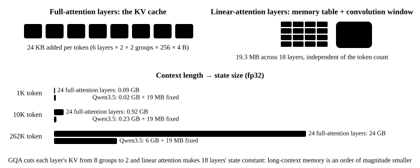

# 10. Two kinds of state: the KV cache and the memory table

<p class="lead">Chapter 9's loop recomputes the whole sequence for every generated token; 38 tokens took 19 seconds. In fact what the earlier tokens computed can be kept: the full-attention layers keep every token's key and value (the <strong>KV cache</strong>, growing with length), the linear-attention layers keep the memory table and a 3-token convolution window (<strong>fixed size</strong>). This chapter gives the model state: prefill once, then compute only one new token per step, taking the speed from 2 tok/s to 20 tok/s; on the way it works out why the hybrid architecture's long-context memory is an order of magnitude smaller than a pure attention model's.</p>

!!! note "What this chapter runs"
    `ch10_cache.py`, about 20 seconds. This chapter changes four files (attention, linear attention, the decoder layer and the whole model each gain a `state` argument, plus the `mask` that chapter 13 needs); the changed lines are highlighted.

@@files@@

## What the state looks like {#状态长什么样}

```python title="qwen/cache.py"
"""两种状态。全注意力层：KV cache，每个 token 追加一份 key/value，随长度增长；
线性注意力层：一张记忆表 S 加一个 3 个 token 的卷积窗口，不管读了多少 token 都是固定大小。
"""
import torch


class AttentionState:
    def __init__(self):
        self.k = self.v = None                                     # [B, kv heads, tokens so far, head_dim], created at the first prefill

    def numel(self):
        return 0 if self.k is None else self.k.numel() + self.v.numel()


class DeltaState:
    def __init__(self, cfg, batch, device, dtype):
        conv_dim = 2 * cfg.linear_num_key_heads * cfg.linear_key_head_dim + cfg.linear_num_value_heads * cfg.linear_value_head_dim
        self.conv = torch.zeros(batch, conv_dim, cfg.linear_conv_kernel_dim - 1, device=device, dtype=dtype)   # the conv input of the last 3 tokens
        self.S = torch.zeros(batch, cfg.linear_num_value_heads, cfg.linear_key_head_dim, cfg.linear_value_head_dim,
                             device=device, dtype=torch.float32)                                                # memory table: [B, heads, dk, dv], always fp32

    def numel(self):
        return self.conv.numel() + self.S.numel()


class State:
    """一次对话的全部状态：每层一个，外加已经处理了多少个 token（下一个 token 的位置）"""

    def __init__(self, model, batch=1):
        p = next(model.parameters())
        self.layers = [AttentionState() if kind == "full_attention" else DeltaState(model.cfg, batch, p.device, p.dtype)
                       for kind in model.cfg.layer_types]
        self.pos = 0                                                       # how many tokens have been processed
        self.mask = None                                                   # [B, pos]: which positions are real tokens when batching

    def megabytes(self):
        return sum(s.numel() for s in self.layers) * 4 / 2 ** 20
```

The difference between the two kinds of state is the one thing this book most wants to say:

| | Full-attention layers (6) | Linear-attention layers (18) |
| --- | --- | --- |
| What is stored | every token's key and value: `[B, 2 groups, T, 256]` × 2 | memory table `[B, 16 heads, 128, 128]` + convolution window `[B, 6144, 3]` |
| Added per token | 2 × 2 × 256 × 4 B = 4 KB (one layer) | 0 |
| What a new token reads | all T keys/values | only this table |

{.aig-svg}

## Change four files {#改四个文件}

Attention: the new tokens' keys/values are appended after the cache and the combined result is stored back. The mask changes too — the $T$ new queries face $S$ keys (history + new), and the $i$-th new token may see up to the $(S - T + i)$-th:

```python title="qwen/attention.py" hl_lines="27 34-38 41-42 44-45"
"""门控注意力：Qwen3.5 的全注意力层，24 层里的 6 层。

和教科书的多头注意力比有四处不同：GQA（8 个 query 头共用 2 组 key/value）、QK-Norm（q 和 k 各过一个
RMSNorm 再旋转）、只旋转前 1/4 维的 RoPE、以及输出门——q_proj 一次算出两份，一份当 query，
一份过 sigmoid 当门，逐维乘在注意力的输出上。
"""
import math

import torch
import torch.nn as nn

from qwen.norm import RMSNorm
from qwen.rope import apply_rope


class Attention(nn.Module):
    def __init__(self, cfg):
        super().__init__()
        H, self.n_head, self.n_kv, self.d = cfg.hidden_size, cfg.num_attention_heads, cfg.num_key_value_heads, cfg.head_dim
        self.q_proj = nn.Linear(H, self.n_head * self.d * 2, bias=False)   # twice as wide: half query, half gate
        self.k_proj = nn.Linear(H, self.n_kv * self.d, bias=False)
        self.v_proj = nn.Linear(H, self.n_kv * self.d, bias=False)
        self.o_proj = nn.Linear(self.n_head * self.d, H, bias=False)
        self.q_norm = RMSNorm(self.d, cfg.rms_norm_eps)                     # normalized per head: only head_dim weights
        self.k_norm = RMSNorm(self.d, cfg.rms_norm_eps)

    def forward(self, x, cos, sin, state=None, mask=None):
        B, T, _ = x.shape
        q, gate = self.q_proj(x).view(B, T, self.n_head, 2 * self.d).chunk(2, dim=-1)   # each head's 512 dims: the first 256 are the query, the last 256 the gate
        k = self.k_proj(x).view(B, T, self.n_kv, self.d)
        v = self.v_proj(x).view(B, T, self.n_kv, self.d)
        q, k = apply_rope(self.q_norm(q), cos, sin), apply_rope(self.k_norm(k), cos, sin)
        q, k, v = (t.transpose(1, 2) for t in (q, k, v))                                  # [B, heads, T, d]
        if state is not None:                                                             # KV cache: append to the previous keys/values, then store the new ones back
            if state.k is not None:
                k, v = torch.cat([state.k, k], dim=2), torch.cat([state.v, v], dim=2)
            state.k, state.v = k, v
        S = k.shape[2]                                                                    # total number of keys (previous + new)
        rep = self.n_head // self.n_kv
        k, v = k.repeat_interleave(rep, dim=1), v.repeat_interleave(rep, dim=1)           # GQA: each KV group is copied to 4 query heads
        scores = q @ k.transpose(-1, -2) / math.sqrt(self.d)                               # [B, heads, T, S]
        causal = torch.ones(T, S, dtype=torch.bool, device=x.device).triu(S - T + 1)       # the i-th new token only sees keys up to S-T+i
        scores = scores.masked_fill(causal, float("-inf"))
        if mask is not None:                                                              # padding when batching: [B, S], keys marked False are visible to no one
            scores = scores.masked_fill(~mask[:, None, None, :], torch.finfo(scores.dtype).min)   # the smallest finite number instead of -inf: when a padding row is fully masked, softmax does not produce NaN
        out = torch.softmax(scores, dim=-1) @ v                                            # [B, heads, T, d]
        out = out.transpose(1, 2).reshape(B, T, -1) * torch.sigmoid(gate.reshape(B, T, -1))   # output gate
        return self.o_proj(out)
```

Linear attention: the convolution window is prepended to the new input (3 columns of zeros without history) and the convolution no longer pads; the memory table starts from `state.S` and is stored back afterwards. The choice "a few tokens: recurrence; a passage: chunked" also lands here — the chunked version pads the length to a multiple of 64, which is slower for one or two tokens:

```python title="qwen/deltanet.py" hl_lines="11 55 57-58 60-64 71-75"
"""Gated DeltaNet：线性注意力层，24 层里的 18 层是它。

它没有"所有 token 两两打分"的注意力矩阵，而是每个头维护一张固定大小的记忆表 S（128×128）。
每来一个 token 就按 delta 规则改写一次：先按 g 衰减，再把"新值 v 和表里已有预测之差"按 β 写进去；
输出是 q 去表里查询。token 再多，表也不会变大——这就是它能撑 262K 上下文的原因。
"""
import torch
import torch.nn as nn
import torch.nn.functional as F

from qwen.chunk import chunked_delta_rule
from qwen.norm import GatedRMSNorm, l2norm


def delta_rule(q, k, v, g, beta, S=None):
    """逐 token 递推。q, k: [B, T, 头, dk]，v: [B, T, 头, dv]；g（对数衰减，≤0）和 beta（写入强度，0~1）: [B, T, 头]。
    S 是开始时的记忆表（没有就从空表开始）；返回输出和算完之后的表。"""
    B, T, n_head, dk = q.shape
    dtype = v.dtype
    q, k, v, g, beta = (t.float() for t in (q, k, v, g, beta))   # the memory table and intermediates are always fp32; bf16 cannot hold hundreds of accumulated steps
    q, k = l2norm(q), l2norm(k)                                   # q and k are normalized to unit length first
    q = q / dk ** 0.5
    if S is None:
        S = q.new_zeros(B, n_head, dk, v.shape[-1])               # one 128×128 memory table per head, empty at the start
    out = torch.empty_like(v)
    for t in range(T):
        S = S * g[:, t].exp()[:, :, None, None]                   # 1. decay: multiply the whole table by a number in (0, 1], forgetting a little
        k_t, v_t = k[:, t], v[:, t]                               # [B, heads, dk], [B, heads, dv]
        pred = torch.einsum("bhk,bhkv->bhv", k_t, S)              # 2. look up with k: what the table thinks v should be
        S = S + torch.einsum("bhk,bhv->bhkv", k_t, (v_t - pred) * beta[:, t, :, None])   # 3. write only the difference (delta)
        out[:, t] = torch.einsum("bhk,bhkv->bhv", q[:, t], S)     # 4. look up with q to get this token's output
    return out.to(dtype), S


class GatedDeltaNet(nn.Module):
    def __init__(self, cfg):
        super().__init__()
        H = cfg.hidden_size
        self.n_k, self.n_v = cfg.linear_num_key_heads, cfg.linear_num_value_heads
        self.dk, self.dv = cfg.linear_key_head_dim, cfg.linear_value_head_dim
        self.key_dim, self.value_dim = self.n_k * self.dk, self.n_v * self.dv            # 2048, 2048
        conv_dim = 2 * self.key_dim + self.value_dim                                       # q, k and v concatenated for the convolution: 6144
        self.in_proj_qkv = nn.Linear(H, conv_dim, bias=False)
        self.in_proj_z = nn.Linear(H, self.value_dim, bias=False)                          # output gate
        self.in_proj_b = nn.Linear(H, self.n_v, bias=False)                                # β: one number per head
        self.in_proj_a = nn.Linear(H, self.n_v, bias=False)                                # the input-dependent part of the decay
        self.conv1d = nn.Conv1d(conv_dim, conv_dim, cfg.linear_conv_kernel_dim, groups=conv_dim,
                                padding=cfg.linear_conv_kernel_dim - 1, bias=False)        # depthwise causal short convolution: each channel only sees its own previous 3 tokens
        self.dt_bias = nn.Parameter(torch.ones(self.n_v))
        self.A_log = nn.Parameter(torch.zeros(self.n_v))
        self.norm = GatedRMSNorm(self.dv, cfg.rms_norm_eps)
        self.out_proj = nn.Linear(self.value_dim, H, bias=False)

    def forward(self, x, state=None, mask=None):
        B, T, _ = x.shape
        if mask is not None:
            x = x * mask[..., None]                                                        # padding when batching: [B, T]; once zeroed it neither enters the memory table nor the convolution
        qkv = self.in_proj_qkv(x).transpose(1, 2)                                          # [B, 6144, T]
        window = state.conv if state is not None else qkv.new_zeros(B, qkv.shape[1], self.conv1d.padding[0])
        qkv = torch.cat([window, qkv], dim=-1)                                             # prepend the previous 3 tokens (zeros without history)
        if state is not None:
            state.conv = qkv[..., -self.conv1d.padding[0]:]                                # keep the last 3 tokens for next time
        qkv = F.silu(F.conv1d(qkv, self.conv1d.weight, groups=qkv.shape[1])).transpose(1, 2)   # causal convolution + SiLU: the output length is exactly T
        q, k, v = qkv.split([self.key_dim, self.key_dim, self.value_dim], dim=-1)
        q, k, v = q.view(B, T, self.n_k, self.dk), k.view(B, T, self.n_k, self.dk), v.view(B, T, self.n_v, self.dv)
        if self.n_v > self.n_k:                                                            # bigger models have more value heads than key heads: repeat q and k
            q, k = q.repeat_interleave(self.n_v // self.n_k, 2), k.repeat_interleave(self.n_v // self.n_k, 2)
        beta = self.in_proj_b(x).sigmoid()                                                 # [B, T, heads], in (0, 1)
        g = -self.A_log.exp() * F.softplus(self.in_proj_a(x) + self.dt_bias)               # log decay, always ≤ 0
        S = state.S if state is not None else None
        rule = delta_rule if T <= 16 else chunked_delta_rule                               # a few tokens: recurrent; a passage: chunked (the chunked version pads to a multiple of 64)
        out, S = rule(q, k, v, g, beta, S)
        if state is not None:
            state.S = S
        out = self.norm(out, self.in_proj_z(x).view(B, T, self.n_v, self.dv))             # gated normalization per head
        return self.out_proj(out.reshape(B, T, -1))
```

The decoder layer only passes the state and the mask down:

```python title="qwen/layer.py" hl_lines="22 24"
"""解码层：一层 = 一个 token 混合器（全注意力或线性注意力）+ 一个前馈网络，各带一个前置 RMSNorm 和一条残差。"""
import torch.nn as nn

from qwen.attention import Attention
from qwen.deltanet import GatedDeltaNet
from qwen.mlp import MLP
from qwen.norm import RMSNorm


class DecoderLayer(nn.Module):
    def __init__(self, cfg, kind):
        super().__init__()
        self.kind = kind                                                   # "full_attention" or "linear_attention"
        if kind == "full_attention":
            self.self_attn = Attention(cfg)
        else:
            self.linear_attn = GatedDeltaNet(cfg)
        self.mlp = MLP(cfg)
        self.input_layernorm = RMSNorm(cfg.hidden_size, cfg.rms_norm_eps)
        self.post_attention_layernorm = RMSNorm(cfg.hidden_size, cfg.rms_norm_eps)

    def forward(self, x, cos, sin, state=None, mask=None, kv_mask=None):
        h = self.input_layernorm(x)
        h = self.self_attn(h, cos, sin, state, kv_mask) if self.kind == "full_attention" else self.linear_attn(h, state, mask)
        x = x + h                                                          # residual: the mixer only *adds* to the residual stream
        return x + self.mlp(self.post_attention_layernorm(x))
```

The whole model: positions start counting from `state.pos` (RoPE's angle has to keep turning), and every layer takes its own share of the state. `mask` is all `True` in this chapter; chapter 13's batching is where padding appears:

```python title="qwen/model.py" hl_lines="31-39 41-45"
"""整模型：嵌入 -> 24 个解码层 -> 最后的 RMSNorm -> 输出层。从这个文件起，前向里没有一行 Hugging Face 的代码。"""
import torch
import torch.nn as nn

from qwen.embedding import Embedding, LMHead
from qwen.layer import DecoderLayer
from qwen.norm import RMSNorm
from qwen.rope import rope_tables
from qwen.weights import Config, find_model, load_weights


class Model(nn.Module):
    def __init__(self, cfg):
        super().__init__()
        self.cfg = cfg
        self.embed_tokens = Embedding(cfg.vocab_size, cfg.hidden_size)
        self.layers = nn.ModuleList(DecoderLayer(cfg, kind) for kind in cfg.layer_types)
        self.norm = RMSNorm(cfg.hidden_size, cfg.rms_norm_eps)
        self.lm_head = LMHead(self.embed_tokens.weight)                       # shares weights with the embedding

    @classmethod
    def from_pretrained(cls, path=None, dtype=torch.float32):
        path = path or find_model()
        model = cls(Config.load(path))
        missing, unexpected = model.load_state_dict(load_weights(path, dtype=dtype), strict=False, assign=True)   # assign=True: take over the tensors instead of copying
        assert not unexpected and missing == ["lm_head.weight"], (missing, unexpected)   # no lm_head in the file: it is the embedding
        model.lm_head.weight = model.embed_tokens.weight                                  # after the take-over the embedding table is a new object; point the output layer at it again
        return model.to(dtype).eval()

    @torch.no_grad()
    def forward(self, ids, state=None, mask=None):
        """ids: [B, T] -> logits [B, T, 词表]。带 state 时 ids 是接在已有 token 后面的新 token；
        mask: [B, T]，批处理时标出哪些是填充位（第 13 章），不传就全是真 token。"""
        if mask is None:
            mask = torch.ones_like(ids, dtype=torch.bool)
        if state is not None:                                                     # the mask of the whole conversation accumulates: attention keys include earlier tokens
            state.mask = mask if state.mask is None else torch.cat([state.mask, mask], dim=1)
        kv_mask = state.mask if state is not None else mask
        positions = (kv_mask.cumsum(1) - 1).clamp(min=0)[:, -ids.shape[1]:]       # each row counts its own positions: padding does not count
        x = self.embed_tokens(ids)
        cos, sin = rope_tables(self.cfg, positions)
        for i, layer in enumerate(self.layers):
            x = layer(x, cos, sin, state.layers[i] if state is not None else None, mask, kv_mask)
        if state is not None:
            state.pos += ids.shape[1]
        return self.lm_head(self.norm(x))
```

## How much faster, and is it right {#快了多少对不对}

```python title="ch10_cache.py" ci="loose"
"""第 10 章：prefill 一次 + 逐 token 解码；和无状态重算逐位对；算两种状态的大小"""
import os
import time

import torch
from tokenizers import Tokenizer

from qwen.cache import State
from qwen.model import Model
from qwen.weights import find_model

torch.set_num_threads(max(1, os.cpu_count() // 2))
max_diff = lambda a, b: (a - b).abs().max().item()
path = find_model()
model = Model.from_pretrained(path)
tk = Tokenizer.from_file(str(path / "tokenizer.json"))
prompt = "<|im_start|>user\n用一句话介绍一下 Transformer。<|im_end|>\n<|im_start|>assistant\n<think>\n\n</think>\n\n"
ids = torch.tensor([tk.encode(prompt).ids])
STOP = {tk.token_to_id("<|im_end|>"), tk.token_to_id("<|endoftext|>")}

state = State(model)                                                 # 1. prefill: the whole prompt in one pass, the state stays
t = time.time()
nxt = model(ids, state)[0, -1].argmax()
t_prefill = time.time() - t
new = [nxt.item()]
t = time.time()
while len(new) < 40 and new[-1] not in STOP:                         # 2. decode: one token per step
    nxt = model(nxt.view(1, 1), state)[0, -1].argmax()
    new.append(nxt.item())
dt = time.time() - t
print(f"prefill {ids.shape[1]} 个 token {t_prefill * 1000:.0f} ms；decode {len(new)} 个 token {dt:.2f} 秒 = {len(new) / dt:.1f} tok/s（第 9 章是 2 tok/s）")
print(tk.decode(new))
print(f"状态：已处理 {state.pos} 个 token，占 {state.megabytes():.1f} MB")

full = torch.tensor([ids[0].tolist() + new])                         # 3. do the stateful logits match a stateless recomputation?
ref = model(full)[0]
state = State(model)
got = [model(full[:, :ids.shape[1]], state)[0, -1]]                  # prefill the prompt, then feed the generated tokens one by one
for j in range(ids.shape[1], full.shape[1] - 1):
    got.append(model(full[:, j:j + 1], state)[0, -1])
print(f"逐 token 解码 vs 整段重算：logits 最大差 {max_diff(torch.stack(got), ref[ids.shape[1] - 1:-1]):.1e}")
state = State(model)                                                 # 4. prefill in several segments (this is what multi-turn chat does)
a, b = model(full[:, :10], state)[0], model(full[:, 10:30], state)[0]
c = model(full[:, 30:], state)[0]
print(f"分三段喂（10 + 20 + {full.shape[1] - 30}）vs 整段：logits 最大差 {max_diff(torch.cat([a, b, c]), ref):.1e}")

cfg = model.cfg                                                      # 5. the size of the two kinds of state (fp32)
kv_per_token = cfg.layer_types.count("full_attention") * 2 * cfg.num_key_value_heads * cfg.head_dim * 4
fixed = cfg.layer_types.count("linear_attention") * (cfg.linear_num_value_heads * cfg.linear_key_head_dim * cfg.linear_value_head_dim
                                                      + (2 * cfg.linear_num_key_heads * cfg.linear_key_head_dim + cfg.linear_num_value_heads * cfg.linear_value_head_dim) * 3) * 4
print(f"每个 token 的 KV cache：6 层 × 2 × 2 组 × 256 维 × 4 B = {kv_per_token / 1024:.0f} KB；18 层线性注意力的状态固定 {fixed / 2 ** 20:.1f} MB")
for T in (1000, 10_000, 262_144):
    print(f"  上下文 {T:>7} 个 token：KV cache {kv_per_token * T / 2 ** 30:6.2f} GB，如果 24 层全是注意力则是 {kv_per_token * T * 4 / 2 ** 30:6.2f} GB")
```

```text title="输出"
prefill 17 个 token 144 ms；decode 38 个 token 1.95 秒 = 19.4 tok/s（第 9 章是 2 tok/s）
Transformer 是一种基于深度学习的神经网络架构，通过自注意力机制解决了传统卷积神经网络在处理长距离依赖和复杂语义关系时的局限性，从而实现了强大的语言理解与生成能力。
状态：已处理 54 个 token，占 20.5 MB
逐 token 解码 vs 整段重算：logits 最大差 2.9e-05
分三段喂（10 + 20 + 25）vs 整段：logits 最大差 4.9e-05
每个 token 的 KV cache：6 层 × 2 × 2 组 × 256 维 × 4 B = 24 KB；18 层线性注意力的状态固定 19.3 MB
  上下文    1000 个 token：KV cache   0.02 GB，如果 24 层全是注意力则是   0.09 GB
  上下文   10000 个 token：KV cache   0.23 GB，如果 24 层全是注意力则是   0.92 GB
  上下文  262144 个 token：KV cache   6.00 GB，如果 24 层全是注意力则是  24.00 GB
```

Three things:

- **10× faster**: the compute per decode step shrinks from "the whole sequence" to "one token"; what remains is mostly reading 3 GB of weights from memory once — which is why decode is memory-bound and almost independent of the sequence length.
- **Element by element the same**: the logits with and without state differ by about 1e-5, and so does segmented prefill. Multi-turn chat and prefix caching are, at bottom, "segmented prefill".
- **The KV cache of a 262K context is only 6 GB** (fp32; half that in bf16), while 24 full-attention layers would need 24 GB. The linear-attention layers' state is under 20 MB regardless of length. This is the direct payoff of Qwen3.5's 3 : 1 mix.

!!! interview "How to explain it"
    To explain the KV cache, first say what it caches (every layer's keys and values per token, not the attention scores), then why decode is memory-bound (every token reads all the weights plus the whole KV cache, but computes little). Then do the hybrid architecture's arithmetic: GQA cuts the KV per token from 8 groups to 2, linear attention turns 18 layers' state into a constant, and together they make long-context memory an order of magnitude smaller than a Llama-style model of the same size. Being able to say that "a recurrent state cannot be truncated and rolled back like a KV cache" (chapter 14's speculative decoding runs into this) shows you have thought about the engineering details.

## Summary {#小结}

- [x] Two kinds of state: the KV cache grows with length (24 KB per token across 6 layers), the linear attention's memory table + convolution window are fixed (19 MB across 18 layers).
- [x] Prefill once + decode token by token, element by element the same as recomputing the whole sequence; decode speed 2 → 20 tok/s.
- [x] The KV cache of a 262K context is 6 GB (fp32); a pure attention model would need 24 GB.

**File created in this chapter**: `qwen/cache.py`; **files changed**: `qwen/attention.py`, `qwen/deltanet.py`, `qwen/layer.py`, `qwen/model.py`.
