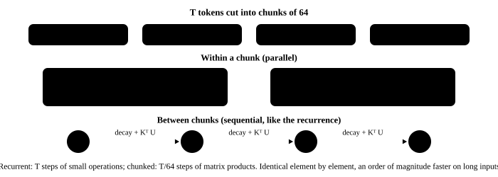

# 8. Gated DeltaNet: chunked parallelism

<p class="lead">One step of the previous chapter's recurrence does a few small 128 × 128 operations, and T tokens mean T iterations of a Python loop; a GPU is nowhere near busy — this is exactly why linear attention was "fast in theory, slow in practice" for years. Cut the sequence into chunks of 64 tokens: the 64 "decay + write" steps within a chunk combine into one lower-triangular linear system, and a single triangular solve gives what each token really writes; between chunks, a single table is passed along just like the recurrence. The result is the same as the token-by-token version and the speed differs by an order of magnitude.</p>

!!! note "What this chapter runs"
    `ch08_chunk.py`, about 15 seconds.

@@files@@

## Within a chunk: 64 recurrence steps become matrix products {#块内把-64-步递推变成矩阵乘}

Ignore the decay for a moment. A chunk has 64 tokens; starting from the chunk-start state $S_0$, write 64 times:

$$
S_t = S_{t-1} + \beta_t k_t (v_t - S_{t-1}^\top k_t)^\top = S_{t-1}\,(I - \beta_t k_t k_t^\top) + \beta_t k_t v_t^\top
$$

Every step is "multiply by an $(I - \beta k k^\top)$ and add a rank-one matrix". Unrolling 64 steps, the chunk-end state can be written as $S_{64} = S_0 \cdot \prod(\cdots) + K^\top U$, where each row $u_t$ of $U$ is the vector the $t$-th token **really writes** — it equals $\beta_t v_t$ minus the "cancellation" by the writes of the $t-1$ tokens before it. That cancellation is a lower-triangular system:

$$
(I + A)\,U = \beta \odot V, \qquad A_{ij} = \beta_i\, k_i^\top k_j \ (j < i)
$$

It is solved with one `solve_triangular` (a 64 × 64 lower-triangular matrix per head) instead of a 64-step loop. With $U$ in hand, every position's output within the chunk = reading the chunk-start state ($Q S_0$) + reading the new writes within the chunk ($(QK^\top)_{\text{causal}} U$), two matrix products. With the decay, every term is multiplied by its cumulative decay factor, which is what the `G.exp()` expressions in the code are. In the literature this transformation is called the WY representation / UT transform, and `chunk_gated_delta_rule` in the FlashLinearAttention library is its CUDA version.

{.aig-svg}

```python title="qwen/chunk.py"
"""Gated DeltaNet 的分块并行版：块内用几次矩阵乘一次算完，块与块之间只传一张状态表 S。

逐 token 递推一步只做几个小矩阵运算，T 个 token 就是 T 次 Python 循环，GPU 完全吃不饱。
把序列切成 64 个 token 一块：块内 64 次"衰减 + 写入"合起来是一个下三角线性方程组（WY 表示），
用一次三角求解得到每个 token 真正写入的差值 u；然后块与块之间像递推一样传 S。结果和逐 token 版一样，误差在 1e-5 量级。
"""
import torch
import torch.nn.functional as F

from qwen.norm import l2norm


def chunked_delta_rule(q, k, v, g, beta, S=None, chunk=64):
    """和 delta_rule 同样的输入输出：q, k: [B, T, 头, dk]，v: [B, T, 头, dv]，g、beta: [B, T, 头]；S 是初始的记忆表"""
    B, T, n_head, dk = q.shape
    dv, dtype = v.shape[-1], v.dtype
    q, k, v, g, beta = (t.float() for t in (q, k, v, g, beta))                   # the memory table and intermediates are always fp32 (bf16 cannot hold 64 accumulated steps)
    q, k = l2norm(q), l2norm(k)
    q = q / dk ** 0.5
    q, k, v = (t.transpose(1, 2) for t in (q, k, v))                               # [B, heads, T, d]
    g, beta = g.transpose(1, 2), beta.transpose(1, 2)                               # [B, heads, T]
    pad = (chunk - T % chunk) % chunk                                               # pad to a multiple of chunk
    q, k, v = (F.pad(t, (0, 0, 0, pad)) for t in (q, k, v))
    g, beta = F.pad(g, (0, pad)), F.pad(beta, (0, pad))
    n = (T + pad) // chunk
    q, k, v = (t.reshape(B, n_head, n, chunk, -1) for t in (q, k, v))               # [B, heads, chunks, chunk length, d]
    g, beta = g.reshape(B, n_head, n, chunk), beta.reshape(B, n_head, n, chunk)

    G = g.cumsum(-1)                                                                # cumulative decay within the chunk (log): total decay from the chunk start to token t
    upper = torch.ones(chunk, chunk, dtype=torch.bool, device=q.device).triu(1)
    decay = (G[..., :, None] - G[..., None, :]).masked_fill(upper, float("-inf")).exp()   # decay[i, j] = decay from j to i (0 when j > i)
    k_beta, v_beta = k * beta[..., None], v * beta[..., None]
    A = (k_beta @ k.transpose(-1, -2)) * decay                                      # how much each pair of tokens in the chunk cancels each other's writes
    u = torch.linalg.solve_triangular(A, v_beta, upper=False, unitriangular=True)   # solve the lower-triangular system: what each token really writes (before subtracting the chunk-start state's prediction)
    w = torch.linalg.solve_triangular(A, k_beta * G.exp()[..., None], upper=False, unitriangular=True)   # coefficients for reading predictions from the chunk-start state
    attn = (q @ k.transpose(-1, -2)) * decay                                        # the "attention" of q over k within the chunk
    q_decay = q * G.exp()[..., None]                                                # when reading the chunk-start state, q carries the decay from the chunk start to itself
    k_decay = k * (G[..., -1:] - G).exp()[..., None]                                # when writing the state, k carries the decay from itself to the chunk end
    chunk_decay = G[..., -1].exp()                                                  # total decay of the whole chunk

    if S is None:
        S = q.new_zeros(B, n_head, dk, dv)
    out = torch.zeros_like(v)
    for i in range(n):                                                              # between chunks: only S is passed, like the recurrence
        u_i = u[:, :, i] - w[:, :, i] @ S                                           # subtract what the chunk-start state already predicts: the real delta
        out[:, :, i] = q_decay[:, :, i] @ S + attn[:, :, i] @ u_i                   # output = read the chunk-start state + read the new writes within the chunk
        S = S * chunk_decay[:, :, i, None, None] + k_decay[:, :, i].transpose(-1, -2) @ u_i   # decay the whole chunk once, then add the chunk's writes in one go
    out = out.reshape(B, n_head, n * chunk, dv)[:, :, :T].transpose(1, 2).contiguous()   # drop the padding, back to [B, T, heads, dv]
    return out.to(dtype), S
```

## Compare and time {#对数计时}

```python title="ch08_chunk.py" ci="loose"
"""第 8 章：分块版和递推版对答案、比速度；一层真实的线性注意力过一段长输入"""
import os
import time

import torch
from tokenizers import Tokenizer

import qwen.deltanet
from qwen.chunk import chunked_delta_rule
from qwen.deltanet import GatedDeltaNet, delta_rule
from qwen.embedding import Embedding
from qwen.norm import RMSNorm
from qwen.weights import Config, find_model, load, load_weights

torch.set_num_threads(max(1, os.cpu_count() // 2))
diff = lambda a, b: (a - b).abs().max().item()
torch.manual_seed(0)
B, H, d = 1, 16, 128
for T in (5, 64, 65, 512, 2048):                                     # 1. random input: the two versions match element by element, timed on the side
    q, k, v = (torch.randn(B, T, H, d) for _ in range(3))
    g, beta = -torch.rand(B, T, H) * 0.5, torch.rand(B, T, H)
    t = time.time()
    o1, S1 = delta_rule(q, k, v, g, beta)
    t1 = time.time() - t
    t = time.time()
    o2, S2 = chunked_delta_rule(q, k, v, g, beta)
    t2 = time.time() - t
    print(f"T={T:4d}：输出最大差 {diff(o1, o2):.1e}，末状态最大差 {diff(S1, S2):.1e}；递推 {t1 * 1000:6.0f} ms，分块 {t2 * 1000:5.0f} ms")

path = find_model()                                                  # 2. one real linear-attention layer over a long input: recurrent vs. chunked
cfg = Config.load(path)
W = load_weights(path)
tk = Tokenizer.from_file(str(path / "tokenizer.json"))
ids = torch.tensor([tk.encode("。".join(["今天天气不错，我们去公园"] * 40)).ids])
h = load(RMSNorm(cfg.hidden_size, cfg.rms_norm_eps), W, "layers.0.input_layernorm.")(load(Embedding(cfg.vocab_size, cfg.hidden_size), W, "embed_tokens.")(ids))
dn = load(GatedDeltaNet(cfg), W, "layers.0.linear_attn.")
outs = {}
for name, rule in (("递推", delta_rule), ("分块", chunked_delta_rule)):
    qwen.deltanet.delta_rule = rule                                  # chapter 7's module calls the module-level delta_rule; swap in the chunked version here (chapter 10 changes it properly)
    t = time.time()
    outs[name] = dn(h)
    print(f"{ids.shape[1]} 个 token 过一层线性注意力，{name}：{(time.time() - t) * 1000:.0f} ms")
print(f"两种算法在这一层上的输出最大差：{diff(outs['递推'], outs['分块']):.1e}")
```

```text title="输出"
T=   5：输出最大差 2.2e-08，末状态最大差 1.2e-07；递推      4 ms，分块     5 ms
T=  64：输出最大差 5.2e-08，末状态最大差 3.6e-07；递推     20 ms，分块     3 ms
T=  65：输出最大差 3.4e-08，末状态最大差 3.0e-07；递推     15 ms，分块     5 ms
T= 512：输出最大差 4.5e-08，末状态最大差 7.2e-07；递推    111 ms，分块    13 ms
T=2048：输出最大差 7.1e-08，末状态最大差 6.6e-07；递推    428 ms，分块    49 ms
279 个 token 过一层线性注意力，递推：283 ms
279 个 token 过一层线性注意力，分块：30 ms
两种算法在这一层上的输出最大差：3.6e-07
```

The two versions agree element by element at every length (differences around 1e-7, purely the order of summation); one real linear-attention layer over 279 tokens is nearly ten times faster chunked. The Hugging Face implementation uses this very algorithm for prefill (without `flash-linear-attention` installed it falls back to a PyTorch implementation like ours).

!!! interview "How to explain it"
    To explain "why linear attention can be trained in parallel": the recurrent form makes every step depend on the previous one, but the 64 steps within a chunk can be written as one lower-triangular system plus two matrix products, and only the state is passed between chunks; this is the same idea as Mamba-2's SSD and FlashLinearAttention's chunk algorithm. Be clear about "why chunk rather than parallelize everything": fully parallel intermediates are $T \times T$, back to attention's quadratic cost; a chunk length of 64 is the compromise between parallelism and the size of the intermediates.

## Summary {#小结}

- [x] Within a chunk: one triangular solve of $(I + A)U = \beta \odot V$ gives the real writes; the output = read the chunk-start state + read the writes within the chunk; between chunks: pass one table.
- [x] Element by element the same as the recurrence, an order of magnitude faster on long inputs; the production implementations (FlashLinearAttention, HF's prefill) use this very algorithm.

**File created in this chapter**: `qwen/chunk.py`.
