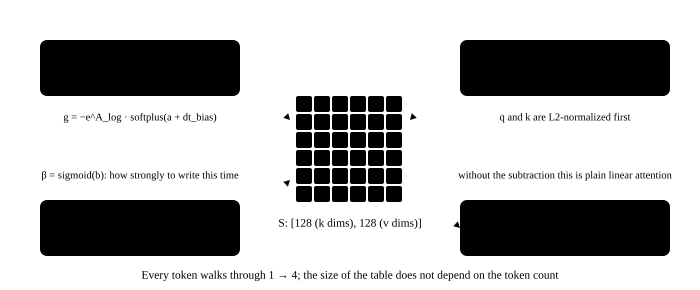

# 7. Gated DeltaNet: the token-by-token recurrence

<p class="lead">18 of the 24 layers are linear attention. It has no $T \times T$ matrix of "every token scoring every other"; instead each head keeps a <strong>fixed-size memory table</strong> $S$ (128 × 128) that is rewritten once per token by the delta rule — decay first, then write in "the difference between the new value and what the table already predicts". The output is the query looking the table up. However many tokens arrive, the table never grows, which is the root reason Qwen3.5 can hold a 262K context without its inference memory growing with length. This chapter writes the most direct token-by-token recurrence; the next one writes the fast version.</p>

!!! note "What this chapter runs"
    `ch07_deltanet.py`, about 15 seconds.

## The formula first, then the code {#先看公式再看代码}

For each head, the memory table is $S_t \in \mathbb{R}^{128 \times 128}$; the $t$-th token brings $k_t, v_t, q_t \in \mathbb{R}^{128}$ (already L2-normalized), a decay $\alpha_t = e^{g_t} \in (0, 1]$ and a write strength $\beta_t \in (0, 1)$:

$$
S_t = \alpha_t S_{t-1} + \beta_t\, k_t\,\big(v_t - S_{t-1}^\top k_t\big)^\top, \qquad o_t = S_t^\top q_t
$$

Read it: $S_{t-1}^\top k_t$ is "the value the table thinks $k_t$ maps to"; $v_t$ minus that is the **difference** (delta) to correct this time; $\beta_t$ decides how much of it to apply; $k_t (\cdot)^\top$ writes the correction back into the "row" of $k_t$. $\alpha_t$ makes the whole table slowly forget. Without the subtraction ($S_t = \alpha_t S_{t-1} + \beta_t k_t v_t^\top$) this would be ordinary linear attention / RetNet; the one subtraction the delta rule adds keeps a key that is written repeatedly from piling up and instead makes it converge to the new value — this is where DeltaNet beats the old linear attention.

{.aig-svg}

```python title="qwen/deltanet.py"
"""Gated DeltaNet：线性注意力层，24 层里的 18 层是它。

它没有"所有 token 两两打分"的注意力矩阵，而是每个头维护一张固定大小的记忆表 S（128×128）。
每来一个 token 就按 delta 规则改写一次：先按 g 衰减，再把"新值 v 和表里已有预测之差"按 β 写进去；
输出是 q 去表里查询。token 再多，表也不会变大——这就是它能撑 262K 上下文的原因。
"""
import torch
import torch.nn as nn
import torch.nn.functional as F

from qwen.norm import GatedRMSNorm, l2norm


def delta_rule(q, k, v, g, beta, S=None):
    """逐 token 递推。q, k: [B, T, 头, dk]，v: [B, T, 头, dv]；g（对数衰减，≤0）和 beta（写入强度，0~1）: [B, T, 头]。
    S 是开始时的记忆表（没有就从空表开始）；返回输出和算完之后的表。"""
    B, T, n_head, dk = q.shape
    dtype = v.dtype
    q, k, v, g, beta = (t.float() for t in (q, k, v, g, beta))   # the memory table and intermediates are always fp32; bf16 cannot hold hundreds of accumulated steps
    q, k = l2norm(q), l2norm(k)                                   # q and k are normalized to unit length first
    q = q / dk ** 0.5
    if S is None:
        S = q.new_zeros(B, n_head, dk, v.shape[-1])               # one 128×128 memory table per head, empty at the start
    out = torch.empty_like(v)
    for t in range(T):
        S = S * g[:, t].exp()[:, :, None, None]                   # 1. decay: multiply the whole table by a number in (0, 1], forgetting a little
        k_t, v_t = k[:, t], v[:, t]                               # [B, heads, dk], [B, heads, dv]
        pred = torch.einsum("bhk,bhkv->bhv", k_t, S)              # 2. look up with k: what the table thinks v should be
        S = S + torch.einsum("bhk,bhv->bhkv", k_t, (v_t - pred) * beta[:, t, :, None])   # 3. write only the difference (delta)
        out[:, t] = torch.einsum("bhk,bhkv->bhv", q[:, t], S)     # 4. look up with q to get this token's output
    return out.to(dtype), S


class GatedDeltaNet(nn.Module):
    def __init__(self, cfg):
        super().__init__()
        H = cfg.hidden_size
        self.n_k, self.n_v = cfg.linear_num_key_heads, cfg.linear_num_value_heads
        self.dk, self.dv = cfg.linear_key_head_dim, cfg.linear_value_head_dim
        self.key_dim, self.value_dim = self.n_k * self.dk, self.n_v * self.dv            # 2048, 2048
        conv_dim = 2 * self.key_dim + self.value_dim                                       # q, k and v concatenated for the convolution: 6144
        self.in_proj_qkv = nn.Linear(H, conv_dim, bias=False)
        self.in_proj_z = nn.Linear(H, self.value_dim, bias=False)                          # output gate
        self.in_proj_b = nn.Linear(H, self.n_v, bias=False)                                # β: one number per head
        self.in_proj_a = nn.Linear(H, self.n_v, bias=False)                                # the input-dependent part of the decay
        self.conv1d = nn.Conv1d(conv_dim, conv_dim, cfg.linear_conv_kernel_dim, groups=conv_dim,
                                padding=cfg.linear_conv_kernel_dim - 1, bias=False)        # depthwise causal short convolution: each channel only sees its own previous 3 tokens
        self.dt_bias = nn.Parameter(torch.ones(self.n_v))
        self.A_log = nn.Parameter(torch.zeros(self.n_v))
        self.norm = GatedRMSNorm(self.dv, cfg.rms_norm_eps)
        self.out_proj = nn.Linear(self.value_dim, H, bias=False)

    def forward(self, x):
        B, T, _ = x.shape
        qkv = self.in_proj_qkv(x).transpose(1, 2)                                          # [B, 6144, T]
        qkv = F.silu(self.conv1d(qkv)[..., :T]).transpose(1, 2)                            # causal convolution (cut off the "future" produced by the right padding) + SiLU
        q, k, v = qkv.split([self.key_dim, self.key_dim, self.value_dim], dim=-1)
        q, k, v = q.view(B, T, self.n_k, self.dk), k.view(B, T, self.n_k, self.dk), v.view(B, T, self.n_v, self.dv)
        if self.n_v > self.n_k:                                                            # bigger models have more value heads than key heads: repeat q and k
            q, k = q.repeat_interleave(self.n_v // self.n_k, 2), k.repeat_interleave(self.n_v // self.n_k, 2)
        beta = self.in_proj_b(x).sigmoid()                                                 # [B, T, heads], in (0, 1)
        g = -self.A_log.exp() * F.softplus(self.in_proj_a(x) + self.dt_bias)               # log decay, always ≤ 0
        out, _ = delta_rule(q, k, v, g, beta)                                              # the memory table is not kept in this chapter; chapter 10 uses it
        out = self.norm(out, self.in_proj_z(x).view(B, T, self.n_v, self.dv))             # gated normalization per head
        return self.out_proj(out.reshape(B, T, -1))
```

The four steps in `delta_rule` match the formula one to one. `GatedDeltaNet` around it is the "shell" that turns the 1024 dimensions of the residual stream into those quantities, with several parts that Llama-style models do not have:

| Part | Shape | What it does |
| --- | --- | --- |
| `in_proj_qkv` + `conv1d` | 1024 → 6144, then a depthwise causal convolution with a window of 4 | q, k and v are not projected directly: each channel first sees its own previous 3 tokens (local context), then passes through SiLU |
| `in_proj_b` → sigmoid | 1024 → 16 | one $\beta$ per head: how strongly this token writes |
| `in_proj_a`, `dt_bias`, `A_log` | 1024 → 16 | $g = -e^{A\_log}\cdot\mathrm{softplus}(a + \text{dt\_bias})$, always $\le 0$, so the decay $e^g \in (0, 1]$; `A_log` is each head's fixed "forgetting speed" |
| `in_proj_z` + `GatedRMSNorm` | 1024 → 2048 | the output is normalized per head and then multiplied by the gate $\mathrm{silu}(z)$ |
| `out_proj` | 2048 → 1024 | back to the residual stream |

`conv1d` with `padding = 3` plus the `[..., :T]` cut is the causal convolution: the output at position $t$ uses only the inputs $t-3 \ldots t$. `groups = 6144` means every channel convolves on its own, with only 6144 × 4 parameters.

## Replace the 18 layers {#换掉-18-层}

```python title="ch07_deltanet.py" ci="loose"
"""第 7 章：换掉 18 层线性注意力（逐 token 递推版）；看一眼衰减、β 和记忆表"""
import os
import time

import torch

from qwen.attention import Attention
from qwen.deltanet import GatedDeltaNet, delta_rule
from qwen.embedding import Embedding, LMHead
from qwen.harness import AttentionAdapter, LinearAttentionAdapter, RotaryAdapter, load_hf, logits, max_diff, status
from qwen.mlp import MLP
from qwen.norm import RMSNorm
from qwen.rope import rope_tables
from qwen.weights import Config, find_model, load, load_weights

torch.set_num_threads(max(1, os.cpu_count() // 2))
path = find_model()
cfg = Config.load(path)
W = load_weights(path)
hf, tok = load_hf(path)
ids = tok("今天天气不错，我们去公园", return_tensors="pt")["input_ids"]
ref = logits(hf, ids)

hf.model.embed_tokens = load(Embedding(cfg.vocab_size, cfg.hidden_size), W, "embed_tokens.")   # replaced in chapters 2–6
hf.lm_head = LMHead(hf.model.embed_tokens.weight)
hf.model.norm = load(RMSNorm(cfg.hidden_size, cfg.rms_norm_eps), W, "norm.")
hf.model.rotary_emb = RotaryAdapter(cfg, rope_tables)
for i, layer in enumerate(hf.model.layers):
    layer.input_layernorm = load(RMSNorm(cfg.hidden_size, cfg.rms_norm_eps), W, f"layers.{i}.input_layernorm.")
    layer.post_attention_layernorm = load(RMSNorm(cfg.hidden_size, cfg.rms_norm_eps), W, f"layers.{i}.post_attention_layernorm.")
    layer.mlp = load(MLP(cfg), W, f"layers.{i}.mlp.")
    if cfg.layer_types[i] == "full_attention":
        layer.self_attn = AttentionAdapter(load(Attention(cfg), W, f"layers.{i}.self_attn."))
    else:                                                                                      # this chapter: 18 layers
        layer.linear_attn = LinearAttentionAdapter(load(GatedDeltaNet(cfg), W, f"layers.{i}.linear_attn."))
t = time.time()
mine = logits(hf, ids)
print(f"换掉 18 层线性注意力后，logits 最大差 {max_diff(ref, mine):.1e}（前向 {(time.time() - t) * 1000:.0f} ms）")
print(status(hf))

dn = hf.model.layers[0].linear_attn.mine
n = sum(p.numel() for p in dn.parameters())
print(f"一层线性注意力 {n / 1e6:.1f}M 参数：in_proj_qkv {dn.in_proj_qkv.weight.numel() / 1e6:.1f}M，conv1d 只有 {dn.conv1d.weight.numel()} 个")
print(f"每个头固定的遗忘速度 exp(A_log)：最小 {dn.A_log.exp().min():.2f}，最大 {dn.A_log.exp().max():.2f}（越大忘得越快）")

with torch.no_grad():                                               # decay and β on real input
    x = hf.model.layers[0].input_layernorm(hf.model.embed_tokens(ids))
    beta = dn.in_proj_b(x).sigmoid()
    g = -dn.A_log.exp() * torch.nn.functional.softplus(dn.in_proj_a(x) + dn.dt_bias)
    print(f"第 0 层对这 6 个 token：衰减 exp(g) 的范围 [{g.exp().min():.2f}, {g.exp().max():.2f}]，β 的范围 [{beta.min():.2f}, {beta.max():.2f}]")

torch.manual_seed(0)                                                # a property of the delta rule: writing the same (key, value) pair repeatedly converges to v; plain linear attention keeps piling up
k = torch.nn.functional.normalize(torch.randn(1, 1, 1, 128), dim=-1).expand(1, 6, 1, 128)
v = torch.randn(1, 1, 1, 128).expand(1, 6, 1, 128)
out, S = delta_rule(k, k, v, torch.zeros(1, 6, 1), torch.full((1, 6, 1), 0.5))   # q = k, no decay, β = 0.5
plain = torch.cumsum(0.5 * v, dim=1)                                           # the version without "subtract the prediction": S += β k v^T, reading gives t × β × v
for t in range(6):
    print(f"  写入 {t + 1} 次后读出的值和 v 的距离：delta 规则 {(out[0, t, 0] * 128 ** 0.5 - v[0, t, 0]).norm():6.3f}，普通线性注意力 {(plain[0, t, 0] - v[0, t, 0]).norm():6.3f}")
```

```text title="output"
换掉 18 层线性注意力后，logits 最大差 1.3e-05（前向 141 ms）
已替换 9/9：embed_tokens✓  input_layernorm✓  post_attention_layernorm✓  mlp✓  rotary_emb✓  self_attn✓  linear_attn✓  norm✓  lm_head✓
一层线性注意力 10.5M 参数：in_proj_qkv 6.3M，conv1d 只有 24576 个
每个头固定的遗忘速度 exp(A_log)：最小 0.00，最大 1.29（越大忘得越快）
第 0 层对这 6 个 token：衰减 exp(g) 的范围 [0.01, 1.00]，β 的范围 [0.13, 1.00]
  写入 1 次后读出的值和 v 的距离：delta 规则  4.673，普通线性注意力  4.673
  写入 2 次后读出的值和 v 的距离：delta 规则  2.336，普通线性注意力  0.000
  写入 3 次后读出的值和 v 的距离：delta 规则  1.168，普通线性注意力  4.673
  写入 4 次后读出的值和 v 的距离：delta 规则  0.584，普通线性注意力  9.345
  写入 5 次后读出的值和 v 的距离：delta 规则  0.292，普通线性注意力 14.018
  写入 6 次后读出的值和 v 的距离：delta 规则  0.146，普通线性注意力 18.691
```

The small experiment at the end is the essence of the delta rule: writing the same (key, value) pair six times, the distance between the value read back and $v$ halves each time ($\beta = 0.5$ only goes half way) and converges to $v$; ordinary linear attention lacks the subtraction, so every write piles on another $\beta v$ — the second write happens to land exactly on $v$, and it drifts further away after that.

!!! interview "How to explain it"
    When explaining linear attention, first explain that "the state has a fixed size": attention's KV cache grows with length, the memory table does not, so memory and the compute per token are constant over long contexts. Then the difference between the delta rule and ordinary linear attention: what is written is "the new value minus what the table already predicts", so a key that recurs does not accumulate, and the table's capacity is used more economically. Finally the gating: the decay $e^g$ lets it forget, $\beta$ lets it write selectively — both gates are computed from the input. Mentioning that "Qwen3.5's 18 : 6 mix uses 6 full-attention layers to make up for the linear layers' lack of precise recall" completes the picture.

## Summary {#小结}

- [x] Gated DeltaNet keeps one 128 × 128 memory table per head: decay → look up with k → write the difference × β → look up with q.
- [x] The shell has a short convolution, a $\beta$ projection, a decay projection (`A_log`, `dt_bias`) and a gated normalization.
- [x] After replacing the 18 layers the maximum logit difference is in the 1e-5 range; all 9 slots of the skeleton are ours, but the forward pass is still HF's decoder layer calling our modules — chapter 9 takes the skeleton apart too.

**File created in this chapter**: `qwen/deltanet.py` (chapter 10 adds the state and mask).
