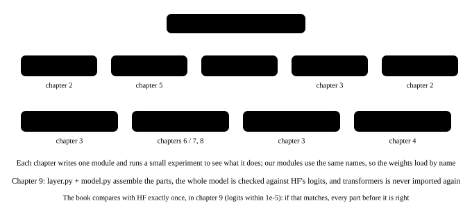

# 1. Weights and configuration

<p class="lead">The first step of writing a model from scratch is not writing an operator; it is reading the <strong>configuration</strong> and the <strong>weights</strong>: the few dozen hyperparameters in config.json decide the shape of every tensor, and the 320 tensors in the safetensors file map by name onto the module tree. This chapter writes a single file, <code>weights.py</code>, and takes a look at the module tree of the Hugging Face implementation — from here on, every chapter that finishes a module checks it against the HF module of the same name, which is the verification method of all of stage 1.</p>

!!! note "What this chapter runs"
    `ch01_weights.py`, about 10 seconds (read the weights, load the HF model, one forward pass). From this chapter on, every script imports from the `qwen/` package and sits next to it: `python ch01_weights.py`.

@@files@@

## config.json: where the shapes come from {#configjson形状从哪来}

Qwen3.5 is a multimodal model, so the top level of config.json has three parts: `architectures`, `vision_config` and `text_config`; everything about the language model is under `text_config`. We pick the fields we use into a dataclass:

```python title="qwen/weights.py"
"""读配置和权重：config.json 里的超参数，safetensors 里的 488 个张量。

权重文件里有三部分：model.language_model.*（语言模型，这本书要手写的）、model.visual.*（视觉编码器，不碰）
和 mtp.*（多 token 预测的草稿头，第 14 章用）。这里把前缀去掉，剩下的名字和模块树一一对应。
"""
import json
import os
from dataclasses import dataclass
from pathlib import Path

import torch
from safetensors import safe_open


def find_model(name="Qwen3.5-0.8B"):
    """从当前目录往上找 models/<name>；也可以用环境变量 QWEN_MODEL 直接指定"""
    if os.environ.get("QWEN_MODEL"):
        return Path(os.environ["QWEN_MODEL"])
    for d in [Path.cwd(), *Path.cwd().parents]:
        if (d / "models" / name).is_dir():
            return d / "models" / name
    raise FileNotFoundError(f"没找到 models/{name}，先下载：hf download Qwen/{name} --local-dir models/{name}")


@dataclass
class Config:
    hidden_size: int                 # 1024: the width of the residual stream
    num_hidden_layers: int           # 24
    layer_types: list                # whether each layer is linear_attention or full_attention
    num_attention_heads: int         # full attention: 8 query heads
    num_key_value_heads: int         # 2 key/value groups (GQA)
    head_dim: int                    # 256
    intermediate_size: int           # 3584: the FFN's intermediate width
    vocab_size: int                  # 248320
    rms_norm_eps: float
    rope_theta: float                # 1e7
    partial_rotary_factor: float     # 0.25: only the first quarter of each head is rotated
    mrope_section: list              # [11, 11, 10]: how many frequencies each of the three position axes gets
    linear_num_key_heads: int        # linear attention: 16 key heads
    linear_num_value_heads: int      # 16 value heads
    linear_key_head_dim: int         # 128
    linear_value_head_dim: int       # 128
    linear_conv_kernel_dim: int      # 4: the short convolution's window
    tie_word_embeddings: bool        # the output layer shares weights with the embedding
    eos_token_id: int

    @classmethod
    def load(cls, path):
        c = json.loads((Path(path) / "config.json").read_text())["text_config"]   # a multimodal model: the language model's config lives under text_config
        rope = c["rope_parameters"]
        fields = {k: c[k] for k in cls.__dataclass_fields__ if k in c}
        return cls(**fields, rope_theta=rope["rope_theta"], partial_rotary_factor=rope["partial_rotary_factor"],
                   mrope_section=rope["mrope_section"])


def load_weights(path, part="model.language_model.", dtype=torch.float32):
    """读 safetensors，返回 {去掉前缀的名字: 张量}。part 可以是 "model.language_model."、"mtp." 或 "model.visual."。"""
    out = {}
    for f in sorted(Path(path).glob("*.safetensors")):
        with safe_open(f, "pt") as st:
            for k in st.keys():
                if k.startswith(part):
                    out[k[len(part):]] = st.get_tensor(k).to(dtype)   # the file is bf16; converting to fp32 lets us match the fp32 reference element by element
    return out


def sub(weights, prefix):
    """取一个子模块的权重：sub(W, "layers.0.mlp.") -> {"gate_proj.weight": ..., "up_proj.weight": ..., ...}"""
    return {k[len(prefix):]: v for k, v in weights.items() if k.startswith(prefix)}

def load(module, weights, prefix):
    """把一个子模块的权重灌进去：load(MLP(cfg), W, "layers.0.mlp.")。我们的属性名和文件里的一致，所以 state_dict 直接对上。"""
    module.load_state_dict(sub(weights, prefix), assign=True)   # assign=True: take over these tensors directly instead of copying them
    return module
```

Two details:

- **safetensors is not pickle.** The file starts with a JSON header (the name, dtype, shape and byte offset of every tensor) followed by raw data, so `safe_open` can read one tensor, or even one slice, which is why step 0's `map.py` could list every shape without loading any data.
- **The file is bf16; we convert to fp32.** Not because fp32 is "more correct", but because the reference implementation (HF) also runs in fp32, and only with both sides in fp32 can the error be pushed down to the 1e-5 range where a bug is obvious at a glance. Real deployments on a GPU use bf16 (chapter 15).

## The reference implementation: HF's module tree {#参考实现hf-的模块树}

This book writes everything from scratch, but every finished part has to be checked. The reference is `Qwen3_5ForCausalLM` from Hugging Face transformers: a module tree (`model.embed_tokens`, `model.layers[i].mlp`, `model.layers[i].self_attn`, `model.norm`, `lm_head`, …) whose **module names are exactly the prefixes of the weight names** — `layers.0.mlp.gate_proj.weight` belongs to `hf.model.layers[0].mlp`. So checking is direct: feed the same input to our module and to the HF module of the same name, and compare the maximum difference. Every single part should differ by 0 or by about 1e-7 (linear attention sums in a different order from HF); chapter 9 assembles the parts into the whole model and checks it against HF's logits once more — about 1e-5 after 24 accumulated layers — and after that transformers is never imported again.

{.aig-svg}

HF's attention and linear-attention modules take a few arguments of their own (the position tables, the mask, the cache); chapters 6 and 7 each have a one-line comment on how to pass them.

## Run it: do we read what HF reads? {#跑一遍我们读到的和-hf-的一样吗}

First confirm two things: the 320 tensors we read by name are equal, one by one, to what the HF model's `state_dict()` holds after loading; and the names on HF's module tree correspond to the weight names.

```python title="ch01_weights.py"
"""第 1 章：读配置和权重，和 HF 加载的逐个对；看一眼 HF 的模块树——后面每一章都拿同名模块对答案"""
import os

import torch
from transformers import AutoModelForCausalLM

from qwen.weights import Config, find_model, load_weights, sub

torch.set_num_threads(max(1, os.cpu_count() // 2))
path = find_model()
cfg = Config.load(path)
print(f"{cfg.num_hidden_layers} 层，hidden {cfg.hidden_size}，词表 {cfg.vocab_size}，RoPE theta {cfg.rope_theta:.0e}，只旋转 {cfg.partial_rotary_factor:.0%} 的维度")

W = load_weights(path)
print(f"语言模型 {len(W)} 个张量，{sum(v.numel() for v in W.values()) / 1e6:.1f}M 参数（文件 bf16 -> 内存 fp32）")
print("lm_head.weight 在文件里吗：", "lm_head.weight" in W, "；tie_word_embeddings =", cfg.tie_word_embeddings)
print("第 0 层（线性注意力）的张量：", sorted(sub(W, "layers.0.").keys()))
print("第 3 层（全注意力）的张量：  ", sorted(sub(W, "layers.3.").keys()))

hf = AutoModelForCausalLM.from_pretrained(path, dtype=torch.float32).eval()   # the reference: every later chapter checks against its module of the same name
sd = hf.state_dict()
mismatch = [k for k, v in W.items() if not torch.equal(v, sd["model." + k])]
print(f"和 HF 的 state_dict 对比：{len(W) - len(mismatch)} 个相同，{len(mismatch)} 个不同；HF 多出来的键：",
      sorted(set(k[6:] for k in sd if k.startswith("model.")) - set(W)) + [k for k in sd if not k.startswith("model.")])
print("HF 的模块树：model 下有", [n for n, _ in hf.model.named_children()], "；第 0 层下有", [n for n, _ in hf.model.layers[0].named_children()])
print("模块名就是权重名的前缀：layers.0.mlp.gate_proj.weight 属于 hf.model.layers[0].mlp —— 后面每章写好一个模块，就拿同名模块对输出")
```

```text title="输出"
24 层，hidden 1024，词表 248320，RoPE theta 1e+07，只旋转 25% 的维度
语言模型 320 个张量，752.4M 参数（文件 bf16 -> 内存 fp32）
lm_head.weight 在文件里吗： False ；tie_word_embeddings = True
第 0 层（线性注意力）的张量： ['input_layernorm.weight', 'linear_attn.A_log', 'linear_attn.conv1d.weight', 'linear_attn.dt_bias', 'linear_attn.in_proj_a.weight', 'linear_attn.in_proj_b.weight', 'linear_attn.in_proj_qkv.weight', 'linear_attn.in_proj_z.weight', 'linear_attn.norm.weight', 'linear_attn.out_proj.weight', 'mlp.down_proj.weight', 'mlp.gate_proj.weight', 'mlp.up_proj.weight', 'post_attention_layernorm.weight']
第 3 层（全注意力）的张量：   ['input_layernorm.weight', 'mlp.down_proj.weight', 'mlp.gate_proj.weight', 'mlp.up_proj.weight', 'post_attention_layernorm.weight', 'self_attn.k_norm.weight', 'self_attn.k_proj.weight', 'self_attn.o_proj.weight', 'self_attn.q_norm.weight', 'self_attn.q_proj.weight', 'self_attn.v_proj.weight']
和 HF 的 state_dict 对比：320 个相同，0 个不同；HF 多出来的键： ['lm_head.weight']
HF 的模块树：model 下有 ['embed_tokens', 'layers', 'norm', 'rotary_emb'] ；第 0 层下有 ['linear_attn', 'mlp', 'input_layernorm', 'post_attention_layernorm']
模块名就是权重名的前缀：layers.0.mlp.gate_proj.weight 属于 hf.model.layers[0].mlp —— 后面每章写好一个模块，就拿同名模块对输出
```

Three confirmations: the 320 tensors are equal one by one, so every later difference comes from our own operators and never from reading the weights; HF's `state_dict` has a `lm_head.weight` but the file does not — that is the shared embedding table (chapter 2); and under layer 0, `linear_attn`, `mlp` and the two `layernorm`s are exactly the modules that chapters 7, 4 and 3 write.

!!! interview "How to explain it"
    To explain "what is in a model file", the answer is a table: name → shape → parameter count. Being able to split the 0.8B's 752M parameters into "vocabulary 254M + 18 linear-attention layers of 21.5M each + 6 full-attention layers of 18.4M each", and to name the operator each block belongs to, shows you have actually read the weights rather than only called an API. Add a sentence on why safetensors replaced pickle: it has an index, it can be read partially without copying, and it cannot execute arbitrary code.

## Summary {#小结}

- [x] `Config.load` takes only the fields of `text_config` we use; `load_weights` takes one of the three parts (language model / vision / MTP) by prefix and strips the prefix.
- [x] The 320 tensors are equal one by one to what HF loads; `lm_head` is not in the file, it is shared with the embedding.
- [x] HF's module tree corresponds one to one to the weight names; from here on, every chapter that finishes a module checks it against the module of the same name.

**File created in this chapter**: `qwen/weights.py`.
