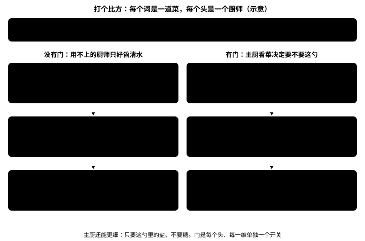
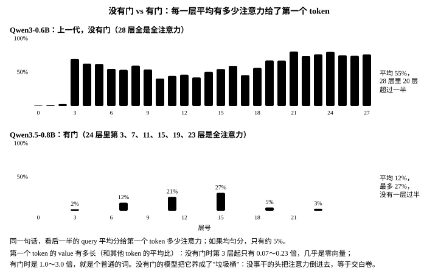
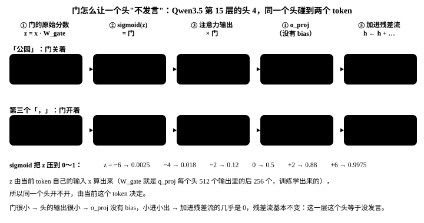
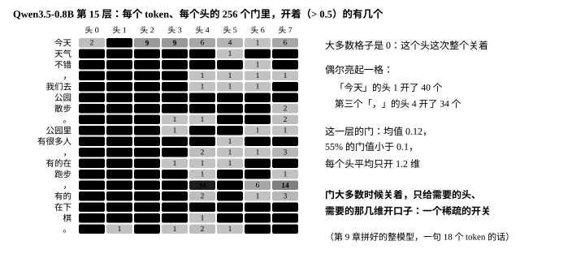

# （六）门控注意力

<p class="lead">24 层里只有 6 层是全注意力，但它们是模型"精确回看"的唯一手段：线性注意力的记忆表会模糊，注意力矩阵不会。这一章先用三个 token 手算一遍注意力，再讲 Qwen3.5 比教科书多的四样东西，其中最新的是<strong>输出门</strong>：它让一个头可以"这次不发言"。最后把它写出来，用真实权重把注意力矩阵画出来看。</p>

!!! abstract "学完这章你能"
    1. 手算一个小例子，说清打分、softmax、加权求和、因果掩码各在做什么。
    2. 说出 Qwen3.5 的注意力比教科书多的四样东西各解决什么问题：GQA、QK-Norm、只转 1/4 维的 RoPE、输出门。
    3. 讲清输出门：头为什么需要"不发言"、没有门时模型怎么凑合、门怎么算、怎么学出来、为什么拼在 `q_proj` 里。
    4. 写出 `qwen/attention.py`，在真实权重上看到注意力矩阵。

!!! note "这一章跑什么"
    三个不用模型的小例子 `ch06_toy.py`、`ch06_gate_toy.py`、`ch06_gate_sgd.py`（各 1 秒），和用真实权重的 `ch06_attention.py`（约 10 秒）。

@@files@@

## 注意力在做什么：三个 token 手算一遍

每个 token 先算出三样东西：**query**（我想找什么）、**key**（我身上贴的标签）、**value**（我能提供的内容）。第 i 个 token 拿自己的 query 和前面每个 token 的 key 做点积，得到一排分数；softmax 把这排分数变成加起来正好是 1 的比例；再按这个比例把各个 token 的 value 混在一起，就是第 i 个 token 在这一层的输出。

用两维向量手算一遍。「今天」「天气」「不错」三个 token 的 key 是 $(1, 0)$、$(0, 1)$、$(0.5, 0.5)$，value 是 $(2, 0)$、$(0, 2)$、$(1, 1)$；「不错」的 query 是 $(0, 4)$，它想找"被评价的是谁"：

1. **打分**：和三个 key 的点积是 $0$、$4$、$2$，除以 $\sqrt{2}$ 得 $0$、$2.83$、$1.41$。
2. **softmax**：$e^{0} : e^{2.83} : e^{1.41} \approx 1 : 16.9 : 4.1$，归一化成 $0.045$、$0.768$、$0.187$。
3. **加权求和**：$0.045 \times (2, 0) + 0.768 \times (0, 2) + 0.187 \times (1, 1) = (0.277,\ 1.723)$。

「不错」把 77% 的注意力给了「天气」，取回来的主要是「天气」的内容。用代码核对一遍：

```python title="ch06_toy.py"
"""第 6 章（一）：三个 token、两维向量，手算一遍注意力；再看 softmax 为什么不让一个头"交白卷" """
import math

import torch

words = ["今天", "天气", "不错"]
k = torch.tensor([[1.0, 0.0], [0.0, 1.0], [0.5, 0.5]])      # 每个 token 的 key：给别人查的"标签"
v = torch.tensor([[2.0, 0.0], [0.0, 2.0], [1.0, 1.0]])      # 每个 token 的 value：被取走的"内容"
q = torch.tensor([0.0, 4.0])                                # 「不错」的 query：它想找"被评价的是谁"

scores = k @ q / math.sqrt(2)                               # 1. 打分：和每个 key 做点积，再除以 √d（d = 2）
w = torch.softmax(scores, dim=-1)                           # 2. softmax：变成加起来正好是 1 的比例
out = w @ v                                                 # 3. 加权求和：按比例把 value 混在一起
r = lambda t, n=3: [round(x, n) for x in t.tolist()]
print(f"「不错」给三个 token 打的分：{r(scores, 2)}")
print(f"softmax 之后的比例：{r(w)}，加起来 {w.sum():.3f}")
print(f"输出 = 比例 × value 再相加：{r(out)}")

Q = torch.tensor([[0.0, 0.0], [3.0, 0.0], [0.0, 4.0]])      # 4. 三个 token 一起算：每行一个 query
mask = torch.ones(3, 3, dtype=torch.bool).triu(1)          # 因果掩码：上三角填 −inf，第 i 行只能看前 i 个
W = torch.softmax((Q @ k.T / math.sqrt(2)).masked_fill(mask, float("-inf")), dim=-1)
print("三行一起算、加上因果掩码（行 = query，列 = key）：")
for word, row in zip(words, W):
    print(f"  {word}  {r(row)}")

q0 = torch.tensor([0.0, 0.0])                               # 5. 这个头这次什么都不想看：query 全是 0
w0 = torch.softmax(k @ q0 / math.sqrt(2), dim=-1)
print(f"什么都不想看时的比例：{r(w0)} → 输出 {r(w0 @ v)}：还是交了一份平均值")
g = torch.sigmoid(torch.tensor(-6.0))                       # 6. 有门：输出再乘一个 sigmoid(−6)
print(f"乘上门 sigmoid(−6) = {g:.4f} → 输出 {r(w0 @ v * g, 4)}：这次真的没发言")
```

```text title="输出"
「不错」给三个 token 打的分：[0.0, 2.83, 1.41]
softmax 之后的比例：[0.045, 0.768, 0.187]，加起来 1.000
输出 = 比例 × value 再相加：[0.277, 1.723]
三行一起算、加上因果掩码（行 = query，列 = key）：
  今天  [1.0, 0.0, 0.0]
  天气  [0.893, 0.107, 0.0]
  不错  [0.045, 0.768, 0.187]
什么都不想看时的比例：[0.333, 0.333, 0.333] → 输出 [1.0, 1.0]：还是交了一份平均值
乘上门 sigmoid(−6) = 0.0025 → 输出 [0.0025, 0.0025]：这次真的没发言
```

第 4 段把三行一起算：每一行是一个 token 的 query，**因果掩码**把上三角填成 $-\infty$，softmax 之后就是 0，所以「今天」只能看自己，「天气」只能看前两个。第 5、6 段先放一放，讲输出门时会用到。

## 公式

把所有 token 的 query、key、value 各叠成一个矩阵 $Q$、$K$、$V$（每行一个 token），一个头的注意力是

$$
\mathrm{Attention}(Q, K, V) = \mathrm{softmax}\!\left(\frac{QK^\top}{\sqrt{d}} + M\right) V
$$

- $QK^\top$ 一次算出所有 (query, key) 的分数，形状是 $T \times T$。
- $M$ 是因果掩码：上三角是 $-\infty$，其余是 0。
- 除以 $\sqrt{d}$：$d$ 维向量的点积会随 $d$ 变大，分数太大时 softmax 几乎变成 one-hot，梯度很小。Qwen3.5 的头维 $d = 256$，除以 16 把分数拉回正常范围。
- softmax 按行做：每一行加起来是 1。

多头注意力就是把这件事并排做很多份：Qwen3.5 的全注意力层有 8 个 query 头，每个头用自己那 256 维的 q、k、v，最后把 8 个头的输出拼起来，过 `o_proj` 回到 1024 维。

## Qwen3.5 比教科书多的四样东西

**GQA 省的是 KV cache。** 8 个 query 头只有 2 组 key/value，每组给 4 个 query 头共用。每个 token 要存的 key/value 从 $8 \times 256 \times 2 = 4096$ 个数降到 $2 \times 256 \times 2 = 1024$ 个，推理时的显存和访存都是 4 倍的差距（第 10 章会算）。质量损失很小，因为多个头看同一组 key 本来就有冗余。

**QK-Norm 防的是 logits 爆炸。** 训练中 $q$ 和 $k$ 的尺度会漂，点积变得很大之后 softmax 退化成 one-hot。在 RoPE 之前把 $q$、$k$ 各过一个 RMSNorm，点积的尺度就被钉住了。Qwen3 开始用，Qwen3.5 延续。

**RoPE 只转前 64 维。** 第 5 章讲过：每个头 256 维里只有前 64 维按位置旋转，后 192 维不转，留给和位置无关的匹配。

**输出门是这一代的新东西。** `q_proj` 一次算出两份：一份当 query，一份过 sigmoid 当门，逐维乘在这个头的输出上。下一节专门讲它。

## 输出门：让一个头可以"不发言"

### 没有门时：把第一个 token 养成垃圾桶

回到 `ch06_toy.py` 的第 5 段：一个头这次什么都不想看，query 全是 0，分数一样，softmax 照样给出 $1/3$、$1/3$、$1/3$，输出是三个 value 的平均。**softmax 的比例必须加起来是 1，头没法交白卷**，它交上去的这份平均值会被加进残差流，成了噪声。

训练出来的模型找到了一个凑合的办法：挑一个所有 query 都看得见的 token（因果掩码下只有第一个 token 满足），把它的 value 学成几乎是零向量；没事干的头就把注意力全倒给它，取回来的约等于 0，等于没发言。这叫**注意力汇聚**（attention sink）。打个比方：

{.aig-svg}

真实模型里确实是这样。[大模型原理手册的注意力一章](llm://transformer/attention/#真实模型里的注意力注意力汇聚)在没有门的 Qwen3-0.6B 上量过：第 6 层以后，后一半的 query 有 40%～77% 的注意力给了第一个 token，而均匀分只有约 5%。用同一句话、同一种量法看有门的 Qwen3.5-0.8B（第 9 章拼出整模型后会自己量一遍）：

{.aig-svg}

这两个模型不只差一个门（层数、线性注意力、训练数据都不同），但 Qwen 团队在论文里做过只差门的对照：同样的模型、同样的数据，加上门以后第一个 token 分到的注意力从 46.7% 降到 4.8%。

### 门怎么算：三步

门不看别的 token，只看**当前这个 token 自己**的输入 $x$：

1. **打分**：$z = x\,W_{\text{gate}}$。$W_{\text{gate}}$ 就是 `q_proj` 每个头 512 个输出里的后 256 个，所以每个头、每一维都有一个分数。
2. **压到 0～1**：$g = \mathrm{sigmoid}(z)$。$z = -6$ 时门是 0.0025，$z = 0$ 是 0.5，$z = 6$ 是 0.9975。
3. **逐维相乘**：这个头的注意力输出 $o$ 变成 $o \odot g$，再进 `o_proj`。

同一个头开不开，由当前 token 决定。下面是玩具数字：4 个特征、2 个头、每头 2 维，$W_{\text{gate}}$ 是手写的（真模型里是训练学出来的，也没有这么好读）。

```python title="ch06_gate_toy.py"
"""第 6 章（二）：门由当前 token 自己算出来——同一个头，碰到「书」关上、碰到「她」打开（玩具数字，示意）"""
import torch

x = {"书": torch.tensor([1.0, 0.0, 0.0, 1.0]),              # 当前 token 的输入：玩具只有 4 个特征
     "她": torch.tensor([0.0, 1.0, 0.0, 1.0])}              # [是名词, 是代词, 是动词, 前面提到过人]
W_gate = torch.tensor([                                    # 4 个特征 → 2 个头 × 每头 2 维 = 4 个门分数（真模型里是训练学出来的）
    [-5.0, -5.0, 2.0, 1.0],                                 # 是名词      代词头：维 0、维 1 | 语法头：维 0、维 1
    [6.0, 5.0, -1.0, -1.0],                                 # 是代词
    [-2.0, -2.0, 2.0, 2.0],                                 # 是动词
    [0.5, 0.5, 0.0, 0.0],                                   # 前面提到过人
])
heads = {"书": torch.tensor([[0.8, -0.3], [0.4, 0.9]]),    # 两个头这次注意力的输出（每个头 2 维）
         "她": torch.tensor([[1.2, 0.5], [0.3, -0.2]])}    # 「她」的代词头取回来的是「小红」的信息
r = lambda t, n=3: [round(v, n) for v in t.tolist()]
for w in ("书", "她"):
    z = x[w] @ W_gate                                      # 1. 门的原始分数：z = x · W_gate
    g = torch.sigmoid(z).view(2, 2)                        # 2. sigmoid 压到 0～1：每个头、每一维一个门
    out = heads[w] * g                                     # 3. 逐维乘到这个头的输出上
    print(f"「{w}」：z = {r(z, 1)}")
    print(f"   代词头：门 {r(g[0])}，输出 {r(heads[w][0], 2)} → {r(out[0])}")
    print(f"   语法头：门 {r(g[1])}，输出 {r(heads[w][1], 2)} → {r(out[1])}")
```

```text title="输出"
「书」：z = [-4.5, -4.5, 2.0, 1.0]
   代词头：门 [0.011, 0.011]，输出 [0.8, -0.3] → [0.009, -0.003]
   语法头：门 [0.881, 0.731]，输出 [0.4, 0.9] → [0.352, 0.658]
「她」：z = [6.5, 5.5, -1.0, -1.0]
   代词头：门 [0.998, 0.996]，输出 [1.2, 0.5] → [1.198, 0.498]
   语法头：门 [0.269, 0.269]，输出 [0.3, -0.2] → [0.081, -0.054]
```

「书」是名词，"代词头"的门是 0.011，它取回来的东西几乎被乘没了；「她」是代词，同一个头的门是 0.998，取回来的「小红」的信息几乎原样放行。"语法头"正好反过来。每一维单独一个门，所以门还能更细：只放行这个头输出里的一部分维度。回到 `ch06_toy.py` 的第 6 段：什么都不想看的头，输出乘上 0.0025，就真的没发言了。

### 门怎么让一个头闭嘴：看真实模型里的一个头

把第 9 章拼好的整模型跑一句话，跟着第 15 层的头 4，从门的分数一直走到残差流：

{.aig-svg}

`o_proj` 没有 bias，输入小、输出就小；残差流只加不覆盖，加进去的几乎是 0，这一层这个头就等于没发言。整层看，门大多数时候是关着的：

{.aig-svg}

### 门是怎么学出来的

$W_{\text{gate}}$ 和别的权重一样，从很小的随机数开始（Qwen3.5 的 `initializer_range` 是 0.02），所以刚初始化时所有门都在 0.5 附近，开一半。训练时，梯度把"开了反而添乱"的门往下推，把"该说话"的门往上拉。最小的例子手算得出来：

```python title="ch06_gate_sgd.py"
"""第 6 章（三）：门是怎么学出来的——一个能手算的最小例子，看 W_gate 从初始化一步步变成"该开就开、该关就关"。

两种 token：x(问号) = [1, 0]，x(数字) = [0, 1]；门只有 1 维，W_gate 就是两个数 w = [w_问号, w_数字]。
这一层的输出 y = 残差 r + 门 g × 头的输出 o，目标 t = 1，损失 (y − t)² / 2：
  问号：r = 0（残差流里还没有答案），o = 1.0（头找到了答案）     → 门应该开
  数字：r = 1（残差流里已经对了），  o = 0.8（头在这里只会添乱） → 门应该关
"""
import torch

x = torch.tensor([[1.0, 0.0], [0.0, 1.0]])
r, o, t = torch.tensor([0.0, 1.0]), torch.tensor([1.0, 0.8]), torch.tensor([1.0, 1.0])
w = torch.tensor([0.01, -0.02], requires_grad=True)        # 初始化：很小的随机数，门都在 0.5 附近
for step in range(201):
    g = torch.sigmoid(x @ w)                               # 门
    loss = ((r + g * o - t) ** 2 / 2).sum()
    w.grad = None
    loss.backward()                                        # 梯度 = (y − t) × o × g(1 − g) × x
    if step in (0, 1, 2, 5, 20, 50, 200):
        print(f"第 {step:3d} 步：w = [{w[0].item():+.3f}, {w[1].item():+.3f}]，门(问号) {g[0].item():.3f}，门(数字) {g[1].item():.3f}，"
              f"损失 {loss.item():.4f}，梯度 [{w.grad[0].item():+.4f}, {w.grad[1].item():+.4f}]")
    with torch.no_grad():
        w -= 1.0 * w.grad                                  # 学习率 1
```

```text title="输出"
第   0 步：w = [+0.010, -0.020]，门(问号) 0.502，门(数字) 0.495，损失 0.2022，梯度 [-0.1244, +0.0792]
第   1 步：w = [+0.134, -0.099]，门(问号) 0.534，门(数字) 0.475，损失 0.1811，梯度 [-0.1161, +0.0758]
第   2 步：w = [+0.250, -0.175]，门(问号) 0.562，门(数字) 0.456，损失 0.1624，梯度 [-0.1077, +0.0725]
第   5 步：w = [+0.550, -0.382]，门(问号) 0.634，门(数字) 0.406，损失 0.1196，梯度 [-0.0849, +0.0626]
第  20 步：w = [+1.365, -1.065]，门(问号) 0.797，门(数字) 0.256，损失 0.0417，梯度 [-0.0330, +0.0313]
第  50 步：w = [+1.980, -1.678]，门(问号) 0.879，门(数字) 0.157，损失 0.0153，梯度 [-0.0129, +0.0134]
第 200 步：w = [+2.835, -2.568]，门(问号) 0.945，门(数字) 0.071，损失 0.0032，梯度 [-0.0029, +0.0030]
```

每一步的梯度是 $(y - t) \times o \times g(1 - g) \times x$，也就是"差多少 × 头的输出 × sigmoid 的斜率 × 输入"。问号处 $y < t$，梯度为负，$w_{\text{问号}}$ 往上走，门越开越大；数字处头只会添乱，$y > t$，$w_{\text{数字}}$ 往下走。200 步后两个门分别是 0.945 和 0.071。门越接近 0 或 1，$g(1-g)$ 越小，变得越慢。真实模型里没有人告诉它"问号该开"，道理是一样的：哪些 (token, 头, 维) 放行能让下一个词猜得更准，梯度就把那里的门推开。

### 为什么把门拼在 q_proj 里

- **数学上和单独一个 `gate_proj` 一样**：两个矩阵并排拼成一个，等于各乘各的。
- **门和 query 都是"当前这个 token"的决定**：都由同一个 $x$ 算出来，也都不进 KV cache；key 和 value 是给后面的 token 查的，要缓存。
- **少一次矩阵乘**：和第 4 章合并的 `gate_up_proj` 一个道理，一次读权重、一次算完。
- **按头交错排**：每个头的 512 个输出是"这个头的 query + 这个头的门"，张量并行按头切 `q_proj` 时，门跟着自己的头走，不用额外通信。

代价是每层多 $1024 \times 2048 \approx 2.1$M 参数，6 层共 12.6M，约占全模型的 1.7%。

### 门是怎么来的

| 时间 | 事件 |
| --- | --- |
| 1997 | LSTM 用 sigmoid 门控制信息的流动 |
| 2016 | GLU：一路线性、一路过 sigmoid，两路相乘（第 4 章 SwiGLU 的前身） |
| 2023-06 | 高通的论文 *Quantizable Transformers: Removing Outliers by Helping Attention Heads Do Nothing*：头"什么都不想做"时会造出巨大的离群值，提出 clipped softmax 和门控注意力 |
| 2023-07 | Evan Miller 的博客 *Attention Is Off By One*：给 softmax 的分母加 1，让一行可以加起来小于 1 |
| 2023-09 | StreamingLLM 给这个现象起名 attention sink：丢掉最早的 KV 模型就崩，必须保留开头几个 token |
| 2025-05 | Qwen 团队的 *Gated Attention for Large Language Models*：比较了 30 种加门的方式，sigmoid 门加在注意力输出上、逐维、由当前 token 算出来效果最好；NeurIPS 2025 最佳论文 |
| 2025-09 起 | Qwen3-Next、Qwen3.5 用上这个门 |

同一个问题也有别的解法：OpenAI 的 gpt-oss 给每个头加一个可学习的 sink 分数，相当于一个永远在的"清水缸"。

## 代码：qwen/attention.py

```python title="qwen/attention.py"
"""门控注意力：Qwen3.5 的全注意力层，24 层里的 6 层。

和教科书的多头注意力比有四处不同：GQA（8 个 query 头共用 2 组 key/value）、QK-Norm（q 和 k 各过一个
RMSNorm 再旋转）、只旋转前 1/4 维的 RoPE、以及输出门——q_proj 一次算出两份，一份当 query，
一份过 sigmoid 当门，逐维乘在注意力的输出上。
"""
import math

import torch
import torch.nn as nn

from qwen.norm import RMSNorm
from qwen.rope import apply_rope


class Attention(nn.Module):
    def __init__(self, cfg):
        super().__init__()
        H, self.n_head, self.n_kv, self.d = cfg.hidden_size, cfg.num_attention_heads, cfg.num_key_value_heads, cfg.head_dim
        self.q_proj = nn.Linear(H, self.n_head * self.d * 2, bias=False)   # 两倍宽：一半 query，一半门
        self.k_proj = nn.Linear(H, self.n_kv * self.d, bias=False)
        self.v_proj = nn.Linear(H, self.n_kv * self.d, bias=False)
        self.o_proj = nn.Linear(self.n_head * self.d, H, bias=False)
        self.q_norm = RMSNorm(self.d, cfg.rms_norm_eps)                     # 按头归一化：权重只有 head_dim 个
        self.k_norm = RMSNorm(self.d, cfg.rms_norm_eps)

    def forward(self, x, cos, sin):
        B, T, _ = x.shape
        q, gate = self.q_proj(x).view(B, T, self.n_head, 2 * self.d).chunk(2, dim=-1)   # 每个头的 512 维：前 256 是 query，后 256 是门
        k = self.k_proj(x).view(B, T, self.n_kv, self.d)
        v = self.v_proj(x).view(B, T, self.n_kv, self.d)
        q, k = apply_rope(self.q_norm(q), cos, sin), apply_rope(self.k_norm(k), cos, sin)
        q, k, v = (t.transpose(1, 2) for t in (q, k, v))                                  # [B, 头, T, d]
        rep = self.n_head // self.n_kv
        k, v = k.repeat_interleave(rep, dim=1), v.repeat_interleave(rep, dim=1)           # GQA：每组 KV 复制给 4 个 query 头
        scores = q @ k.transpose(-1, -2) / math.sqrt(self.d)                               # [B, 头, T, T]
        causal = torch.ones(T, T, dtype=torch.bool, device=x.device).triu(1)               # 上三角：看不到后面的 token
        scores = scores.masked_fill(causal, float("-inf"))
        out = torch.softmax(scores, dim=-1) @ v                                            # [B, 头, T, d]
        out = out.transpose(1, 2).reshape(B, T, -1) * torch.sigmoid(gate.reshape(B, T, -1))   # 输出门
        return self.o_proj(out)
```

逐行对着形状读：

| 步骤 | 形状 | 说明 |
| --- | --- | --- |
| `q_proj(x)` | `[B, T, 4096]` → `[B, T, 8, 512]` | 每个头 512 维：前 256 是 query，后 256 是门 |
| `k_proj`, `v_proj` | `[B, T, 2, 256]` | 只有 2 组 key/value（GQA） |
| `q_norm`, `k_norm` | 不变 | 按头做 RMSNorm，权重只有 256 个；再做 RoPE |
| `repeat_interleave` | `[B, 8, T, 256]` | 每组 KV 复制给 4 个 query 头 |
| `scores` | `[B, 8, T, T]` | $qk^\top/\sqrt{256}$，上三角填 $-\infty$ |
| `softmax @ v` | `[B, 8, T, 256]` → `[B, T, 2048]` | 按行归一化再加权求和 |
| `* sigmoid(gate)` | `[B, T, 2048]` | 输出门：逐维决定这个头的输出放行多少 |
| `o_proj` | `[B, T, 1024]` | 回到残差流的宽度 |

{.aig-svg}

## 跑起来：真实权重上的注意力矩阵

```python title="ch06_attention.py" ci="loose"
"""第 6 章（四）：门控注意力。用真实权重跑一层，把注意力矩阵和输出门拿出来看"""
import math
import os

import torch
from tokenizers import Tokenizer

from qwen.attention import Attention
from qwen.embedding import Embedding
from qwen.norm import RMSNorm
from qwen.rope import apply_rope, rope_tables
from qwen.weights import Config, find_model, load, load_weights

torch.set_num_threads(max(1, os.cpu_count() // 2))
path = find_model()
cfg = Config.load(path)
W = load_weights(path)
attn = load(Attention(cfg), W, "layers.3.self_attn.")                                          # 第 3 层是第一层全注意力
n = sum(p.numel() for p in attn.parameters())
print(f"一层注意力 {n / 1e6:.1f}M 参数，其中 q_proj {attn.q_proj.weight.numel() / 1e6:.1f}M（一半是门）")

tk = Tokenizer.from_file(str(path / "tokenizer.json"))         # 用第 2、3 章的零件造出一段真实输入
ids = torch.tensor([tk.encode("今天天气不错，我们去公园").ids])
T = ids.shape[1]
h = load(RMSNorm(cfg.hidden_size, cfg.rms_norm_eps), W, "layers.3.input_layernorm.")(load(Embedding(cfg.vocab_size, cfg.hidden_size), W, "embed_tokens.")(ids))
cos, sin = rope_tables(cfg, torch.arange(T))
y = attn(h, cos, sin)
print(f"输入 {tuple(h.shape)} -> 输出 {tuple(y.shape)}")

with torch.no_grad():                                                                          # 1. 把注意力矩阵算出来看：每行加起来是 1，上三角是 0
    q, gate = attn.q_proj(h).view(1, T, attn.n_head, 2 * attn.d).chunk(2, dim=-1)
    k = attn.k_proj(h).view(1, T, attn.n_kv, attn.d)
    q, k = apply_rope(attn.q_norm(q), cos, sin), apply_rope(attn.k_norm(k), cos, sin)
    scores = q[0, :, 0] @ k[0, :, 0].T / math.sqrt(attn.d)                                     # 第 0 个 query 头 × 它那组 key
    probs = torch.softmax(scores.masked_fill(torch.ones(T, T, dtype=torch.bool).triu(1), float("-inf")), dim=-1)
    words = [tk.decode([i]) for i in ids[0].tolist()]
    print("第 0 个头的注意力矩阵（行 = query，列 = key）：")
    for w, row in zip(words, probs):
        print(f"  {w:<4}", " ".join(f"{p:.2f}" for p in row.tolist()))
    g = torch.sigmoid(gate)                                                                    # 2. 输出门：每个 token、每个头、每一维一个
    print(f"输出门的形状 {tuple(g.shape)}：{T} 个 token × {attn.n_head} 个头 × {attn.d} 维，每个数都在 0～1 之间")
print(f"GQA：{attn.n_head} 个 query 头共用 {attn.n_kv} 组 KV，每个 token 要存的 KV 是 {2 * attn.n_kv * attn.d} 个数，不用 GQA 要存 {2 * attn.n_head * attn.d} 个")
```

```text title="输出"
一层注意力 7.3M 参数，其中 q_proj 4.2M（一半是门）
输入 (1, 6, 1024) -> 输出 (1, 6, 1024)
第 0 个头的注意力矩阵（行 = query，列 = key）：
  今天   1.00 0.00 0.00 0.00 0.00 0.00
  天气   0.07 0.93 0.00 0.00 0.00 0.00
  不错   0.01 0.97 0.02 0.00 0.00 0.00
  ，    0.00 0.23 0.76 0.00 0.00 0.00
  我们去  0.05 0.01 0.00 0.43 0.50 0.00
  公园   0.00 0.00 0.13 0.21 0.06 0.60
输出门的形状 (1, 6, 8, 256)：6 个 token × 8 个头 × 256 维，每个数都在 0～1 之间
GQA：8 个 query 头共用 2 组 KV，每个 token 要存的 KV 是 1024 个数，不用 GQA 要存 4096 个
```

注意力矩阵每行加起来是 1，上三角全是 0：第一个 token 只能看自己，所以是 1.00；「不错」把 97% 的注意力给了前一个 token「天气」，和开头手算的例子是一个意思；「公园」则分给了「不错」「，」「我们去」和自己。这只是第一层全注意力的第 0 个头，而且输入只经过了嵌入和归一化（前面三层线性注意力还没写），所以它看起来在做"看前一个词"这种局部的事。这样的输入也看不出门真正怎么用：门要等第 9 章拼出整模型、喂进真实的中间结果才能量，那里会看到 6 个全注意力层的门均值只有 0.07～0.19，大多数时候关着。

## 常见疑问

**门是在标记"这个词和这个头有没有关系"吗？**

差不多，但更细。门的形状是 [token, 头, 256]：每个 token、每个头、每一维各一个 0～1 的数。它回答的是"这个头这次取回来的东西，有多少要交给残差流"，而且只由当前 token 自己决定，不看它要看的那些 token。

**门和注意力权重有什么区别？都是 0～1 的数。**

注意力权重是一行 softmax，管的是"从哪些 token 取、各取多少"，一行必须加起来是 1。门是在取回来之后，管"取回来的要不要"，每个数各自独立，可以全是 0。

**有了门，注意力汇聚就完全没有了吗？**

没有完全消失。第一个 token 在 Qwen3.5 里平均还分到 12% 左右，个别层到 27%（上面那张图）。门给了头一条更直接的"不发言"的路，就不用再把第一个 token 养成垃圾桶，它的 value 也就是个普通的词。

**为什么 24 层里只有 6 层是注意力？**

全注意力每个 token 都要存 KV，上下文越长存得越多；另外 18 层换成了不随上下文长大的记忆表。下一章讲。

!!! interview "怎么讲清楚"
    讲注意力的实现，按数据的形状走一遍最清楚：投影 → 分头 → 归一化 → 旋转 → 打分 → 掩码 → softmax → 加权求和 → 合头 → 门 → 投影。然后点出 Qwen3.5 的四个改动各解决什么：GQA 省 KV cache、QK-Norm 钉住点积尺度、部分旋转留一些无位置的维度、输出门让头可以不发言。讲门时先讲问题再讲办法：softmax 逼每个头必须交一份加权平均，没有门的模型只好把第一个 token 养成 value 接近 0 的垃圾桶；门由当前 token 算出、逐维乘在头的输出上，想闭嘴就乘 0。最后用数字收尾：没有门的 Qwen3-0.6B 一半以上的注意力倒给第一个 token，Qwen3.5 只有一成左右。

## 小结

- [x] 注意力 = 打分（$q \cdot k / \sqrt{d}$）→ 因果掩码 → softmax → 按比例混合 value；softmax 一行加起来必须是 1。
- [x] 门控注意力 = GQA + QK-Norm + 部分 RoPE + 输出门；`q_proj` 是两倍宽的，每个头 512 个输出：前 256 是 query，后 256 是门。
- [x] 输出门让头可以不发言：门由当前 token 算出、逐维相乘；没有门的模型会把第一个 token 养成垃圾桶。
- [x] 第一层第 0 个头偏向看前一个 token；GQA 让每个 token 要存的 KV 从 4096 个数降到 1024 个。

## 思考题

**1. 把某个头的门全设成 0，这一层的输出和残差流会怎样？**

??? success "参考答案"
    这个头的输出乘完门全是 0；`o_proj` 没有 bias，这个头对应的那一块乘 0 还是 0，所以它对这一层的输出没有任何贡献，其余头照常。整层的门都是 0 时，注意力子层加进残差流的就是 0，这一层的注意力等于被跳过。

**2. 为什么没有门的模型挑第一个 token 当垃圾桶，而不是随便哪个 token？**

??? success "参考答案"
    因果掩码下，第 i 个 query 只能看前 i 个 token。只有第一个 token 对所有 query 都看得见，而且永远在同一个位置；把它的 value 学成接近 0，所有头随时都能把注意力倒过去"交白卷"。这也是 StreamingLLM 丢掉最早的 KV 时必须保留开头几个 token 的原因。

**3. 如果把 GQA 换成 MQA（所有 query 头共用 1 组 KV），每个 token 要存多少个数？代价是什么？**

??? success "参考答案"
    $1 \times 256 \times 2 = 512$ 个，是现在的一半、全多头的 1/8。代价是 8 个 query 头只能查同一组 key、取同一组 value，表达能力下降，质量损失比 GQA 明显；GQA 是两者之间的折中。

**这一章新建的文件**：`qwen/attention.py`（第 10 章会加上状态和 mask 两个参数）。
