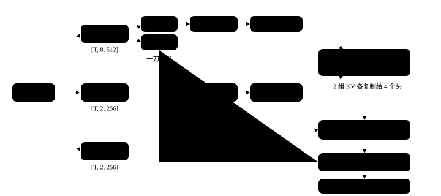

# （六）门控注意力

<p class="lead">24 层里只有 6 层是全注意力，但它们是模型"精确回看"的唯一手段——线性注意力的记忆表会模糊，注意力矩阵不会。Qwen3.5 的注意力和教科书版比有四处不同：GQA（8 个 query 头共用 2 组 key/value）、QK-Norm（q 和 k 各过一个 RMSNorm 再旋转）、只转前 1/4 维的 RoPE、以及<strong>输出门</strong>——<code>q_proj</code> 一次算出两份，一份当 query，一份过 sigmoid 乘在输出上。这一章把它写出来，用真实权重和真实输入把注意力矩阵画出来看。</p>

!!! note "这一章跑什么"
    `ch06_attention.py`，约 10 秒。

@@files@@

## 一次前向

```python title="qwen/attention.py"
"""门控注意力：Qwen3.5 的全注意力层，24 层里的 6 层。

和教科书的多头注意力比有四处不同：GQA（8 个 query 头共用 2 组 key/value）、QK-Norm（q 和 k 各过一个
RMSNorm 再旋转）、只旋转前 1/4 维的 RoPE、以及输出门——q_proj 一次算出两份，一份当 query，
一份过 sigmoid 当门，逐维乘在注意力的输出上。
"""
import math

import torch
import torch.nn as nn

from qwen.norm import RMSNorm
from qwen.rope import apply_rope


class Attention(nn.Module):
    def __init__(self, cfg):
        super().__init__()
        H, self.n_head, self.n_kv, self.d = cfg.hidden_size, cfg.num_attention_heads, cfg.num_key_value_heads, cfg.head_dim
        self.q_proj = nn.Linear(H, self.n_head * self.d * 2, bias=False)   # 两倍宽：一半 query，一半门
        self.k_proj = nn.Linear(H, self.n_kv * self.d, bias=False)
        self.v_proj = nn.Linear(H, self.n_kv * self.d, bias=False)
        self.o_proj = nn.Linear(self.n_head * self.d, H, bias=False)
        self.q_norm = RMSNorm(self.d, cfg.rms_norm_eps)                     # 按头归一化：权重只有 head_dim 个
        self.k_norm = RMSNorm(self.d, cfg.rms_norm_eps)

    def forward(self, x, cos, sin):
        B, T, _ = x.shape
        q, gate = self.q_proj(x).view(B, T, self.n_head, 2 * self.d).chunk(2, dim=-1)   # 每个头的 512 维：前 256 是 query，后 256 是门
        k = self.k_proj(x).view(B, T, self.n_kv, self.d)
        v = self.v_proj(x).view(B, T, self.n_kv, self.d)
        q, k = apply_rope(self.q_norm(q), cos, sin), apply_rope(self.k_norm(k), cos, sin)
        q, k, v = (t.transpose(1, 2) for t in (q, k, v))                                  # [B, 头, T, d]
        rep = self.n_head // self.n_kv
        k, v = k.repeat_interleave(rep, dim=1), v.repeat_interleave(rep, dim=1)           # GQA：每组 KV 复制给 4 个 query 头
        scores = q @ k.transpose(-1, -2) / math.sqrt(self.d)                               # [B, 头, T, T]
        causal = torch.ones(T, T, dtype=torch.bool, device=x.device).triu(1)               # 上三角：看不到后面的 token
        scores = scores.masked_fill(causal, float("-inf"))
        out = torch.softmax(scores, dim=-1) @ v                                            # [B, 头, T, d]
        out = out.transpose(1, 2).reshape(B, T, -1) * torch.sigmoid(gate.reshape(B, T, -1))   # 输出门
        return self.o_proj(out)
```

逐行对着形状读：

| 步骤 | 形状 | 说明 |
| --- | --- | --- |
| `q_proj(x)` | `[B, T, 4096]` → `[B, T, 8, 512]` | 每个头 512 维：前 256 是 query，后 256 是门 |
| `k_proj`, `v_proj` | `[B, T, 2, 256]` | 只有 2 组 key/value（GQA） |
| `q_norm`, `k_norm` | 不变 | 按头做 RMSNorm，权重只有 256 个；再做 RoPE |
| `repeat_interleave` | `[B, 8, T, 256]` | 每组 KV 复制给 4 个 query 头 |
| `scores` | `[B, 8, T, T]` | $qk^\top/\sqrt{256}$，上三角填 $-\infty$ |
| `softmax @ v` | `[B, 8, T, 256]` → `[B, T, 2048]` | 按行归一化再加权求和 |
| `* sigmoid(gate)` | `[B, T, 2048]` | 输出门：逐维决定这个头的输出放行多少 |
| `o_proj` | `[B, T, 1024]` | 回到残差流的宽度 |

{.aig-svg}

**GQA 省的是 KV cache。** 8 个 query 头、2 组 KV：每个 token 要存的 key/value 从 8 × 256 × 2 降到 2 × 256 × 2 个数，推理时的显存和访存都是 4 倍的差距（第 10 章会算）。质量损失很小，因为多个 query 头看同一组 key 本来就有冗余。

**QK-Norm 防的是 logits 爆炸。** 训练中 $q$ 和 $k$ 的尺度会漂，点积变得很大之后 softmax 退化成 one-hot，梯度消失。在 RoPE 之前把 $q$、$k$ 各自归一化，点积的尺度就被钉住了。Qwen3 开始用，Qwen3.5 延续。

**输出门是这一代的新东西。** 来自 Qwen3-Next 的"Gated Attention"论文：在注意力输出后乘一个由输入算出的 sigmoid 门，代价是 `q_proj` 翻倍（25M 参数里有 12.6M 是门），收益是压掉"注意力汇聚"（attention sink，第一个 token 吃掉大量注意力）并稳定训练。

## 跑起来：注意力矩阵长什么样

```python title="ch06_attention.py" ci="loose"
"""第 6 章：门控注意力。用真实权重和真实输入跑一层，把注意力矩阵和输出门拿出来看"""
import math
import os

import torch
from tokenizers import Tokenizer

from qwen.attention import Attention
from qwen.embedding import Embedding
from qwen.norm import RMSNorm
from qwen.rope import apply_rope, rope_tables
from qwen.weights import Config, find_model, load, load_weights

torch.set_num_threads(max(1, os.cpu_count() // 2))
path = find_model()
cfg = Config.load(path)
W = load_weights(path)
attn = load(Attention(cfg), W, "layers.3.self_attn.")                                          # 第 3 层是第一层全注意力
n = sum(p.numel() for p in attn.parameters())
print(f"一层注意力 {n / 1e6:.1f}M 参数，其中 q_proj {attn.q_proj.weight.numel() / 1e6:.1f}M（一半是门）")

tk = Tokenizer.from_file(str(path / "tokenizer.json"))         # 用第 2、3 章的零件造出一段真实输入
ids = torch.tensor([tk.encode("今天天气不错，我们去公园").ids])
T = ids.shape[1]
h = load(RMSNorm(cfg.hidden_size, cfg.rms_norm_eps), W, "layers.3.input_layernorm.")(load(Embedding(cfg.vocab_size, cfg.hidden_size), W, "embed_tokens.")(ids))
cos, sin = rope_tables(cfg, torch.arange(T))
y = attn(h, cos, sin)
print(f"输入 {tuple(h.shape)} -> 输出 {tuple(y.shape)}")

with torch.no_grad():                                                                          # 1. 把注意力矩阵算出来看：每行加起来是 1，上三角是 0
    q, gate = attn.q_proj(h).view(1, T, attn.n_head, 2 * attn.d).chunk(2, dim=-1)
    k = attn.k_proj(h).view(1, T, attn.n_kv, attn.d)
    q, k = apply_rope(attn.q_norm(q), cos, sin), apply_rope(attn.k_norm(k), cos, sin)
    scores = q[0, :, 0] @ k[0, :, 0].T / math.sqrt(attn.d)                                     # 第 0 个 query 头 × 它那组 key
    probs = torch.softmax(scores.masked_fill(torch.ones(T, T, dtype=torch.bool).triu(1), float("-inf")), dim=-1)
    words = [tk.decode([i]) for i in ids[0].tolist()]
    print("第 0 个头的注意力矩阵（行 = query，列 = key）：")
    for w, row in zip(words, probs):
        print(f"  {w:<4}", " ".join(f"{p:.2f}" for p in row.tolist()))
    g = torch.sigmoid(gate)                                                                    # 2. 输出门：每个头每一维各开多少
    print(f"输出门 sigmoid(gate)：均值 {g.mean():.2f}，小于 0.1 的比例 {(g < 0.1).float().mean():.0%}，大于 0.9 的比例 {(g > 0.9).float().mean():.0%}")
print(f"GQA：{attn.n_head} 个 query 头共用 {attn.n_kv} 组 KV，每个 token 要存的 KV 是 {2 * attn.n_kv * attn.d} 个数，不用 GQA 要存 {2 * attn.n_head * attn.d} 个")
```

```text title="输出"
一层注意力 7.3M 参数，其中 q_proj 4.2M（一半是门）
输入 (1, 6, 1024) -> 输出 (1, 6, 1024)
第 0 个头的注意力矩阵（行 = query，列 = key）：
  今天   1.00 0.00 0.00 0.00 0.00 0.00
  天气   0.07 0.93 0.00 0.00 0.00 0.00
  不错   0.01 0.97 0.02 0.00 0.00 0.00
  ，    0.00 0.23 0.76 0.00 0.00 0.00
  我们去  0.05 0.01 0.00 0.43 0.50 0.00
  公园   0.00 0.00 0.13 0.21 0.06 0.60
输出门 sigmoid(gate)：均值 0.49，小于 0.1 的比例 2%，大于 0.9 的比例 2%
GQA：8 个 query 头共用 2 组 KV，每个 token 要存的 KV 是 1024 个数，不用 GQA 要存 4096 个
```

注意力矩阵每行加起来是 1，上三角全是 0（因果掩码）：第一个 token 只能看自己，所以是 1.00；"不错"把 97% 的注意力给了前一个 token "天气"，"公园"则分给了"不错""，""我们去"和自己。这只是第一层注意力的第 0 个头，而且输入只经过了嵌入和归一化（没有前面三层线性注意力），所以它看起来像在做"看前一个词"这种局部的事——深层的头会看得更远。输出门的均值 0.49、极端值很少，说明门在训练后主要做细调，不是开关。

!!! interview "怎么讲清楚"
    讲注意力的实现，按数据的形状走一遍最清楚：投影 → 分头 → 归一化 → 旋转 → 打分 → 掩码 → softmax → 加权求和 → 合头 → 门 → 投影。然后点出 Qwen3.5 的四个改动各解决什么：GQA 省 KV cache、QK-Norm 钉住点积尺度、部分旋转留一些无位置的维度、输出门压 attention sink。最后把"为什么 24 层里只有 6 层注意力"留给下一章：另外 18 层用的是不长大的记忆表。

## 小结

- [x] 门控注意力 = GQA + QK-Norm + 部分 RoPE + 输出门；`q_proj` 是两倍宽的。
- [x] 注意力矩阵每行和为 1、上三角为 0；第一层第 0 个头偏向看前一个 token；GQA 让每个 token 要存的 KV 从 4096 个数降到 1024 个。

**这一章新建的文件**：`qwen/attention.py`（第 10 章会加上状态和 mask 两个参数）。
