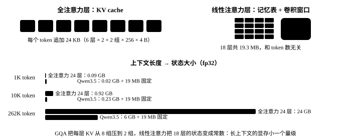

# （十）两种状态：KV Cache 与记忆表

<p class="lead">第 9 章的循环每生成一个 token 都把整段重算一遍，38 个 token 花了 19 秒。实际上前面的 token 算过的东西可以留下来：全注意力层留下每个 token 的 key 和 value（<strong>KV cache</strong>，随长度增长），线性注意力层留下记忆表和 3 个 token 的卷积窗口（<strong>固定大小</strong>）。这一章给模型加上状态：prefill 一次，之后每步只算一个新 token，速度从 2 tok/s 变成 20 tok/s；顺便算清楚为什么混合架构的长上下文显存比纯注意力模型小一个量级。</p>

!!! note "这一章跑什么"
    `ch10_cache.py`，约 20 秒。这一章改了四个文件（注意力、线性注意力、解码层、整模型各加一个 `state` 参数，顺手加了第 13 章要用的 `mask`），高亮的是改动的行。

## 状态长什么样

```python title="qwen/cache.py"
"""两种状态。全注意力层：KV cache，每个 token 追加一份 key/value，随长度增长；
线性注意力层：一张记忆表 S 加一个 3 个 token 的卷积窗口，不管读了多少 token 都是固定大小。
"""
import torch


class AttentionState:
    def __init__(self):
        self.k = self.v = None                                     # [B, kv 头, 已有 token 数, head_dim]，第一次 prefill 时创建

    def numel(self):
        return 0 if self.k is None else self.k.numel() + self.v.numel()


class DeltaState:
    def __init__(self, cfg, batch, device, dtype):
        conv_dim = 2 * cfg.linear_num_key_heads * cfg.linear_key_head_dim + cfg.linear_num_value_heads * cfg.linear_value_head_dim
        self.conv = torch.zeros(batch, conv_dim, cfg.linear_conv_kernel_dim - 1, device=device, dtype=dtype)   # 最近 3 个 token 的卷积输入
        self.S = torch.zeros(batch, cfg.linear_num_value_heads, cfg.linear_key_head_dim, cfg.linear_value_head_dim,
                             device=device, dtype=torch.float32)                                                # 记忆表：[B, 头, dk, dv]，永远 fp32

    def numel(self):
        return self.conv.numel() + self.S.numel()


class State:
    """一次对话的全部状态：每层一个，外加已经处理了多少个 token（下一个 token 的位置）"""

    def __init__(self, model, batch=1):
        p = next(model.parameters())
        self.layers = [AttentionState() if kind == "full_attention" else DeltaState(model.cfg, batch, p.device, p.dtype)
                       for kind in model.cfg.layer_types]
        self.pos = 0                                                       # 已经处理了多少个 token
        self.mask = None                                                   # [B, pos]：批处理时哪些位置是真 token

    def megabytes(self):
        return sum(s.numel() for s in self.layers) * 4 / 2 ** 20
```

两种状态的差别就是这本书最想讲的一件事：

| | 全注意力层（6 层） | 线性注意力层（18 层） |
| --- | --- | --- |
| 存什么 | 每个 token 的 key 和 value：`[B, 2 组, T, 256]` × 2 | 记忆表 `[B, 16 头, 128, 128]` + 卷积窗口 `[B, 6144, 3]` |
| 每个 token 新增 | 2 × 2 × 256 × 4 B = 4 KB（一层） | 0 |
| 读新 token 时要看的 | 全部 T 个 key/value | 只有这张表 |

{.aig-svg}

## 改四个文件

注意力：新 token 的 key/value 接在缓存后面，再把拼好的存回去。掩码也要变——新来的 $T$ 个 query 面对的是 $S$ 个 key（历史 + 新的），第 $i$ 个新 token 能看到第 $S - T + i$ 个及之前的：

```python title="qwen/attention.py" hl_lines="27 34-38 41-42 44-45"
"""门控注意力：Qwen3.5 的全注意力层，24 层里的 6 层。

和教科书的多头注意力比有四处不同：GQA（8 个 query 头共用 2 组 key/value）、QK-Norm（q 和 k 各过一个
RMSNorm 再旋转）、只旋转前 1/4 维的 RoPE、以及输出门——q_proj 一次算出两份，一份当 query，
一份过 sigmoid 当门，逐维乘在注意力的输出上。
"""
import math

import torch
import torch.nn as nn

from qwen.norm import RMSNorm
from qwen.rope import apply_rope


class Attention(nn.Module):
    def __init__(self, cfg):
        super().__init__()
        H, self.n_head, self.n_kv, self.d = cfg.hidden_size, cfg.num_attention_heads, cfg.num_key_value_heads, cfg.head_dim
        self.q_proj = nn.Linear(H, self.n_head * self.d * 2, bias=False)   # 两倍宽：一半 query，一半门
        self.k_proj = nn.Linear(H, self.n_kv * self.d, bias=False)
        self.v_proj = nn.Linear(H, self.n_kv * self.d, bias=False)
        self.o_proj = nn.Linear(self.n_head * self.d, H, bias=False)
        self.q_norm = RMSNorm(self.d, cfg.rms_norm_eps)                     # 按头归一化：权重只有 head_dim 个
        self.k_norm = RMSNorm(self.d, cfg.rms_norm_eps)

    def forward(self, x, cos, sin, state=None, mask=None):
        B, T, _ = x.shape
        q, gate = self.q_proj(x).view(B, T, self.n_head, 2 * self.d).chunk(2, dim=-1)   # 每个头的 512 维：前 256 是 query，后 256 是门
        k = self.k_proj(x).view(B, T, self.n_kv, self.d)
        v = self.v_proj(x).view(B, T, self.n_kv, self.d)
        q, k = apply_rope(self.q_norm(q), cos, sin), apply_rope(self.k_norm(k), cos, sin)
        q, k, v = (t.transpose(1, 2) for t in (q, k, v))                                  # [B, 头, T, d]
        if state is not None:                                                             # KV cache：接上以前的 key/value，再把新的存回去
            if state.k is not None:
                k, v = torch.cat([state.k, k], dim=2), torch.cat([state.v, v], dim=2)
            state.k, state.v = k, v
        S = k.shape[2]                                                                    # key 的总数（以前的 + 这次的）
        rep = self.n_head // self.n_kv
        k, v = k.repeat_interleave(rep, dim=1), v.repeat_interleave(rep, dim=1)           # GQA：每组 KV 复制给 4 个 query 头
        scores = q @ k.transpose(-1, -2) / math.sqrt(self.d)                               # [B, 头, T, S]
        causal = torch.ones(T, S, dtype=torch.bool, device=x.device).triu(S - T + 1)       # 第 i 个新 token 只能看到第 S-T+i 个及之前的 key
        scores = scores.masked_fill(causal, float("-inf"))
        if mask is not None:                                                              # 批处理时的填充位：[B, S]，False 的 key 谁都不许看
            scores = scores.masked_fill(~mask[:, None, None, :], torch.finfo(scores.dtype).min)   # 用最小的有限数而不是 -inf：填充位自己那一行全被挡住时，softmax 不会算出 NaN
        out = torch.softmax(scores, dim=-1) @ v                                            # [B, 头, T, d]
        out = out.transpose(1, 2).reshape(B, T, -1) * torch.sigmoid(gate.reshape(B, T, -1))   # 输出门
        return self.o_proj(out)
```

线性注意力：卷积窗口接在新输入前面（没有历史就是 3 列 0），卷积不再 padding；记忆表从 `state.S` 开始算，算完存回去。同时把"几个 token 用递推、一段文本用分块"的选择放进来——分块版要把长度补到 64 的整数倍，一两个 token 用它反而慢：

```python title="qwen/deltanet.py" hl_lines="11 55 57-58 60-64 71-75"
"""Gated DeltaNet：线性注意力层，24 层里的 18 层是它。

它没有"所有 token 两两打分"的注意力矩阵，而是每个头维护一张固定大小的记忆表 S（128×128）。
每来一个 token 就按 delta 规则改写一次：先按 g 衰减，再把"新值 v 和表里已有预测之差"按 β 写进去；
输出是 q 去表里查询。token 再多，表也不会变大——这就是它能撑 262K 上下文的原因。
"""
import torch
import torch.nn as nn
import torch.nn.functional as F

from qwen.chunk import chunked_delta_rule
from qwen.norm import GatedRMSNorm, l2norm


def delta_rule(q, k, v, g, beta, S=None):
    """逐 token 递推。q, k: [B, T, 头, dk]，v: [B, T, 头, dv]；g（对数衰减，≤0）和 beta（写入强度，0~1）: [B, T, 头]。
    S 是开始时的记忆表（没有就从空表开始）；返回输出和算完之后的表。"""
    B, T, n_head, dk = q.shape
    dtype = v.dtype
    q, k, v, g, beta = (t.float() for t in (q, k, v, g, beta))   # 记忆表和中间量一律 fp32，bf16 攒不住几百步的累加
    q, k = l2norm(q), l2norm(k)                                   # q、k 先归一化到单位长度
    q = q / dk ** 0.5
    if S is None:
        S = q.new_zeros(B, n_head, dk, v.shape[-1])               # 每个头一张 128×128 的记忆表，初始为空
    out = torch.empty_like(v)
    for t in range(T):
        S = S * g[:, t].exp()[:, :, None, None]                   # 1. 衰减：整张表乘一个 0~1 的数，忘掉一点旧的
        k_t, v_t = k[:, t], v[:, t]                               # [B, 头, dk]，[B, 头, dv]
        pred = torch.einsum("bhk,bhkv->bhv", k_t, S)              # 2. 用 k 查表：表里认为 v 应该是什么
        S = S + torch.einsum("bhk,bhv->bhkv", k_t, (v_t - pred) * beta[:, t, :, None])   # 3. 只写入差值（delta）
        out[:, t] = torch.einsum("bhk,bhkv->bhv", q[:, t], S)     # 4. 用 q 查表得到这个 token 的输出
    return out.to(dtype), S


class GatedDeltaNet(nn.Module):
    def __init__(self, cfg):
        super().__init__()
        H = cfg.hidden_size
        self.n_k, self.n_v = cfg.linear_num_key_heads, cfg.linear_num_value_heads
        self.dk, self.dv = cfg.linear_key_head_dim, cfg.linear_value_head_dim
        self.key_dim, self.value_dim = self.n_k * self.dk, self.n_v * self.dv            # 2048, 2048
        conv_dim = 2 * self.key_dim + self.value_dim                                       # q、k、v 拼在一起做卷积：6144
        self.in_proj_qkv = nn.Linear(H, conv_dim, bias=False)
        self.in_proj_z = nn.Linear(H, self.value_dim, bias=False)                          # 输出门
        self.in_proj_b = nn.Linear(H, self.n_v, bias=False)                                # β：每个头一个数
        self.in_proj_a = nn.Linear(H, self.n_v, bias=False)                                # 衰减里随输入变的那部分
        self.conv1d = nn.Conv1d(conv_dim, conv_dim, cfg.linear_conv_kernel_dim, groups=conv_dim,
                                padding=cfg.linear_conv_kernel_dim - 1, bias=False)        # 深度可分的因果短卷积：每个通道只看自己前 3 个 token
        self.dt_bias = nn.Parameter(torch.ones(self.n_v))
        self.A_log = nn.Parameter(torch.zeros(self.n_v))
        self.norm = GatedRMSNorm(self.dv, cfg.rms_norm_eps)
        self.out_proj = nn.Linear(self.value_dim, H, bias=False)

    def forward(self, x, state=None, mask=None):
        B, T, _ = x.shape
        if mask is not None:
            x = x * mask[..., None]                                                        # 批处理时的填充位：[B, T]，清零后既不写进记忆表也不进卷积
        qkv = self.in_proj_qkv(x).transpose(1, 2)                                          # [B, 6144, T]
        window = state.conv if state is not None else qkv.new_zeros(B, qkv.shape[1], self.conv1d.padding[0])
        qkv = torch.cat([window, qkv], dim=-1)                                             # 接上前 3 个 token（没有历史就是 0）
        if state is not None:
            state.conv = qkv[..., -self.conv1d.padding[0]:]                                # 留下最后 3 个 token 给下一次
        qkv = F.silu(F.conv1d(qkv, self.conv1d.weight, groups=qkv.shape[1])).transpose(1, 2)   # 因果卷积 + SiLU：输出长度正好是 T
        q, k, v = qkv.split([self.key_dim, self.key_dim, self.value_dim], dim=-1)
        q, k, v = q.view(B, T, self.n_k, self.dk), k.view(B, T, self.n_k, self.dk), v.view(B, T, self.n_v, self.dv)
        if self.n_v > self.n_k:                                                            # 大模型里 value 头比 key 头多：q、k 复制几份
            q, k = q.repeat_interleave(self.n_v // self.n_k, 2), k.repeat_interleave(self.n_v // self.n_k, 2)
        beta = self.in_proj_b(x).sigmoid()                                                 # [B, T, 头]，0~1
        g = -self.A_log.exp() * F.softplus(self.in_proj_a(x) + self.dt_bias)               # 对数衰减，永远 ≤ 0
        S = state.S if state is not None else None
        rule = delta_rule if T <= 16 else chunked_delta_rule                               # 几个 token 用递推，一段文本用分块（分块版要补到 64 的整数倍）
        out, S = rule(q, k, v, g, beta, S)
        if state is not None:
            state.S = S
        out = self.norm(out, self.in_proj_z(x).view(B, T, self.n_v, self.dv))             # 按头做门控归一化
        return self.out_proj(out.reshape(B, T, -1))
```

解码层只是把状态和 mask 传下去：

```python title="qwen/layer.py" hl_lines="22 24"
"""解码层：一层 = 一个 token 混合器（全注意力或线性注意力）+ 一个前馈网络，各带一个前置 RMSNorm 和一条残差。"""
import torch.nn as nn

from qwen.attention import Attention
from qwen.deltanet import GatedDeltaNet
from qwen.mlp import MLP
from qwen.norm import RMSNorm


class DecoderLayer(nn.Module):
    def __init__(self, cfg, kind):
        super().__init__()
        self.kind = kind                                                   # "full_attention" 或 "linear_attention"
        if kind == "full_attention":
            self.self_attn = Attention(cfg)
        else:
            self.linear_attn = GatedDeltaNet(cfg)
        self.mlp = MLP(cfg)
        self.input_layernorm = RMSNorm(cfg.hidden_size, cfg.rms_norm_eps)
        self.post_attention_layernorm = RMSNorm(cfg.hidden_size, cfg.rms_norm_eps)

    def forward(self, x, cos, sin, state=None, mask=None, kv_mask=None):
        h = self.input_layernorm(x)
        h = self.self_attn(h, cos, sin, state, kv_mask) if self.kind == "full_attention" else self.linear_attn(h, state, mask)
        x = x + h                                                          # 残差：混合器只往残差流里"加"东西
        return x + self.mlp(self.post_attention_layernorm(x))
```

整模型：位置从 `state.pos` 开始数（RoPE 的角度要接着转），每层拿自己那份状态。`mask` 这一章先全传 `True`，第 13 章批处理时才有填充位：

```python title="qwen/model.py" hl_lines="31-39 41-45"
"""整模型：嵌入 -> 24 个解码层 -> 最后的 RMSNorm -> 输出层。从这个文件起，前向里没有一行 Hugging Face 的代码。"""
import torch
import torch.nn as nn

from qwen.embedding import Embedding, LMHead
from qwen.layer import DecoderLayer
from qwen.norm import RMSNorm
from qwen.rope import rope_tables
from qwen.weights import Config, find_model, load_weights


class Model(nn.Module):
    def __init__(self, cfg):
        super().__init__()
        self.cfg = cfg
        self.embed_tokens = Embedding(cfg.vocab_size, cfg.hidden_size)
        self.layers = nn.ModuleList(DecoderLayer(cfg, kind) for kind in cfg.layer_types)
        self.norm = RMSNorm(cfg.hidden_size, cfg.rms_norm_eps)
        self.lm_head = LMHead(self.embed_tokens.weight)                       # 和嵌入层共用权重

    @classmethod
    def from_pretrained(cls, path=None, dtype=torch.float32):
        path = path or find_model()
        model = cls(Config.load(path))
        missing, unexpected = model.load_state_dict(load_weights(path, dtype=dtype), strict=False, assign=True)   # assign=True：不复制，直接接管
        assert not unexpected and missing == ["lm_head.weight"], (missing, unexpected)   # 文件里没有 lm_head：它就是嵌入层
        model.lm_head.weight = model.embed_tokens.weight                                  # 接管之后嵌入表换了对象，输出层重新指过去
        return model.to(dtype).eval()

    @torch.no_grad()
    def forward(self, ids, state=None, mask=None):
        """ids: [B, T] -> logits [B, T, 词表]。带 state 时 ids 是接在已有 token 后面的新 token；
        mask: [B, T]，批处理时标出哪些是填充位（第 13 章），不传就全是真 token。"""
        if mask is None:
            mask = torch.ones_like(ids, dtype=torch.bool)
        if state is not None:                                                     # 整段对话的 mask 要攒起来：注意力的 key 包括以前的 token
            state.mask = mask if state.mask is None else torch.cat([state.mask, mask], dim=1)
        kv_mask = state.mask if state is not None else mask
        positions = (kv_mask.cumsum(1) - 1).clamp(min=0)[:, -ids.shape[1]:]       # 每行各数各的位置：填充位不算
        x = self.embed_tokens(ids)
        cos, sin = rope_tables(self.cfg, positions)
        for i, layer in enumerate(self.layers):
            x = layer(x, cos, sin, state.layers[i] if state is not None else None, mask, kv_mask)
        if state is not None:
            state.pos += ids.shape[1]
        return self.lm_head(self.norm(x))
```

## 快了多少，对不对

```python title="ch10_cache.py" ci="loose"
"""第 10 章：prefill 一次 + 逐 token 解码；和无状态重算逐位对；算两种状态的大小"""
import os
import time

import torch
from tokenizers import Tokenizer

from qwen.cache import State
from qwen.harness import max_diff
from qwen.model import Model
from qwen.weights import find_model

torch.set_num_threads(max(1, os.cpu_count() // 2))
path = find_model()
model = Model.from_pretrained(path)
tk = Tokenizer.from_file(str(path / "tokenizer.json"))
prompt = "<|im_start|>user\n用一句话介绍一下 Transformer。<|im_end|>\n<|im_start|>assistant\n<think>\n\n</think>\n\n"
ids = torch.tensor([tk.encode(prompt).ids])
STOP = {tk.token_to_id("<|im_end|>"), tk.token_to_id("<|endoftext|>")}

state = State(model)                                                 # 1. prefill：整段提示词一次算完，状态留下
t = time.time()
nxt = model(ids, state)[0, -1].argmax()
t_prefill = time.time() - t
new = [nxt.item()]
t = time.time()
while len(new) < 40 and new[-1] not in STOP:                         # 2. decode：每步只喂一个 token
    nxt = model(nxt.view(1, 1), state)[0, -1].argmax()
    new.append(nxt.item())
dt = time.time() - t
print(f"prefill {ids.shape[1]} 个 token {t_prefill * 1000:.0f} ms；decode {len(new)} 个 token {dt:.2f} 秒 = {len(new) / dt:.1f} tok/s（第 9 章是 2 tok/s）")
print(tk.decode(new))
print(f"状态：已处理 {state.pos} 个 token，占 {state.megabytes():.1f} MB")

full = torch.tensor([ids[0].tolist() + new])                         # 3. 带状态算出来的 logits 和无状态重算的一样吗
ref = model(full)[0]
state = State(model)
got = [model(full[:, :ids.shape[1]], state)[0, -1]]                  # 先 prefill 提示词，再一个一个喂生成的 token
for j in range(ids.shape[1], full.shape[1] - 1):
    got.append(model(full[:, j:j + 1], state)[0, -1])
print(f"逐 token 解码 vs 整段重算：logits 最大差 {max_diff(torch.stack(got), ref[ids.shape[1] - 1:-1]):.1e}")
state = State(model)                                                 # 4. 分几段 prefill（多轮对话就是这样）
a, b = model(full[:, :10], state)[0], model(full[:, 10:30], state)[0]
c = model(full[:, 30:], state)[0]
print(f"分三段喂（10 + 20 + {full.shape[1] - 30}）vs 整段：logits 最大差 {max_diff(torch.cat([a, b, c]), ref):.1e}")

cfg = model.cfg                                                      # 5. 两种状态的大小（fp32）
kv_per_token = cfg.layer_types.count("full_attention") * 2 * cfg.num_key_value_heads * cfg.head_dim * 4
fixed = cfg.layer_types.count("linear_attention") * (cfg.linear_num_value_heads * cfg.linear_key_head_dim * cfg.linear_value_head_dim
                                                      + (2 * cfg.linear_num_key_heads * cfg.linear_key_head_dim + cfg.linear_num_value_heads * cfg.linear_value_head_dim) * 3) * 4
print(f"每个 token 的 KV cache：6 层 × 2 × 2 组 × 256 维 × 4 B = {kv_per_token / 1024:.0f} KB；18 层线性注意力的状态固定 {fixed / 2 ** 20:.1f} MB")
for T in (1000, 10_000, 262_144):
    print(f"  上下文 {T:>7} 个 token：KV cache {kv_per_token * T / 2 ** 30:6.2f} GB，如果 24 层全是注意力则是 {kv_per_token * T * 4 / 2 ** 30:6.2f} GB")
```

```text title="输出"
prefill 17 个 token 144 ms；decode 38 个 token 1.95 秒 = 19.4 tok/s（第 9 章是 2 tok/s）
Transformer 是一种基于深度学习的神经网络架构，通过自注意力机制解决了传统卷积神经网络在处理长距离依赖和复杂语义关系时的局限性，从而实现了强大的语言理解与生成能力。
状态：已处理 54 个 token，占 20.5 MB
逐 token 解码 vs 整段重算：logits 最大差 2.9e-05
分三段喂（10 + 20 + 25）vs 整段：logits 最大差 4.9e-05
每个 token 的 KV cache：6 层 × 2 × 2 组 × 256 维 × 4 B = 24 KB；18 层线性注意力的状态固定 19.3 MB
  上下文    1000 个 token：KV cache   0.02 GB，如果 24 层全是注意力则是   0.09 GB
  上下文   10000 个 token：KV cache   0.23 GB，如果 24 层全是注意力则是   0.92 GB
  上下文  262144 个 token：KV cache   6.00 GB，如果 24 层全是注意力则是  24.00 GB
```

三件事：

- **快了 10 倍**：decode 每步的计算量从"整段"变成"一个 token"，剩下的开销主要是把 3 GB 权重从内存读一遍——这就是为什么 decode 是访存瓶颈，和序列长度几乎无关。
- **逐位一致**：带状态和不带状态算出的 logits 差在 1e-5 量级，分段 prefill 也一样。多轮对话、前缀缓存，本质上就是"分段 prefill"。
- **262K 上下文的 KV cache 只有 6 GB**（fp32；bf16 再减半），而同样 24 层全注意力要 24 GB。线性注意力层的状态不到 20 MB，和长度无关。这是 Qwen3.5 用 3 : 1 混合的直接收益。

!!! interview "怎么讲清楚"
    讲 KV cache 先说它缓存的是什么（每层每个 token 的 key 和 value，不是注意力分数），再说为什么 decode 阶段是访存瓶颈（每个 token 都要读一遍全部权重 + 全部 KV cache，算的却很少）。然后把混合架构的账算出来：GQA 把每 token 的 KV 从 8 组降到 2 组，线性注意力把 18 层的状态变成常数，两个加起来，长上下文的显存比同规模的 Llama 式模型小一个量级。能顺口说出"递推状态不能像 KV cache 那样截断回退"（第 14 章投机解码会碰到），说明你想过工程细节。

## 小结

- [x] 两种状态：KV cache 随长度涨（6 层共每 token 24 KB），线性注意力的记忆表 + 卷积窗口固定（18 层共 19 MB）。
- [x] prefill 一次 + 逐 token decode，和整段重算逐位一致；decode 速度 2 → 20 tok/s。
- [x] 262K 上下文的 KV cache 6 GB（fp32），纯注意力模型要 24 GB。

**这一章新建的文件**：`qwen/cache.py`；**修改的文件**：`qwen/attention.py`、`qwen/deltanet.py`、`qwen/layer.py`、`qwen/model.py`。
